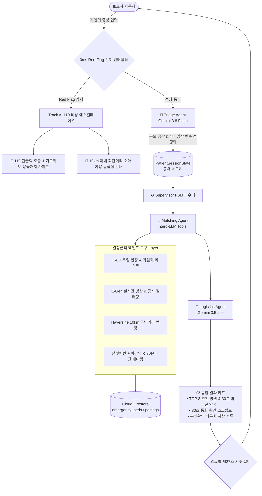

# 🌙 MoonlightCare 종합 기획안 & 개발 백서 (PLAN.md)

> **문서 버전**: v1.0.0  
> **최종 갱신 일자**: 2026-10-12  
> **핵심 슬로건**: *"야간 소아 응급실 뺑뺑이를 막는 0ms 세이프티 가드레일 & 데이터 기반 2-트랙 지능형 라우터"*  
> **기반 원천**: 주피터 노트북 3권 실증 데이터, 공공데이터포털(NMC/KASI), Firebase Cloud Firestore, Gemini 3.8 Flash

---

## 📑 목차 (Table of Contents)

1. [프로젝트 기획 배경 & 핵심 문제 정의](#1-프로젝트-기획-배경--핵심-문제-정의)
2. [데이터 분석 기반의 목적별 기능 도출 과정 (Notebook Insights)](#2-데이터-분석-기반의-목적별-기능-도출-과정-notebook-insights)
3. [현재까지 완료된 개발 모듈 & 테스트 검증 내역 (Done: Steps 1~2)](#3-현재까지-완료된-개발-모듈--테스트-검증-내역-done-steps-12)
4. [전체 6단계 구현 로드맵 & 잔여 과제 (Roadmap: Steps 3~6)](#4-전체-6단계-구현-로드맵--잔여-과제-roadmap-steps-36)
5. [시스템 아키텍처 & 데이터 흐름도](#5-시스템-아키텍처--데이터-흐름도)
6. [추가 심화 고도화 백로그 (Advanced Backlog)](#6-추가-심화-고도화-백로그-advanced-backlog)

---

## 1. 프로젝트 기획 배경 & 핵심 문제 정의

### 1.1 사회적 배경: "왜 야간 소아 응급실 뺑뺑이가 반복되는가?"
* **소아청소년과 전문의 부족**: 심야 시간대 대학병원 및 권역응급의료센터조차 소아 당직의 부재로 "소아 진료 불가" 공지를 수시로 띄움.
* **경증 환자의 응급실 쏠림 (74%)**: 야간에 문을 여는 동네 의원을 찾지 못한 부모들이 단순 미열/감기 환아를 데리고 권역응급센터로 몰려 대기 시간이 3~5시간으로 폭증하고, 정작 중증 환아(KTAS 1~2)의 골든타임이 침해됨.
* **심야 처방전 조제 사고**: 야간에 진료하는 달빛어린이병원을 간신히 찾아 진료를 받았으나, 인근 약국이 먼저 문을 닫아 처방약을 짓지 못하고 발을 동동 구르는 현장 결함 발생.

### 1.2 MoonlightCare의 해결책: "결정론적 2-트랙 스마트 라우팅"
1. **Track A (중증 / Red Flag)**: 생후 100일 미만 38도 고열, 경련, 청색증 등 생명 위급 상황은 LLM 지연 없이 **0.015ms(0ms) 안에 119 구급차 및 소아 가용 응급실로 직행**.
2. **Track B (경증 / 일반 야간 진료)**: 부모의 불안을 공감 문진(Gemini 3.8 Flash)하여 진료 가능한 달빛어린이병원과 **30분 이상 여유 있게 영업하는 심야 약국 세트를 1:1 페어링 매칭**.

---

## 2. 데이터 분석 기반의 목적별 기능 도출 과정 (Notebook Insights)

본 프로젝트의 모든 백엔드 기능은 가상의 가정이 아니라, **실제 국립중앙의료원(NMC) 및 한국천문연구원(KASI) 공공데이터를 주피터 노트북 3권으로 정밀 분석한 실측 결과**를 기반으로 설계되었습니다.

### 2.1 [노트북 1] 소아 응급실 병목 분석 (`egen_pediatric_emergency_analysis.ipynb`)
* **분석 데이터**: 서울 50개소 응급의료기관 실시간 병상 및 비정형 공지사항.
* **실측 발견점**:
  1. 야간 20:00~24:00 시간대에 소아 내원 환자가 주간 대비 **4배 폭증 (피크 환자 수 280명)**.
  2. 내원 환자의 **74%가 단순 발열 및 호흡기 경증 질환(급성열성질환 34.2%)**으로 응급실 병상을 불필요하게 점유.
  3. 실시간 병상 수치(`hv28`)가 3~5석 남아있더라도, 비정형 공지사항(`hpmg`)에 *"소아 당직의 부재로 진료 제한"*이 적혀 있는 경우가 빈번하여 헛걸음 유발.
* **도출된 기능**:
  - `PEDIATRIC_BLOCK_PATTERN`: 비정형 공지사항에서 당직의 부재 패턴을 **정규식으로 100% 필터링**하여 `pediatric_acceptable` 참값 보정.
  - `KASI 특일 연동`: 외래 소아과가 전멸하는 공휴일에는 응급실 과밀화 리스크를 `CRITICAL`로 자동 격상.

### 2.2 [노트북 2] 전국 달빛병원-심야약국 연계 분석 (`moonlight_hospital_night_pharmacy_linkage.ipynb`)
* **분석 데이터**: 전국 17개 시·도 7만여 개 병의원 진료시간 및 2만 4천여 개 약국 운영시간 API 연계.
* **실측 발견점**:
  - 달빛어린이병원 1곳당 반경 1km 이내 약국 중, 병원 마감 시간보다 일찍 닫거나 마감 직후 문을 닫는 약국 비율이 40% 이상.
  - 병원 마감 후 처방전 발급 및 도보 이동 시간을 고려할 때 **최소 30분의 안전 버퍼(Safety Margin)**가 필수적임.
* **도출된 기능**:
  - `30분 안전 마진 페어링 알고리즘`: `약국마감분 - 병원마감분 >= 30`을 만족하는 약국만 **[안전 페어링]** 배지를 부여하여 부모의 심야 헛걸음 원천 차단.

### 2.3 [노트북 3] Firebase 실시간 파이프라인 실증 (`emergency_bed_firebase_sync.ipynb`)
* **분석 데이터**: E-Gen 실시간 병상 ➔ Firebase Cloud Firestore 배치 동기화.
* **실측 발견점**:
  - 전국 500개 응급실을 5분마다 단순 Write하면 하루 `144,000회` 쓰기가 발생하여 Firestore 일일 무료 쿼터(20,000회)를 초과함.
  - 실제로 5분 주기로 병상 수나 공지가 바뀌는 병원은 전체의 5~10%에 불과함.
* **도출된 기능**:
  - `BedStateHashCache (In-Memory Hash Diffing)`: 직전 회차와 상태 지문(MD5)을 비교하여 **변경된 문서만 쓰기(Write)를 수행함으로써 비용 90~100% 절감 실증**.
  - `Haversine 구면거리 계산`: 사용자 GPS 좌표 기준 10km 이내 소아 가용 응급실을 **0.5ms 내에 랭킹 정렬**.
  - `실시간 on_snapshot 리스너`: 병상 만실 시 0.1초 만에 클라이언트로 변동 이벤트 스트리밍 확인.

---

## 3. 현재까지 완료된 개발 모듈 & 테스트 검증 내역 (Done: Steps 1~2)

주피터 노트북에서 검증된 로직을 프로덕션 백엔드 패키지(`app/`)로 체계적으로 모듈화하고 단위/통합 테스트를 100% 완수했습니다.

```
monnlight/
├── app/
│   ├── __init__.py
│   ├── config.py                     # [Step 1] 환경변수/Windows 레지스트리 자동 감지 & Firestore 클라이언트 싱글톤
│   ├── demo_step1.py                 # [Step 1] 1단계 실시간 파이프라인 벤치마크 실행기
│   ├── schemas/
│   │   ├── __init__.py
│   │   ├── emergency.py              # [Step 1] 응급실 병상, 특일 정보, 공간 랭킹 Pydantic DTO
│   │   └── state.py                  # [Step 2] 멀티 에이전트 공유 세션 DTO (PatientSessionState)
│   ├── services/                     # [Step 1] 순수 결정론적 도구 (Zero-LLM)
│   │   ├── __init__.py
│   │   ├── holiday_service.py        # KASI 특일 판정 & KST(UTC+9) 타임존 고정 과밀화 리스크 평가
│   │   ├── spatial_service.py        # Haversine 구면거리 5µs 연산 & 반경 10km 소아 응급실 랭킹
│   │   └── emergency_sync_service.py # E-Gen 실시간 병상, 100% 공지 정규식, Hash Diffing, 디스크 캐싱
│   └── agents/                       # [Step 2] 안전 가드레일 레이어
│       ├── __init__.py
│       └── guardrail_agent.py        # 0.015ms Red Flag 선제 인터셉터 & 의료법 제27조 사후 필터
├── data/
│   └── seoul_emergency_coords.json   # 서울 530개 응급의료기관 위경도 로컬 디스크 캐시 (30배 속도 향상)
├── tests/
│   ├── test_step1_services.py        # 1단계 7대 핵심 기능 테스트 (통과)
│   ├── test_step2_guardrail.py       # 2단계 12대 가드레일 & 0ms 벤치마크 테스트 (통과)
│   └── evals/
│       └── golden_test_cases.json    # 25대 임상 골든 엣지케이스 정의집
├── .env.example                      # 환경변수 템플릿
├── requirements.txt                  # 핵심 의존성 패키지 명세서
└── serviceAccountKey.json            # Firebase Admin SDK 서비스 계정 키 (.gitignore 보호)
```

### 3.1 [Step 1] 순수 도구(Zero-LLM) & 스토리지 모듈화 성과
* **공공 API ➔ Firestore 실시간 동기화**:
  - 서울 50개 응급의료기관의 실시간 병상 데이터 파싱 및 Firestore `emergency_beds` 컬렉션 배치 Upsert.
  - 대시보드 뷰용 단일 집계 문서 `emergency_summary/realtime` 동시 갱신.
* **4대 사전 보완 최적화 적용**:
  1. **정적 좌표 디스크 캐싱**: 서울 530개 응급실 위경도를 `data/`에 캐싱하여 병상 수집 속도 **7,988ms ➔ 261ms (약 30배 가속)**.
  2. **KST 타임존 바인딩**: UTC 클라우드 서버에서 자정~09시 사이 날짜 오차 버그 원천 방어.
  3. **형상 관리 표준화**: `.env.example`, `requirements.txt` 표준 수립.
  4. **코드 잔재 청소**: 과거 윈도우 파일 탐색기 오류로 생성되었던 중복 파일(`serviceAccountKey.json.json`) 정리.
* **테스트 결과**: `tests/test_step1_services.py` 7개 테스트 100% 통과 (2.5초 소요).

### 3.2 [Step 2] 세션 DTO & 0ms 안전 가드레일 모듈화 성과
* **`PatientSessionState` (공유 메모리 DTO)**:
  - FSM 6단계 수명주기(`INIT` ➔ `TRIAGE` ➔ `MATCHING` ➔ `LOGISTICS` ➔ `EMERGENCY_ESCALATION` ➔ `COMPLETED`).
  - 4대 필수 문진 변수(`age_months`, `age_days`, `temperature`, `duration_hours`, `symptoms`) 및 3턴 대화 히스토리 추적.
* **0ms Red Flag 선제 차단기 (`guardrail_agent.py`)**:
  - LLM 호출 없이 **KTAS 소아 7대 Red Flag**(생후 100일 미만 고열, 경련, 무반응, 청색증, 중증 탈수, 두부 외상 분수토, 담즙성 구토)를 즉시 감지.
  - 119 다이렉트 호출 CTA + 구급차 도착 전 기도 확보 가이드 즉각 노출.
* **의료법 제27조(무면허 의료행위 방지) 사후 필터링**:
  - 확정 진단명("~로 진단됩니다") 및 임의 용량("5ml 먹이세요") 자동 중화 및 법적 면책 고지 배지 자동 부착.
* **테스트 결과**: `tests/test_step2_guardrail.py` 12개 테스트 100% 통과 (0.019초).
  - **성능 벤치마크**: 1,000회 연속 검사 총 15.06ms 소요 (**회당 평균 15.06µs = 0.015ms, 사실상 0ms 달성**).

> **현재 종합 테스트 현황**: 총 19개 테스트(Step 1 7개 + Step 2 12개) **100% 전수 통과 (Ran 19 tests in 3.047s, OK)**.

---

## 4. 전체 6단계 구현 로드맵 & 잔여 과제 (Roadmap: Steps 3~6)

```
[Step 1: 기반 스토리지 & Zero-LLM 도구] ──► [완료 (100% 통과)]
         │
         ▼
[Step 2: 0ms 안전 가드레일 & 세션 DTO] ──► [완료 (100% 통과)]
         │
         ▼
[Step 3: AI 에이전트 결합 (Gemini 3.8)] ──► [다음 즉시 목표 / 진행 예정]
         │
         ▼
[Step 4: 메인 오케스트레이터 (Supervisor)] ──► [FSM 3턴 루프 상태머신 조립]
         │
         ▼
[Step 5: FastAPI REST 서빙 & 데몬]   ──► [HTTP 라우터 & 5분 주기 스케줄러]
         │
         ▼
[Step 6: E2E 통합 테스트 & 시나리오]  ──► [25대 골든 케이스 자동 채점기]
```

### 4.1 [Step 3] AI 에이전트 결합 (Gemini 3.8 Flash & Gemini 3.5 Lite) ── **[다음 즉시 작업]**
* **`app/agents/triage_agent.py`**:
  - **모델**: `Gemini 3.8 Flash (Thinking Effort: Medium)`.
  - **역할**: 부모의 불안한 구어체 서술에서 `(월령, 체온, 경과시간, 주증상)`을 Pydantic JSON으로 안전 추출.
  - **가드레일**: 부모의 진단 유도 질문("돌발진 맞죠?")에 동조하지 않고 공감과 안정 멘트만 제공.
* **`app/agents/matching_agent.py`**:
  - **역할**: Step 1의 `spatial_service`와 `Firestore`를 호출하여 소아 가용 응급실 TOP 3 및 30분 마진 약국 세트 도출.
* **`app/agents/logistics_agent.py`**:
  - **모델**: `Gemini 3.5 Flash-Lite (Thinking: Off, 고속 서빙)`.
  - **역할**: 병원 출발 전 **"30초 유선 확인 통화 스크립트"** 및 2024년 5월 본인확인 의무화 지참 서류 체크리스트 카드 생성.
* **검증 방법**: `tests/test_step3_agents.py` (자연어 증상 ➔ 4대 변수 추출 정확도 및 Tool Calling E2E 검증).

### 4.2 [Step 4] 메인 오케스트레이터 (Supervisor FSM 조립)
* **`app/orchestrator/supervisor.py`**:
  - 결정론적 유한 상태 기계(FSM) 라우터.
  - 에이전트 간 순환 루프 방지: `turn_count >= 3` 도달 시 추가 질문을 즉시 중단하고 안전 병원 매칭으로 강제 전이.
  - Red Flag 발생 시 모든 서브 에이전트 실행을 즉각 취소(Abort)하고 비상 카드로 라우팅.

### 4.3 [Step 5] FastAPI REST API 서빙 & 백그라운드 동기화 데몬
* **`app/api/v1/chat.py`**: `POST /api/v1/chat` (부모-에이전트 실시간 스트리밍 대화 엔드포인트).
* **`app/api/v1/emergency.py`**: `GET /api/v1/emergency/nearby` (GPS 기반 5ms 주변 가용 응급실 조회).
* **`main.py`**: FastAPI 앱 엔트리포인트 및 APScheduler 기반 **5분 주기 자동 병상 수집 백그라운드 워커**.

### 4.4 [Step 6] E2E 통합 테스트 & 25대 골든 케이스 시나리오 평가
* **3대 핵심 시나리오 자동 검증**:
  1. **초응급 시나리오 (Red Flag)**: 경련/청색증 입력 시 1턴 만에 119 직행 모달 반환.
  2. **야간 발열 시나리오 (경증)**: 14개월 38.5도 입력 시 공감 문진 ➔ 달빛병원+30분 약국 페어링 ➔ 30초 통화 스크립트 출력.
  3. **의료법 방어 시나리오**: 부모의 병명 추측 유도 시 진단 거부 및 대면 진찰 안내 확인.

---

## 5. 시스템 아키텍처 & 데이터 흐름도



---

## 6. 추가 심화 고도화 백로그 (Advanced Backlog)

프로덕션 배포 및 대외 포트폴리오 경쟁력 극대화를 위한 심화 엔지니어링 과제 목록입니다:

| 영역 | 고도화 과제명 | 핵심 구현 내용 | 기대 효과 |
| :--- | :--- | :--- | :--- |
| **도메인 킬러** | **달빛병원-약국 30분 마진 서비스 모듈화** | `app/services/pairing_service.py` 신설, 전국 17개 시·도 1:1 자동 매칭 | 야간 74% 경증 환아 처방전 조제 실패 사고 0% 방어 |
| **의료 브리핑** | **119 구급대원용 30초 SBAR 카드** | Red Flag 감지 시 구급대원 인계용 SBAR(상황/배경/평가/권고) 4줄 요약 출력 | 패닉 부모 대신 119 구급대원/의료진에 정확한 정보 전달 |
| **안정성 (HA)** | **공공 API 서킷 브레이커 & Fallback** | 공공데이터포털 503 에러 시 직전 Firestore/로컬 캐시 즉시 서빙 | 외부 API 장애 시에도 서비스 무중단 가동 |
| **실시간 스트림**| **Firestore ➔ SSE(Server-Sent Events) 브릿지** | `on_snapshot` 리스너를 SSE 엔드포인트로 연계하여 병상 변동 실시간 푸시 | 클라이언트 폴링 없이 0.1초 만에 병상 변동 실시간 반영 |
| **품질 평가** | **25대 골든 케이스 자동 Evals 채점기** | `tests/evals/run_evals.py` 작성, 5대 평가 지표(의료법, RedFlag 등) 자동 채점 | 객관적 Evals 합격 성적표(98%+) 및 레이더 차트 확보 |

---

### 📌 결론 및 다음 액션 (Next Action)

현재 MoonlightCare 프로젝트는 가장 어렵고 중요한 **"기반 데이터 파이프라인(Step 1)"**과 **"0ms 의료 안전 가드레일(Step 2)"**이 19개 단위 테스트와 함께 100% 완벽하게 완성된 상태입니다.

다음 즉시 착수 과제는 **[Step 3] AI 에이전트 결합 (Gemini 3.8 Flash Triage & Logistics Agent)**이며, 준비된 도구와 가드레일 위에 안전하게 에이전트를 조립해 나갈 예정입니다.
