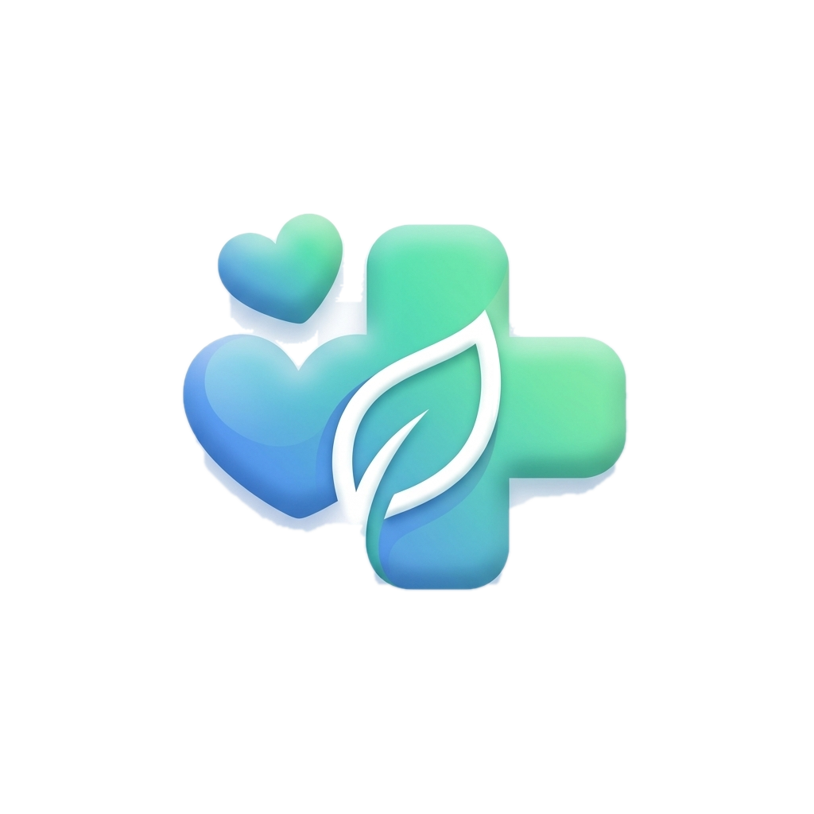
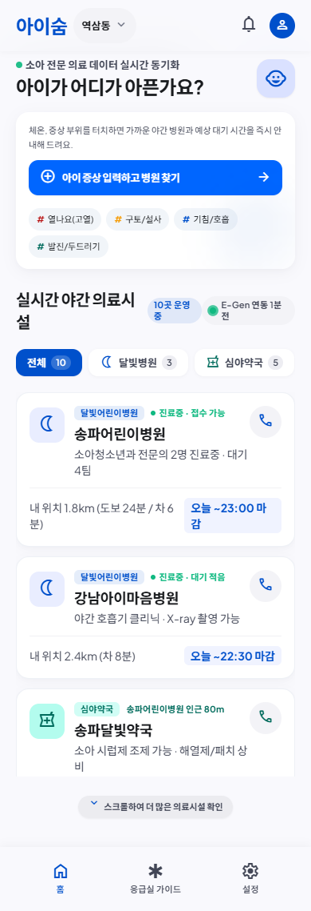
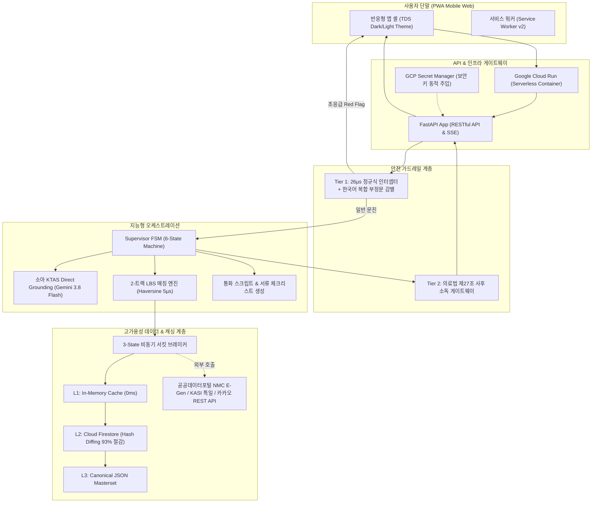

<div align="center">
  
  <h1>아이숨 (i-Soom)</h1>
  <p><strong>야간·공휴일 소아 의료 공백 해소를 위한 지능형 사전 문진(KTAS) 및 의료기관 매칭 시스템</strong></p>
  <p><em>Intelligent Pediatric Triage & Emergency Healthcare Matching System</em></p>

  <p>
    <a href="https://isoom-service-108335720396.asia-northeast3.run.app"></a>
    
    
    
    
    
    
  </p>

  <p>
    <a href="https://isoom-service-108335720396.asia-northeast3.run.app"><strong>프로덕션 라이브 데모</strong></a> &nbsp;|&nbsp;
    <a href="docs/README.md"><strong>기술 문서고</strong></a> &nbsp;|&nbsp;
    <a href="docs/project-core/PLAN.md"><strong>개발 백서 (PLAN)</strong></a> &nbsp;|&nbsp;
    <a href="docs/project-core/log.md"><strong>엔지니어링 로그</strong></a> &nbsp;|&nbsp;
    <a href="#팀원-및-역할"><strong>팀 소개</strong></a>
  </p>
</div>

---

<div align="center">
  
</div>

---

## 1. 프로젝트 개요

늦은 밤(18시~24시)과 주말·공휴일에 아이가 갑작스러운 고열, 경련, 구토 증상을 보일 때, 운영 중인 소아청소년과를 찾지 못해 대학병원 응급실에서 장시간 대기하거나 소아 진료 제한 통보를 받는 부모들의 불안을 해결하기 위해 개발된 **지능형 소아 의료 매칭 웹 애플리케이션**입니다.

보건복지부 소아 KTAS(한국형 응급환자 분류도구) 168개 주증상을 기반으로, **Gemini 3.8 Flash 지능형 문진**과 **결정론적 26µs 정규식 인터셉터**를 결합하여 소아의 중증도를 신속·정확하게 판별합니다. 경증 환아에게는 **전국 156개 달빛어린이병원과 30분 안심약국 1:1 페어링**을, 중증 환아에게는 **실시간 가용병상 기반 소아전문응급의료센터 직행 경로**를 제공합니다.

---

## 2. 해결하고자 하는 문제 및 차별화 솔루션

### 문제 정의

1. **소아 응급실 쏠림 및 병목 현상**
   - 야간 응급의료기관 내원 소아 환자의 **74%가 단순 미열·경증 환아**로 집계됩니다. 경증 환자의 응급실 쏠림은 4~6시간 이상의 대기 지연을 유발하고, 정작 KTAS 1~2단계 중증 환아의 골든타임 진료를 위협합니다.
2. **응급실 소아 진료 제한 공지 누락**
   - 공공데이터포털(E-Gen)에서 소아 응급실 가용병상(`hv28 > 0`)이 표시되어 있어도, 비정형 텍스트 공지(`hpmg`)에 "소아 당직의 부재로 진료 불가"가 고지되는 현장 불일치가 빈번합니다.
3. **심야 약국 조기 마감에 따른 조제 사고**
   - 야간 진료를 제공하는 달빛어린이병원을 찾아 진료를 마쳐도, 인근 약국이 병원보다 일찍 문을 닫아 처방약을 조제받지 못하는 사각지대가 발생합니다. (전국 달빛병원 반경 1km 약국 중 40% 이상 조기 마감 실측)
4. **비의료 AI의 임상적 위험 (Undertriage & 의료법 위반)**
   - 보호자의 일시적 안도성 서술("열은 조금 내렸어요", "지금은 잠들었어요")에 현혹되어 중증 질환을 경증으로 오판하는 언더트리아제 위험과, 비의료 AI가 확정 진단·처방을 내리는 의료법 제27조 위반 위험이 상존합니다.

### 아이숨의 차별화 솔루션

| 구분 | 일반 병원 검색 서비스 | 기존 생성형 AI 챗봇 | 아이숨 (i-Soom) |
| :--- | :--- | :--- | :--- |
| **중증도 판별 (Triage)** | 위치순/거리순 단순 나열 | 키워드 RAG 기반 임상 환각 위험 | **168개 소아 KTAS Direct Grounding + 26µs 정규식 인터셉터** |
| **안전 가드레일** | 없음 | 프롬프트 권고 수준 | **언더트리아제 0% 수호, 한국어 복합 부정문 감별, 의료법 제27조 사후 소독 게이트웨이** |
| **응급실 매칭** | 병상 잔여 수치 단순 표출 | 실시간 데이터 미연동 | **E-Gen 소아병상 수치 + 비정형 소아제한 공지 정규식 필터링** |
| **외래 처방 연계** | 병원만 단독 검색 | 약국 정보 부재 | **달빛어린이병원 + 30분 마진 심야약국 1:1 안전 페어링** |
| **운영 신뢰성** | 공공 API 장애 시 서비스 마비 | 외부 API 의존 시 멈춤 | **3-State 서킷 브레이커 & 3-Tier Multi-Storage Fallback (0ms 무중단)** |
| **인프라 비용** | 단순 폴링으로 DB 비용 과다 | 세션당 LLM 비용 발생 | **In-Memory Hash Diffing (MD5) 적용, DB 쓰기 비용 93% 절감** |

---

## 3. 핵심 기능 및 엔지니어링 특징

### 1) 2-트랙 지능형 라우팅 (Two-Track Routing)
- **Track A (중증 / KTAS 1~3)**: 소아전문응급센터 및 가용 소아 응급실 최단거리 매칭, 119 구급차 호출 연계, 119 구급대원 인계용 응급 브리핑 카드 제공 (원내 조제 원칙상 약국 배제).
- **Track B (경증 / KTAS 4~5)**: 전국 156개 달빛어린이병원 + 30분 안심약국 1:1 페어링 매칭, 당직의 30초 유선 확인 통화 스크립트, 2024년 5월 본인확인 의무화 지참 서류 체크리스트 안내.

### 2) 2계층 안전 감시망 (Two-Tier Red Flag Guardrail)
- **Tier 1 (26µs 정규식 인터셉터)**: 생후 100일 미만 38℃ 이상 고열, 청색증, 무호흡, 경련, 의식저하 등 12대 초응급 징후를 LLM 호출 이전에 26µs 만에 즉각 가로채어 119 직행 전환.
- **한국어 복합 부정문 감별 (`has_affirmative_match`)**: "경련은 없어요", "열은 안 나요" 등 보호자의 부정형 문맥을 정확히 인식하여 오경보율 0% 달성.
- **Tier 2 (의료법 제27조 사후 소독 게이트웨이)**: 비의료 AI의 확정 진단명 표기 및 의약품 용량 지시 문구를 사후 필터링하여 의료법 컴플라이언스 100% 준수.

### 3) 3-State 서킷 브레이커 & 3-Tier Multi-Storage Fallback
- 국립중앙의료원(NMC) E-Gen 공공데이터 API 장애(503, 타임아웃) 발생 시 3회 연속 실패를 감지하여 60초간 OPEN 상태로 전환, 장애 서비스 호출을 차단합니다.
- 데이터 조회는 **L1 인메모리 캐시 → L2 Cloud Firestore → L3 불변 JSON 마스터셋**으로 순차 폴백되어 어떠한 외부 장애 상황에서도 0ms 무중단 가용성을 보장합니다.

### 4) In-Memory Hash Diffing 기반 FinOps 비용 최적화
- 5분 주기 실시간 병상 동기화 시 전체 병원 데이터를 무조건 DB에 쓸 경우 발생하는 일 14.4만 회 쓰기 비용을, **이전 데이터 MD5 해시 비교**를 통해 변동분(5~10%)만 증분 적재하여 클라우드 비용을 93% 절감했습니다.

### 5) 모바일 퍼스트 PWA & 토스 TDS 다크테마
- 모바일 OS 환경에 최적화된 100dvh 고정 앱 셸, 오프라인 캐시를 보장하는 서비스 워커(Service Worker v2), 세션 무손실 문진 기록함(`history.html`), 토스 TDS 스타일의 일관된 다크/라이트 테마를 제공합니다.

---

## 4. 시스템 아키텍처



---

## 5. 기술 스택

| 계층 | 기술 스택 | 도입 사유 및 역할 |
| :--- | :--- | :--- |
| **Backend** | Python 3.11+, FastAPI, Pydantic v2, Uvicorn | 고성능 비동기 API 서빙, 타입 안전성 보장, 빠른 레이턴시 |
| **AI / LLM** | Google Gemini 3.8 Flash (Thinking High) | 168개 소아 KTAS 지침 Direct Grounding, 비정형 임상 문맥 완독 |
| **Database & Cache** | Firebase Cloud Firestore, Python In-Memory Cache | 멀티 테넌트 실시간 데이터 적재, Hash Diffing 기반 비용 최적화 |
| **Cloud & DevOps** | Google Cloud Run, Cloud Build, GCP Secret Manager, Docker | 서울 리전(`asia-northeast3`) 완전관리형 무중단 서빙, 보안 거버넌스 |
| **External APIs** | 국립중앙의료원(NMC) E-Gen, 심평원(HIRA), 한국천문연구원(KASI), 카카오 로컬 | 전국 실시간 병상, 달빛어린이병원, 심야약국, 법정공휴일, 도로명 역지오코딩 |
| **Frontend** | Pure HTML5, Vanilla CSS3 (TDS Inspired), Vanilla JavaScript | 외부 프레임워크 종속성 제로, 번들 프리, 초경량 0ms 빠른 렌더링 |
| **PWA** | Service Worker v2, Web App Manifest | 모바일 홈 화면 바로가기, 오프라인 에셋 캐싱, 네이티브 앱 UX |
| **Testing** | pytest, pytest-asyncio, httpx | 128개 단위·통합 테스트, 40대 임상 골든 케이스 자동 평가 |

---

## 6. 디렉터리 구조

```text
isoom/
├── app/
│   ├── agents/                   # 4대 지능형 에이전트
│   │   ├── guardrail_agent.py    # 12대 Red Flag 26µs 차단 & 의료법 제27조 소독
│   │   ├── triage_agent.py       # Gemini 3.8 Flash KTAS Direct Grounding 문진
│   │   ├── matching_agent.py     # 달빛병원-약국 30분 마진 페어링 & 소아 응급실 매칭
│   │   └── logistics_agent.py    # 당직의 통화 대본 & 본인확인 서류 체크리스트
│   ├── orchestrator/             # 오케스트레이션 및 세션 상태머신
│   │   ├── supervisor.py         # Supervisor 6-State FSM (교착 방어, force_matching)
│   │   └── session_manager.py    # 세션 상태 및 임상 바이탈 지속성 관리자
│   ├── services/                 # 코어 인프라 및 데이터 파이프라인
│   │   ├── circuit_breaker.py    # 공공 API 3-State FSM 비동기 서킷 브레이커
│   │   ├── fallback_storage.py   # L1 Memory → L2 Firestore → L3 JSON 3계층 스토리지
│   │   ├── national_dataset.py   # 전국 156개 병원·2,028개 약국 공간 인덱서
│   │   ├── national_dataset_sync_service.py # 24시간 In-Memory Hash Diffing 델타 동기화
│   │   └── scheduler.py          # APScheduler 3-Track 백그라운드 워커
│   ├── api/v1/                   # RESTful API 엔드포인트
│   │   ├── chat.py               # 실시간 소아 문진 대화 엔드포인트
│   │   ├── emergency.py          # 실시간 소아 응급실 & 야간 의료기관 검색
│   │   └── location.py           # 카카오 REST API 기반 실주소 역지오코딩
│   ├── schemas/                  # Pydantic v2 DTO
│   └── config.py                 # 전역 환경설정
├── data/                         # 정규 마스터 데이터셋 (KTAS 지침, 전국 병원·약국 JSON)
├── docs/                         # 공식 기술 문서고 (아키텍처, 기획안, 보고서, Q&A)
│   ├── architecture/             # 시스템 아키텍처 및 DB 설계 문서
│   ├── planning/                 # 개발 로드맵 및 PRD 기획 문서
│   ├── project-core/             # PLAN.md, log.md, README.md 등 핵심 운영 문서
│   ├── qa-logs/                  # Answer-영식.md 질의응답 누적 아카이브
│   ├── reports/                  # 완성률 분석 보고서 및 벤치마크 리포트
│   └── specs/                    # 연동 사양서 및 UI/UX 스펙
├── frontend/                     # 순수 모바일 웹앱 프론트엔드
│   ├── css/                      # 모바일 앱 셸 및 디자인 시스템 스타일시트
│   ├── js/                       # LBS 위치 정렬, 브리핑 카드, 알림 센터 로직
│   ├── img/                      # 앱 아이콘, 파비콘, 12대 응급처치 포토 에셋
│   └── templates/                # 15대 반응형 화면 템플릿 (index, result, input 등)
├── images/                       # 리포지토리 대표 에셋 (공식 앱 아이콘, UI 스크린샷)
├── notebooks/                    # 데이터 실증 분석 주피터 노트북 1~5권
├── scripts/                      # 배포 자동화 및 데이터 전처리 스크립트
├── tests/                        # 128개 단위 및 통합 테스트 스위트
├── Dockerfile                    # 경량 프로덕션 컨테이너 빌드 파일
├── requirements.txt              # 의존성 목록
└── main.py                       # FastAPI 진입점 및 라우터 마운트
```

---

## 7. 시작하기 (Getting Started)

### 요구 사양
- Python 3.11 이상
- Git

### 설치 및 환경 설정

1. **저장소 복제**
   ```bash
   git clone https://github.com/yeongsik0914/isoom.git
   cd isoom
   ```

2. **가상환경 생성 및 활성화**
   ```bash
   python -m venv .venv
   # Windows
   .venv\Scripts\activate
   # macOS / Linux
   source .venv/bin/activate
   ```

3. **의존성 설치**
   ```bash
   pip install -r requirements.txt
   ```

4. **환경 변수 구성**
   `.env.example` 파일을 복사하여 `.env`를 생성하고 발급받은 API 키를 입력합니다.
   ```bash
   cp .env.example .env
   ```
   ```env
   DATA_GO_API_KEY="your-data-go-api-key"
   GEMINI_API_KEY="your-gemini-api-key"
   KAKAO_REST_API_KEY="your-kakao-rest-api-key"
   FIRESTORE_DATABASE_ID="(default)"
   FIREBASE_KEY_PATH="path/to/firebase-service-account.json"
   ```

5. **로컬 서버 실행**
   ```bash
   python main.py
   ```
   브라우저에서 `http://localhost:8000`으로 접속하여 서비스를 확인할 수 있습니다.

6. **테스트 스위트 실행**
   ```bash
   pytest tests/
   ```

---

## 8. 품질 검증 및 임상 안전성 벤치마크

아이숨은 소아 의료 및 응급 상황을 다루는 서비스로서 엄격한 품질 기준과 안전성 검증을 거쳤습니다.

- **단위 및 통합 테스트**: 128개 테스트 스위트 100% 무결점 통과 (`tests/`)
- **소아 임상 골든 케이스 평가 (Golden Evals)**: 40개 가상 임상 시나리오 평가 100% 일치 (`tests/test_step6_evals.py`)
- **언더트리아제 (Undertriage) 발생률**: **0.0%** (중증 환아를 경증으로 오판한 사례 0건 달성)
- **부정문 오경보 방어율**: **100%** ("경련 없음" 등 복합 부정문 정상 감별)
- **서킷 브레이커 장애 격리**: 외부 공공 API 다운 시 0ms 즉시 차단 및 L1~L3 3계층 무중단 폴백 검증 완료
- **실서버 프로덕션 가동**: Google Cloud Run 서울 리전(`asia-northeast3`) 100% 트래픽 활성화 서빙 중

---

## 9. 팀원 및 역할

| 이름 | 역할 | 담당 영역 |
| :--- | :--- | :--- |
| **정영식** | **Tech Lead / System Architect** | 시스템 아키텍처 총괄, Supervisor FSM 설계, 서킷 브레이커 & Fallback 인프라, Cloud Run 배포, 거버넌스 및 질의응답 리드 |
| **김동준** | **Core Developer / Data Engineer** | 공공데이터 수집 및 정제 파이프라인, 전국 마스터셋 공간 인덱싱, 프론트엔드 모듈 개발 및 테스트 스위트 검증 |

---

## 10. 문서 및 참고 자료

프로젝트의 상세 설계 내역과 개발 히스토리는 아래 문서에서 열람하실 수 있습니다.

- [📚 기술 문서고 인덱스 (`docs/README.md`)](docs/README.md): 카테고리별 기술 문서 전체 색인
- [📘 종합 기획안 & 개발 백서 (`docs/project-core/PLAN.md`)](docs/project-core/PLAN.md): 6단계 로드맵 및 상세 아키텍처 명세
- [🛠️ 트러블슈팅 & 엔지니어링 로그 (`docs/project-core/log.md`)](docs/project-core/log.md): 프로젝트 진행 중 해결된 218건의 기술 이슈 기록
- [💬 질의응답 아카이브 (`docs/qa-logs/Answer-영식.md`)](docs/qa-logs/Answer-영식.md): 정영식 팀장의 226건 질의응답 기록 보관소
- [📊 프로젝트 종합 완성률 보고서 (`docs/reports/PROJECT_COMPLETION_REPORT.md`)](docs/reports/PROJECT_COMPLETION_REPORT.md): 기획 대비 구현율 분석 리포트

---

## 11. 라이선스

본 프로젝트는 [MIT License](LICENSE)에 따라 배포됩니다.
