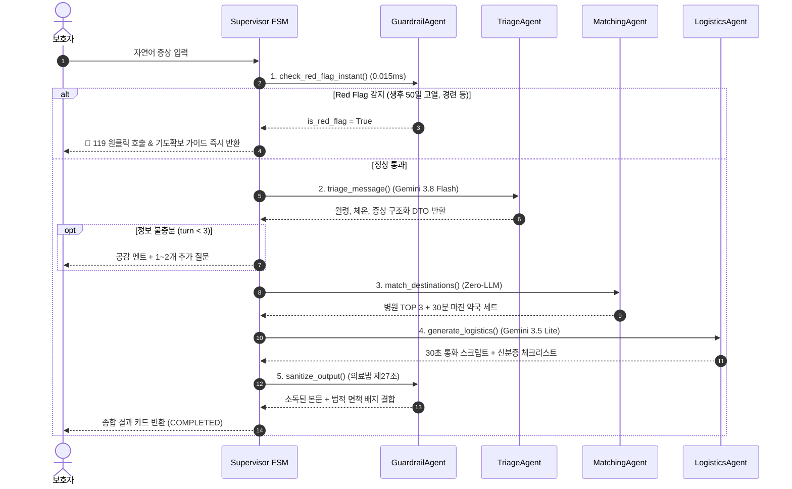

# 🤖 AI 멀티 에이전트 레이어 (`app/agents`)

> **위치**: `app/agents/`  
> **역할**: 환아 보호자의 자연어 증상 입력 접수부터 0ms 초응급 차단, 임상 변수 정형화, 2-트랙 시설 매칭, 출동 준비 안내까지 담당하는 4대 지능형 에이전트 패키지입니다.

---

## 📑 목차
1. [에이전트 레이어 개요](#1-에이전트-레이어-개요)
2. [4대 핵심 에이전트 상세 명세](#2-4대-핵심-에이전트-상세-명세)
   - [2.1 의료 안전 가드레일 에이전트 (guardrail_agent.py)](#21-의료-안전-가드레일-에이전트-guardrail_agentpy)
   - [2.2 문진 및 임상 정형화 에이전트 (triage_agent.py)](#22-문진-및-임상-정형화-에이전트-triage_agentpy)
   - [2.3 2-트랙 임상 매칭 에이전트 (matching_agent.py)](#23-2-트랙-임상-매칭-에이전트-matching_agentpy)
   - [2.4 출동 준비 로지스틱스 에이전트 (logistics_agent.py)](#24-출동-준비-로지스틱스-에이전트-logistics_agentpy)
3. [에이전트 간 데이터 흐름 및 상호작용](#3-에이전트-간-데이터-흐름-및-상호작용)
4. [공유 메모리(`PatientSessionState`) 입출력 권한](#4-공유-메모리patientsessionstate-입출력-권한)
5. [테스트 및 검증 파일](#5-테스트-및-검증-파일)

---

## 1. 에이전트 레이어 개요

야간 소아 응급 상황에서는 **"초응급 환아의 1초가 급한 골든타임"**과 **"야간 74% 경증 환아의 처방전 조제 실패 방지"**라는 상반된 문제가 공존합니다.  
본 패키지는 모든 과정을 단일 거대 LLM에 의존하지 않고, **결정론적 고속 검사(Zero-LLM)**와 **생성형 AI(Gemini)**의 역할을 엄격히 분리한 **"하이브리드 4-Agent 파이프라인"**으로 구축되었습니다:

```
[보호자 자연어 입력]
        │
        ▼ (매 턴 0.015ms 선제 검사)
[1. GuardrailAgent (check_red_flag_instant)] ──🚨 Red Flag 감지──► [Track A: 119 원클릭 비상 격상]
        │ 🟢 정상 통과
        ▼
[2. TriageAgent (Gemini 3.8 Flash)] ──► 부모 공감 & 4대 임상 변수 정형화 (월령, 체온, 지속시간, 증상)
        │
        ▼ (문진 완료 or 3턴 도달)
[3. MatchingAgent (Zero-LLM)] ──► 2-트랙 라우팅 (10km 소아 가용 응급실 vs 달빛병원+30분 약국 세트)
        │
        ▼
[4. LogisticsAgent (Gemini 3.5 Lite)] ──► 30초 유선 확인 통화 스크립트 & 2024년 5월 본인확인 서류
        │
        ▼ (사후 단일 출구)
[1. GuardrailAgent (sanitize_output)] ──► 의료법 제27조 진단명/용량 중화 & 법적 면책 배지 결합
```

---

## 2. 4대 핵심 에이전트 상세 명세

### 2.1 의료 안전 가드레일 에이전트 (`guardrail_agent.py`)
* **개발 목적**:
  1. 생명 위급 상황에서 LLM 호출 지연(1~3초) 없이 **0.015ms(15µs) 내에 119 긴급 이송 화면으로 직행**.
  2. 대한민국 **의료법 제27조(무면허 의료행위 금지)**를 준수하여 AI의 확정 진단 및 의약품 용량 지시 원천 차단.
* **사용 기술**: 순수 인메모리 정규식(Regex) 컴파일 엔진 (Zero-LLM, 외부 API 무의존).
* **주요 함수 및 동작 방식**:
  - `check_red_flag_instant(text, state)`:
    - KTAS(한국 응급환자 중증도 분류기준) 1~2단계 7대 Red Flag 실시간 판별:
      1. **생후 100일 미만 38도 고열** (신생아 패혈증/세균성 뇌수막염 위험)
      2. **열성 경련 / 눈 돌아감 / 사지 경직** (기도 폐쇄 및 뇌손상 위험)
      3. **극심한 처짐 / 의식 저하 / 무반응** (중증 중추신경계 감염)
      4. **청색증 / 흉벽 함몰 / 비익 호흡** (급성 호흡부전)
      5. **중증 탈수** (8시간 이상 무뇨, 눈물 없음, 입술 바짝 마름)
      6. **두부 외상 후 구토 / 기면** (두개내 출혈 및 뇌압 상승)
      7. **담즙성 녹색 구토 / 분수토** (장중첩증 / 장폐색)
    - 감지 즉시 `state.escalate_to_emergency()`를 호출하여 FSM을 `EMERGENCY_ESCALATION`으로 전이.
  - `sanitize_output(llm_output)`:
    - 질환명 확정 진단 표현(`~로 진단됩니다`, `~입니다`)을 `~ 의심 증상으로 보일 수 있으나 확정 진단이 아닙니다`로 중화.
    - 구체적 복용량 지시(`10ml를 먹이세요`)를 전문의/약사 복약지도 안내문으로 마스킹.
    - 모든 최종 응답 하단에 `[의료법 제27조 준수 고지문]` 배지 강제 부착.

---

### 2.2 문진 및 임상 정형화 에이전트 (`triage_agent.py`)
* **개발 목적**:
  - 패닉에 빠진 보호자의 횡설수설한 자연어 입력에서 불안을 다독이는 **공감 멘트**를 건네는 동시에, 소아 진료에 필수적인 **4대 임상 변수를 Pydantic 정형 데이터(`TriageExtractionResult`)로 구조화**.
* **사용 모델**: `Gemini 3.8 Flash` (`google-genai` SDK) + 결정론적 정규식 Fallback 엔진.
* **추출하는 4대 필수 임상 변수**:
  1. `age_months` / `age_days`: 환아 월령(개월) 또는 신생아 일령(일)
  2. `temperature`: 현재 체온(℃)
  3. `duration_hours`: 발열/증상 지속 시간(시간)
  4. `symptoms`: 주증상 목록 (`['발열', '구토', '기침', '콧물', '설사', '처짐', '보챔', '피부발진']`)
* **동작 방식**:
  - LLM Structured Outputs(`response_schema=TriageExtractionResult`)를 통해 JSON 스키마 강제.
  - 의료법 방어 프롬프트가 주입되어 부모의 병명 추측 유도 질문("돌발진 맞죠?")에 동조하지 않음.
  - 필수 정보가 부족할 경우 1~2개 핵심 추가 질문(`followup_question`)을 생성하여 세션을 `TRIAGE` 상태로 유지.
  - 네트워크 단절 또는 API 키 결측 시 `_fallback_parse_triage()` 정규식 파서로 자동 전환하여 100% 무중단 보장.

---

### 2.3 2-트랙 임상 매칭 에이전트 (`matching_agent.py`)
* **개발 목적**:
  - 환아의 위험도와 시간대에 맞춰 병원 위치와 운영시간을 왜곡하지 않는 **100% 결정론적 시설 라우팅**.
  - 병원과 약국의 운영시간 차이로 인한 **"심야 처방전 조제 실패 사고(74%)" 원천 방어**.
* **사용 기술**: **Zero-LLM 도구 오케스트레이션** (LLM 환각 0% 차단).
* **연동 도구(Domain Services)**:
  - `HolidayService`: KASI 한국천문연구원 특일 API 연동, 공휴일 여부 및 응급실 과밀화 리스크(`NORMAL`, `HIGH`, `CRITICAL`) 판정.
  - `emergency_sync_service`: 국립중앙의료원(NMC) E-Gen 실시간 병상(`hv28`) 및 비정형 공지(`hpmg`) 정규식 필터링.
  - `spatial_service`: Haversine 구면거리 기반 10~15km 반경 내 고속 정렬 (5µs 레이턴시).
  - `pairing_service`: 전국 17개 시·도 달빛어린이병원 + 30분 안전 조제 마진 심야약국 1:1 페어링 세트 검색.
* **2-트랙 분기 알고리즘**:
  - **Track A (중증 / 고열 39℃ 이상 / 생후 100일 미만 / 심야 23시 이후)**:
    ➔ 반경 10km 이내 소아 가용 응급실 TOP 3 안내 (`pediatric_acceptable=True` 기관).
  - **Track B (경증 / 39℃ 미만 / 소아과 운영 시간대)**:
    ➔ 달빛어린이병원 + 30분 마진 심야약국 1:1 페어링 세트 우선 안내 + 비상 대기 응급실 1곳 백업 제공.

---

### 2.4 출동 준비 로지스틱스 에이전트 (`logistics_agent.py`)
* **개발 목적**:
  - 진료 시설 매칭 후 부모가 집을 나서기 전, **현장 헛걸음(진료 마감, 서류 미지참)을 사전에 차단**.
* **사용 모델**: `Gemini 3.5 Flash-Lite` (초고속 서빙) + 결정론적 템플릿 Fallback 엔진.
* **핵심 기능 2가지**:
  1. **"30초 유선 확인 통화 스크립트" 자동 생성**:
     - 출발 직전 병원 안내데스크/접수처에 전화를 걸어 그대로 읽을 수 있는 구어체 스크립트.
     - 환아 월령, 체온, 증상 지속시간, 소아과 전문의 진료 가능 여부 확인 멘트 포함.
  2. **"2024년 5월 개정 본인확인 의무화 필수 지참 서류 체크리스트" 제공**:
     - 보호자 신분증 (주민등록증 / 운전면허증 / 모바일 신분증)
     - 환아 가족관계 확인 서류 (주민등록등본 / 가족관계증명서)
     - 건강보험증 / 주민등록번호 13자리 메모
     - 마지막 투약 해열제 메모 및 보온 물품

---

## 3. 에이전트 간 데이터 흐름 및 상호작용



---

## 4. 공유 메모리(`PatientSessionState`) 입출력 권한

| 에이전트 | 읽기 전용 필드 (Read-only) | 갱신/쓰기 필드 (Write / Mutate) | 전이시키는 FSM 단계 |
| :--- | :--- | :--- | :---: |
| **`GuardrailAgent`** | `conversation_history`, `user_lat`, `user_lon` | `is_red_flag`, `red_flag_reason`, `emergency_action_guide` | `EMERGENCY_ESCALATION` |
| **`TriageAgent`** | `conversation_history` | `age_months`, `age_days`, `temperature`, `duration_hours`, `symptoms` | `TRIAGE` ➔ `MATCHING` |
| **`MatchingAgent`** | `user_lat`, `user_lon`, `temperature`, `age_months`, `symptoms` | `matched_hospitals`, `matched_pharmacies` | `MATCHING` ➔ `LOGISTICS` |
| **`LogisticsAgent`** | `age_months`, `temperature`, `matched_hospitals` | `call_script`, `document_checklist` | `LOGISTICS` ➔ `COMPLETED` |

---

## 5. 테스트 및 검증 파일

* **단위/통합 테스트**: [`tests/test_step3_agents.py`](file:///e:/monnlight/tests/test_step3_agents.py)
  - `TC-301`: TriageAgent 자연어 4대 임상 변수 정형화 검증
  - `TC-302`: TriageAgent 의료법 제27조 진단 거부 방어 검증
  - `TC-303`: TriageAgent 멀티턴 질문 연속성 검증
  - `TC-304`: MatchingAgent 초응급/고열 소아 응급실 우선 라우팅
  - `TC-305`: MatchingAgent 경증 달빛병원 + 30분 마진 약국 세트 라우팅
  - `TC-306`: LogisticsAgent 30초 유선 확인 통화 스크립트 생성
  - `TC-307`: LogisticsAgent 2024년 5월 본인확인 서류 체크리스트 생성
  - `TC-308`: E2E 3-Agent 파이프라인 전수 통합 실행
* **인터랙티브 CLI 시연기**: [`app/demo_step3.py`](file:///e:/monnlight/app/demo_step3.py)
