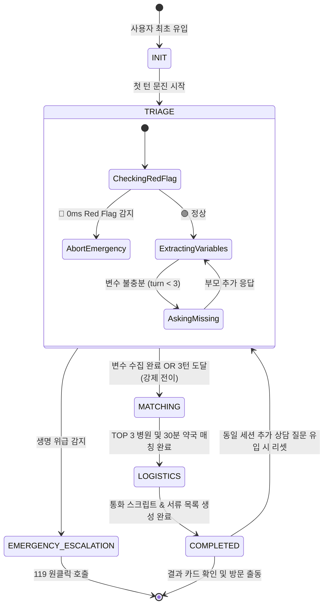

# ⚙️ 메인 오케스트레이션 레이어 (`app/orchestrator`)

> **위치**: `app/orchestrator/`  
> **역할**: 멀티 에이전트들의 실행 순서를 제어하는 **유한 상태 머신(FSM) Supervisor**와 동시성 제어 및 메모리 누수를 방지하는 **Thread-Safe SessionManager**를 제공합니다.

---

## 📑 목차
1. [오케스트레이션 레이어 개요](#1-오케스트레이션-레이어-개요)
2. [핵심 모듈 상세 명세](#2-핵심-모듈-상세-명세)
   - [2.1 Supervisor FSM 오케스트레이터 (supervisor.py)](#21-supervisor-fsm-오케스트레이터-supervisorpy)
   - [2.2 세션 매니저 (session_manager.py)](#22-세션-매니저-session_managerpy)
3. [6단계 FSM 상태 전이 다이어그램](#3-6단계-fsm-상태-전이-다이어그램)
4. [3대 핵심 안전 메커니즘](#4-3대-핵심-안전-메커니즘)
5. [테스트 및 검증 파일](#5-테스트-및-검증-파일)

---

## 1. 오케스트레이션 레이어 개요

각 에이전트(Guardrail, Triage, Matching, Logistics)가 독립적으로 동작하면, 모호한 대화가 반복될 때 무한 루프에 빠지거나 중간에 위험 증상이 나타났을 때 즉각적인 제어가 어렵습니다.  
`app/orchestrator`는 모든 서브 에이전트를 **단일 중앙 통제탑(Supervisor)** 아래에 두고, 엄격한 **상태 기계(Finite State Machine)**와 **스레드 안전 세션 저장소**를 통해 예측 가능하고 안전한 진료 상담 흐름을 보장합니다.

---

## 2. 핵심 모듈 상세 명세

### 2.1 Supervisor FSM 오케스트레이터 (`supervisor.py`)
* **핵심 클래스**: `SupervisorOrchestrator`
* **개발 목적**:
  - 사용자 메시지마다 세션을 식별하고, 가드레일 ➔ 트라이아지 ➔ 매칭 ➔ 로지스틱스 에이전트를 규격화된 순서로 트리거.
  - 대화 턴 수가 3턴을 초과하지 않도록 **데드락 방어(Deadlock Guard)**를 집행.
  - 모든 에이전트의 출력물을 출구 단일 관문에서 의료법 제27조 필터로 소독.
* **주요 메서드**:
  ```python
  async def process_turn(
      self,
      user_message: str,
      session_id: Optional[str] = None,
      user_lat: float = 37.5133,
      user_lon: float = 127.1001,
      user_address: Optional[str] = None,
  ) -> SupervisorResponse
  ```
* **동작 단계**:
  1. **세션 획득**: `SessionManager`에서 기존 세션 로드 또는 신규 세션 발급.
  2. **매 턴 Red Flag 선제 검사**: 0.015ms 내에 위험 징후 검사 ➔ 감지 시 즉시 전 에이전트 실행 중단(Abort) 및 119 모달 반환.
  3. **문진 실행 및 3턴 상한선 판정**: 4대 변수가 완성되었거나 `turn_count >= 3` 도달 시 `MATCHING`으로 강제 전이.
  4. **결정론적 시설 매칭**: `MatchingAgent`를 호출하여 실시간 응급실 또는 달빛병원 세트 배정.
  5. **로지스틱스 생성**: `LogisticsAgent`를 호출하여 30초 통화 스크립트 및 본인확인 서류 체크리스트 생성.
  6. **의료법 소독 관문**: 최종 메시지를 `sanitize_output()`에 통과시킨 후 `SupervisorResponse` 규격으로 반환.

---

### 2.2 세션 매니저 (`session_manager.py`)
* **핵심 클래스**: `SessionManager`
* **개발 목적**:
  - FastAPI 및 다중 요청 환경에서 세션 상태 딕셔너리에 동시 접근할 때 발생하는 Race Condition 차단.
  - 장시간 방치된 세션을 정기적으로 정리하여 메모리 누수(OOM) 방지.
* **주요 기능**:
  - **`asyncio.Lock` 동시성 락**: 세션 생성, 수정, 삭제 시 비동기 락을 획득하여 데이터 원자성 보장.
  - **위치 좌표 동적 갱신**: 사용자가 대화 도중 위치(`user_lat`, `user_lon`, `user_address`)를 변경하면 세션에 즉시 반영.
  - **TTL 자동 정리 (`evict_expired_sessions`)**: 최종 수정 시간(`updated_at`) 기준 30분(1,800초) 이상 비활성인 세션을 메모리에서 자동 제거.

---

## 3. 6단계 FSM 상태 전이 다이어그램



---

## 4. 3대 핵심 안전 메커니즘

1. **3턴 데드락 가드 (Deadlock Guard)**:
   - 부모가 *"열나요"*, *"아파요"* 등 모호한 단변을 반복해도, 최대 3턴(`turn_count >= 3`)에 도달하면 즉시 안전 디폴트 값(체온 38.0℃, 발열/컨디션저하)을 채우고 매칭 단계로 강제 전이시켜 의사 진찰을 지체하지 않도록 방어.
2. **매 턴 무조건 0ms Red Flag 인터셉터**:
   - 대화 1턴뿐만 아니라 2턴, 3턴 도중에 증상이 급변(*"아이가 갑자기 경련해요"*, *"입술이 파래요"*)해도 즉시 모든 서브 에이전트를 Abort하고 119 직행 모달을 노출.
3. **단일 출구 의료법 제27조 소독 관문**:
   - 어떤 에이전트가 어떤 텍스트를 반환하든, 오케스트레이터의 최종 반환 직전 `sanitize_output()`을 통과하여 진단명/투약량 표현을 중화하고 법적 면책 배지를 결합.

---

## 5. 테스트 및 검증 파일

* **단위/통합 테스트**: [`tests/test_step4_orchestrator.py`](file:///e:/monnlight/tests/test_step4_orchestrator.py)
  - `TC-401`: 단일 턴 완결 문진 및 정상 FSM 완주 검증
  - `TC-402`: 2턴 점진적 문진 연속성 검증
  - `TC-403`: 3턴 데드락 가드(무한 루프 방지 강제 전이) 실증
  - `TC-404`: 1턴 즉시 Red Flag 비상 에스컬레이션 검증
  - `TC-405`: 2턴 중도 경련 급변(Mid-Turn Deterioration) 즉각 차단 검증
  - `TC-406`: 의료법 제27조 단일 관문 소독 및 면책 고지 검증
  - `TC-407`: SessionManager 30분 TTL 자동 정리 및 메모리 누수 방어 검증
* **인터랙티브 CLI 시연기**: [`app/demo_step4.py`](file:///e:/monnlight/app/demo_step4.py)
