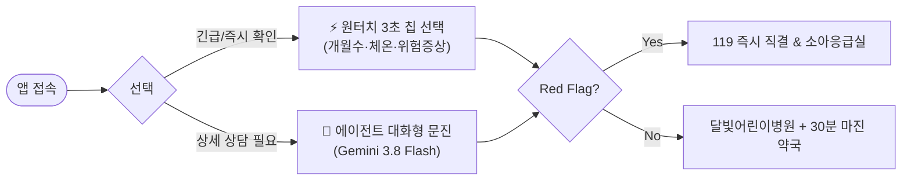

# 보건복지부 '응급똑똑' 앱 개발 분석, MoonlightCare 비교 차별점 및 개선 방안 보고서

> **문서 버전**: 1.0.0  
> **작성일자**: 2026-10-10  
> **비교 대상**: 보건복지부·국립중앙의료원 중앙응급의료센터 **'응급똑똑'** vs 자체 기획 **'MoonlightCare(달빛케어)'**  
> **문서 목적**: 정부 공공 응급의료 의사결정 앱의 개발 방식 및 구조를 파악하고, 본 기획안의 경쟁 우위(차별점)를 도출하며, 실무적·기술적·정책적 관점에서 보완해야 할 핵심 개선점을 정의함.

---

## 1. 보건복지부 '응급똑똑' 앱은 어떤 방식으로 개발되었는가? (Reverse-Engineering 분석)

보건복지부와 국립중앙의료원(NMC) 중앙응급의료센터가 출시한 **'응급똑똑'**은 기존의 정적 정보 검색 서비스였던 **'응급의료정보제공(E-Gen)'**의 한계(단순 나열식 검색, 경증 환자의 상급응급실 쏠림 현상)를 극복하기 위해 개발된 **"증상 기반 대국민 응급의료 의사결정 지원 플랫폼"**입니다.

```
┌─────────────────────────────────────────────────────────────────────────────────┐
│                    보건복지부 '응급똑똑' 시스템 아키텍처 개요                      │
└─────────────────────────────────────────────────────────────────────────────────┘
 [대국민 모바일 클라이언트] (Cross-Platform Native / Hybrid App)
    │  - 일상 언어 증상 입력 (자연어 검색 & 선택형 질문)
    │  - LBS 위치기반 응급실 / 병·의원 / 약국 / 달빛어린이병원 / AED 지도 표출
    │  - 119 원터치 직결 & 비상 응급처치 요령
    ▼
 [공공 클라우드 백엔드 (전자정부 표준프레임워크 기반 API Gateway)]
    │  - KTAS(한국형 응급환자 분류도구) 기반 임상 알고리즘 엔진
    │  - 비의료 건강관리 가이드라인 준수 가드레일 (의료법 제27조 진단 방어)
    ▼
 [국가 공공 보건의료 백본 데이터망]
    ├─► 국가응급진료정보망 (NEDIS) : 전국 응급실 실시간 가용병상, 진료가능과목, 중환자실 현황
    ├─► 응급의료포털 (E-Gen DB)   : 전국 병·의원/약국 인허가 정보, 요일별/공휴일 진료시간
    └─► 119 구급상황관리센터 연계 : 비상 시 상황실 데이터 연계 체계
```

### 1.1 데이터 인프라 및 소스 (Data Pipeline)
1. **국가응급진료정보망 (NEDIS, National Emergency Department Information System)**:
   * 전국 410여 개 응급의료기관의 전자의무기록(EMR) 및 원무 시스템과 연동되어 실시간 환자 재원 현황, 일반 병상(`hvec`), 소아 병상(`hv28`), 중환자실, CT/MRI 가동 여부를 수집하는 국가 중앙 백본망입니다.
2. **응급의료포털 (E-Gen) 마스터 데이터**:
   * 각 지자체 보건소에 인허가 등록된 전국 의료기관 및 약국의 기본 정보, 요일별 진료시간(`dutyTime1s~dutyTime8c`), 야간·휴일 운영 여부, 달빛어린이병원 지정 현황 데이터를 제공합니다.
3. **공공데이터포털 Open API 및 내부 전용망(VPN/전용선)**:
   * 일반 서드파티 개발자에게 제공되는 공개 API뿐만 아니라, 정부 주관 앱 특성상 국립중앙의료원 내부 데이터베이스와 고속 REST API/내부 프로토콜로 직접 연계되어 데이터 갱신 주기를 최적화합니다.

### 1.2 알고리즘 및 AI 추론 메커니즘
1. **KTAS (Korean Triage and Acuity Scale) 기반 임상 알고리즘**:
   * 대한응급의학회 등 전문가 위원회의 검수를 거친 정형화된 **의학적 의사결정 트리(CDSS)**를 핵심 엔진으로 탑재했습니다.
   * 사용자가 입력한 자연어 증상("머리가 깨질 듯 아파요", "아이가 열이 39도예요")에서 형태소 분석 및 의료 개체명 인식(NER)을 수행하여 해당하는 표준 KTAS 대분류/소분류 질문군으로 매핑합니다.
2. **보수적 룰 기반(Rule-based) 안전망 우선 설계**:
   * 의료사고 위험 및 법적 책임 문제로 인해 자율 추론형 생성 AI(LLM)에 진단을 맡기지 않고, **"의학회가 사전 승인한 정적 질문-응답 분기 트리"**가 80% 이상을 통제합니다.
   * 결과 출력은 항상 **[1단계: 즉시 119/권역센터 응급실 내원] vs [2단계: 인근 당직 병의원/달빛어린이병원 방문] vs [3단계: 가정 내 자가 응급처치 및 경과 관찰]**의 3단계로 엄격히 정형화되어 제공됩니다.

### 1.3 프론트엔드 및 클라이언트 기술
* **크로스플랫폼 하이브리드 앱**: iOS/Android를 동시에 지원하며 전자정부 모바일 표준 UI 가이드라인을 준수합니다.
* **LBS(위치기반서비스)**: GPS 기반 반경 검색으로 가장 가까운 의료기관을 지도에 마커로 렌더링합니다.
* **원터치 119 통화 Intent**: 앱 내에서 위급 판정 시 OS 네이티브 다이얼러를 호출하여 즉시 119로 연결합니다.

---

## 2. '응급똑똑' vs 'MoonlightCare' 심층 비교 매트릭스

| 비교 항목              | 보건복지부 **'응급똑똑'**                                | 자체 기획 **'MoonlightCare'**                                                                                       |                  차별성 평가                  |
| :----------------- | :---------------------------------------------- | :-------------------------------------------------------------------------------------------------------------- | :--------------------------------------: |
| **타깃 사용자 및 범위**    | **전 국민 전 연령 (성인/노인/소아 범용)**<br>모든 급성 증상 포괄      | **야간·휴일 '소아청소년과' 초집중 (Hyper-Focused)**<br>생후 100일 미만~소아 다빈도 급성질환 특화                                             |     **MoonlightCare 우위**<br>(버티컬 깊이)     |
| **핵심 문제의식**        | 응급실 전반의 경증 환자 과밀화 완화                            | **소아 병상 만실(`hv28=0`) 및 야간 1차의원 마감에 따른 소아 뺑뺑이 방지**                                                               |   **MoonlightCare 우위**<br>(소아 특수성 저격)    |
| **AI 시스템 아키텍처**    | **단일 룰 엔진 + 정형 분류 모델**<br>(전문가 위원회 사전 검수 정적 트리) | **7개 특화 에이전트 하네스 (Agent Harness)**<br>(Supervisor, Triage, Guardrail, Emergency, Matching, Logistics, Sentinel) |  **MoonlightCare 우위**<br>(지능형 협업 및 유연성)  |
| **LLM 모델 배치 전략**   | 일반 키워드 매핑/NLP 위주 (생성형 LLM 극히 제한적)               | **GCP Gemini 3.8 Flash (Thinking Effort 제어) + 3.5 Flash-Lite + Zero-LLM 하이브리드**                                 |   **MoonlightCare 우위**<br>(최신 AI 최적화)    |
| **공공데이터 파이프라인**    | 내부 NEDIS/E-Gen 직접 호출 위주<br>(정부 인프라 활용)          | **Firebase 실시간 배치(5분 주기) 동기화**<br>(Hash Diffing, `regional_bed_bundles` 98% Read 절감, 무료티어 0원 운영)                |    **접근 방식의 차이**<br>(공공망 vs 클라우드 최적화)    |
| **약국 연계 방식**       | 주변 운영 약국 단순 나열 (거리순)                            | **소아과 마감 30분 안전 마진 보장 1:1 심야 당번약국 동적 페어링**                                                                      |  **MoonlightCare 압도적 우위**<br>(실제 복약 연결)  |
| **초심야(00~06시) 대응** | 24시간 응급실 리스트 제공                                 | **외래 전멸 시 2-트랙 안전망**<br>(트랙A: 해열제 타이머 홈케어 vs 트랙B: 119 SBAR 카드 생성)                                               | **MoonlightCare 압도적 우위**<br>(공백기 전용 안전망) |
| **실제 내원 안내 UX**    | 단순 전화번호 및 주소 제공                                 | **30초 유선확인 스크립트, 접수 조기마감(Cut-off) 경고, 2024년 5월 본인확인 서류 체크리스트**                                                  |  **MoonlightCare 압도적 우위**<br>(현장 행동 지침)  |
| **거버넌스 및 감사**      | 공공 표준 보안 감사                                     | **Sentinel Agent 기반 Firestore 클라이언트 쓰기 0ms 물리 차단 & HITL 관리자 승인 큐**                                              |  **MoonlightCare 우위**<br>(자율 AI 보안 통제)   |
| **법적 공신력 & 신뢰도**   | **보건복지부/국립중앙의료원 공식 인증 (압도적 공신력)**               | 민간 서비스 (의료법 제27조 리스크 및 면책고지 의존)                                                                                 |        **응급똑똑 우위**<br>(국가 공공 브랜드)        |

---

## 3. MoonlightCare만의 5대 독보적 차별점 (Strong Points)

### 1) '야간 소아 의료 공백'에 대한 마이크로 버티컬 솔루션
* **응급똑똑의 한계**: 성인의 심근경색, 뇌졸중부터 단순 복통까지 전 연령을 아우르다 보니, 정작 야간에 가장 다급한 **"생후 3개월 아기가 39도 고열인데 소아 전문의가 있는 곳이 어디인가?"**라는 질문에 즉각적이고 세분화된 답을 주기 어렵습니다.
* **MoonlightCare의 차별점**:
  * 소아 내원 질환의 55.7%를 차지하는 **급성 열성질환/경련, 위장관염(구토/탈수)**에 특화.
  * 일반 병상(`hvec`)이 남아돌아도 소아 병상(`hv28`)이 0자리인 **'소아 착시 병목 현상'**을 감지하여 환아 부모의 헛걸음을 원천 차단.
  * 생후 100일 미만, 24개월 미만 영아를 위한 **소아청소년과 전문의 상주 여부 티어링**.

### 2) 소아과-약국 30분 안전 마진 1:1 동적 페어링 (국내 최초)
* **응급똑똑의 한계**: 응급똑똑은 병원 지도와 약국 지도를 따로 보여줍니다. 밤 9시 50분에 야간 소아과에서 처방전을 받았는데, 인근 약국이 모두 밤 10시에 문을 닫아 처방약을 조제받지 못하고 발을 동동 구르는 부모의 현실적인 문제를 해결하지 못합니다.
* **MoonlightCare의 차별점**:
  * 병원의 운영 종료 시각보다 **최소 30분 이상 늦게까지 영업하는 심야 당번약국을 알고리즘으로 동적 매칭(Pairing)**하여 원스톱 진료-수령 동선을 완벽히 보장합니다.

### 3) 초심야(00~06시) 외래 전멸 시간대 전용 2-트랙 안전망
* **응급똑똑의 한계**: 새벽 2시에는 문 연 동네 의원이 없으므로 결국 대형 응급실을 안내하지만, 야간 소아 응급실 대기는 4~6시간에 달하며 경증 환자는 수액 처치조차 받기 힘듭니다.
* **MoonlightCare의 차별점**:
  * **트랙 A (경증 환아)**: 교차복용 인터벌 타이머 + 탈수 방지 수분 섭취 가이드 + 익일 09:00 달빛어린이병원 우선 접수 대기 안내로 불필요한 야간 응급실 뺑뺑이 예방.
  * **트랙 B (중증/Red Flag)**: 소아 가용병상이 확인된 권역센터 직행 및 구급대원/119 의료지도용 **30초 SBAR 브리핑 카드** 자동 생성.

### 4) 철저한 현장 중심의 실전 내원 로지스틱스 (Visit Logistics)
* 병원 영업시간만 보고 갔다가 번호표 조기 마감으로 쫓겨나는 부모들을 위한 **'접수 조기 마감(Cut-off) 휴리스틱 경고'**.
* 당황해서 병원에 전화해 무슨 말을 해야 할지 모르는 부모를 위한 **'30초 원클릭 통화 확인 스크립트'**.
* 2024년 5월부터 시행된 법 개정으로 신분증이 없어 진료를 거부당하는 사태를 막는 **'소아 본인확인 서류 체크리스트'**.

### 5) 초경량·초저비용 서버리스 아키텍처 (Cost & Latency Optimization)
* 고비용의 클라우드 서버 인프라를 상시 가동하는 대신, **Zero-LLM(0ms 정규식/Geohash/Haversine) + Firebase 동적 배치 번들링 + Context Caching**을 결합하여 공공 API 지연(1.5~3초)을 30ms로 단축하고 운영 비용을 '월 0원'에 수렴하도록 설계했습니다.

---

## 4. MoonlightCare 기획안에서 반드시 개선·보완해야 할 6대 핵심 과제

응급똑똑의 장점과 실제 대한민국 응급의료 현장의 생태계를 심층 분석한 결과, 현재 MoonlightCare 기획안에서 보강해야 할 치명적인 사각지대와 개선 방안은 다음과 같습니다.

---

### [개선 과제 1] E-Gen 공공데이터의 '허위 여유 병상(Ghost Bed)' 및 '수기 갱신 지연' 맹점 극복

#### 🚨 문제점 분석
* E-Gen API의 소아 가용병상 수치(`hv28`)는 전산 자동 연동 외에도 원무과/응급실 간호사의 **수기 입력 의존도**가 높습니다.
* 따라서 시스템상 `hv28 = 2`로 표시되어도 실제 응급실에 도착하면 **"야간 소아청소년과 당직 전문의 부재", "소아 수액 라인 확보 간호사 부족", "소아 격리실 만실"** 등의 이유로 수용 불가 판정을 받는 경우가 빈번합니다(소아 뺑뺑이의 주원인).
* MoonlightCare가 단순히 `hv28 > 0`만 믿고 부모를 안내했다가는, 촌각을 다투는 응급 상황에서 부모와 아이를 위험에 빠뜨릴 수 있습니다.

#### 🛠️ 구체적 개선 방안
1. **응급실 실시간 공지사항(`hpmg`) NLP 정규식 파서 탑재**:
   * E-Gen API에서 제공하는 `hpmg`(의료기관별 실시간 긴급 메시지) 텍스트를 5분 주기로 분석하는 키워드 필터를 추가합니다.
   * `소아 진료 불가`, `소아 당직의 부재`, `소아 야간 진료 중단`, `소아 투석/수술 불가` 등의 키워드가 감지되면 `hv28` 수치와 무관하게 즉시 `[야간 소아 수용 불가]` 플래그로 강제 격하시킵니다.
2. **"출발 전 119 구급상황관리센터 유선확인" 강제 절차 UI화**:
   * 권역소아센터 카드를 노출할 때, "병상 여유 표시가 있더라도 당직의 현황에 따라 변동되므로 이동 중 반드시 119 또는 응급실 직통전화로 수용 가능 여부를 최종 확인하라"는 경고 및 원클릭 통화 버튼을 결합합니다.

---

### [개선 과제 2] 민간 소아과 예약 생태계('똑닥' 등)와의 현장 괴리 해결

#### 🚨 문제점 분석
* 현재 대다수의 달빛어린이병원 및 인기 야간 소아청소년과는 모바일 예약 플랫폼(예: 똑닥)을 통해 당일 오후나 진료 개시 직후에 이미 **온라인 번호표가 전량 마감**됩니다.
* 공공데이터포털의 진료시간(`dutyTime1s~dutyTime1c`)에는 '23:00까지 운영'으로 되어 있어 앱이 이를 안내하더라도, 현장에 도착하면 "이미 오후 7시에 현장/모바일 접수가 모두 끝났다"며 문전박대당하는 일이 비일비재합니다.

#### 🛠️ 구체적 개선 방안
1. **'접수 조기 마감 위험도 지수 (Cut-off Risk Score)' 모델링**:
   * 요일별, 시간대별 소아 환자 몰림 패턴을 기반으로 위험도 배지를 3단계로 표시합니다:
     * `[여유]`: 진료 시작 직후 (~19:00)
     * `[주의]`: 환자 집중 시간대 (19:00~21:00) - "방문 전 접수 마감 여부 유선 확인 권장"
     * `[혼잡/마감 임박]`: 마감 2시간 전 (21:00~) - "현장 대기 인원 초과로 조기 마감 가능성 80% 이상, 전화 통화 필수"
2. **크라우드소싱 기반 '실시간 현장 대기 상황 퀵 제보' 기능 추가**:
   * 방문 부모들이 버튼 한 번으로 `[접수 마감됨]`, `[대기 1시간 이상]`, `[원활]`을 누를 수 있는 경량 피드백 루프를 마련하여 공공데이터의 시차를 보완합니다.

---

### [개선 과제 3] 위급 상황 부모의 인지 부하를 줄이는 '하이브리드 패스트트랙(Fast-Track) UX' 도입

#### 🚨 문제점 분석
* 현재 MoonlightCare 기획안은 `Supervisor -> Triage -> Guardrail`로 이어지는 **대화형(Chat-based) 에이전트 인터랙션(최대 4턴)**을 기본으로 설계되었습니다.
* 하지만 밤에 아이가 39도 고열로 자지러지게 울고 경련을 일으키려 할 때, 부모는 챗봇과 여러 턴에 걸쳐 문답을 주고받을 정신적 여유가 없습니다.
* 텍스트 타이핑 기반의 Triage는 오히려 사용자 이탈과 골든타임 지연을 유발할 수 있습니다.

#### 🛠️ 구체적 개선 방안
1. **원터치 3초 패스트트랙 폼 (Fast-Track Visual Form) 하이브리드 제공**:
   * 대화창 진입 전 또는 최상단에 **[3초 간편 선택 칩]**을 전면 배치합니다:
     * 1단계: 아이 개월 수 (100일 미만 / 100일~24개월 / 24개월 이상)
     * 2단계: 체온 (38.0℃ 미만 / 38.0~38.9℃ / 39.0℃ 이상)
     * 3단계: 위험 증상 체크박스 (경련, 헐떡임, 청색증, 쳐짐, 없음)
   * 칩 선택 즉시 0ms In-Memory 엔진이 Red Flag 여부를 판정하여 곧바로 응급/일반 매칭 카드로 이동하도록 하고, 대화형 에이전트는 '상세 증상 상담이나 불안 해소가 필요한 경우'에만 선택적으로 사용하도록 이원화합니다.



---

### [개선 과제 4] 소아 전용 약국 조제 불가(시럽/가루약) 리스크 방어 로직 강화

#### 🚨 문제점 분석
* 현재 기획안은 소아과 진료 마감보다 30분 늦게까지 여는 약국을 매칭합니다.
* 그러나 **소아청소년과 처방약(항생제 건조시럽, 체중별 세분화된 가루약 조제)**은 일반 성인 중심의 심야 당번약국에서 조제 설비(소아 전용 자동 포장기)나 약품 재고가 없어 **"소아과 약은 조제할 수 없다"며 조제를 거절당하는 사례**가 매우 많습니다.

#### 🛠️ 구체적 개선 방안
1. **'소아과 문전약국(Hospital-Adjacent Pharmacy)' 우선 가중치 알고리즘**:
   * 소아과와 동일 건물 또는 반경 100m 이내에 위치한 약국에 최우선 가중치(Tier 1)를 부여합니다.
2. **약국 안내 카드에 '소아 조제 유선 확인 템플릿' 추가**:
   * *"처방받은 소아 시럽제/가루약 조제가 가능한지 방문 전 약국에 확인하세요"* 안내문 및 약국 원클릭 통화 버튼 제공.

---

### [개선 과제 5] 민간 서비스로서의 의료법 컴플라이언스 및 법적 리스크 방어벽 강화

#### 🚨 문제점 분석
* 보건복지부의 '응급똑똑'은 국가 정부 기관이 만든 공공 앱이므로, 안내에 다소 오차가 있더라도 정책적 면책과 국민적 신뢰가 기본적으로 부여됩니다.
* 반면 민간 프로젝트인 MoonlightCare는 아이의 상태가 악화되었을 때 **의료법 제27조(무면허 의료행위/진단)** 위반 시비나 **업무상과실치상 등 민형사상 손해배상 소송**의 표적이 될 위험이 현저히 높습니다.

#### 🛠️ 구체적 개선 방안
1. **면책 동의 절차의 '명시적 동의(Explicit Opt-in)' 강제**:
   * 단순 하단 텍스트 노출에 그치지 않고, 최초 1회 및 긴급 Triage 진입 시 *"본 서비스는 의사의 진단을 대신할 수 없는 보조 검색 도구이며 응급 시 119를 이용해야 함"*에 체크하도록 법적 UX를 강화합니다.
2. **에이전트 감사 로깅(Audit Trail)의 영구 보존**:
   * 에이전트가 "절대 진단명을 말하지 않고 증상 분류 및 병원 안내만 수행했다"는 사실을 입증할 수 있도록 대화 로그 및 Triage 판단 근거를 익명화된 해시 형태로 보관하는 방어 메커니즘을 제도화합니다.

---

### [개선 과제 6] 오프라인 및 통신 음영지역 대비 'PWA 로컬 긴급 대처 캐시' 구축

#### 🚨 문제점 분석
* 지하 주차장, 이동 중인 차량, 통신망 장애 등 네트워크가 불안정한 상황에서 아이가 고열 경련을 일으키면 Firebase나 Gemini API 서버 접속이 끊길 수 있습니다.
* 응급 상황에서 흰 화면(하얀 에러 화면)이 뜨는 것은 치명적입니다.

#### 🛠️ 구체적 개선 방안
1. **Service Worker 기반 오프라인 응급 모드 (Offline Emergency Mode)**:
   * 네트워크가 두절되어도 앱이 즉시 로컬 캐시 모드로 전환됩니다.
   * 로컬에 하드코딩된 **[119 다이렉트 통화 Intent]**와 **[소아 열성경련/기도확보 0ms 응급처치 애니메이션 가이드]**는 인터넷 연결 없이도 즉시 실행되도록 오프라인 가용성을 100% 확보합니다.

---

## 5. 결론 및 향후 개발 로드맵 제언

### 5.1 종합 평가
* 보건복지부의 **'응급똑똑'**은 **국가 백본망(NEDIS)의 데이터 파워와 공공 신뢰도**를 갖춘 범용 의사결정 플랫폼입니다.
* 반면 본 기획안 **'MoonlightCare'**는 공공 앱이 미처 챙기지 못한 **"야간·휴일 소아 의료의 치명적 디테일(소아 병상 착시, 30분 마진 약국 페어링, 심야 2-트랙, 조기마감 휴리스틱, 본인확인 서류)"**을 완벽하게 파고든 혁신적인 버티컬 솔루션입니다.

### 5.2 추천 마일스톤 (Actionable Next Steps)

```
[Phase 1: 데이터 무결성 강화]
 ├── E-Gen 'hpmg' 실시간 공지 정규식 파서 구축 (소아 진료 불가 병원 사전 차단)
 └── 공휴일 캘린더 동기화 및 요일별 마감시간 파싱 정밀화

[Phase 2: UX 고속화 및 패스트트랙]
 ├── 3초 원터치 칩 선택형 Fast-Track Triage UI 구현 (LLM 지연 없는 0ms 분기)
 └── 30초 유선확인 통화 스크립트 및 2024년 5월 본인확인 서류 체크리스트 렌더링

[Phase 3: 약국 페어링 및 심야 안전망]
 ├── 소아과 마감시간 +30분 안전 마진 약국 1:1 페어링 쿼리 완성
 └── 00~06시 초심야 2-트랙(홈케어 타이머 vs 119 SBAR 카드) 모듈 구현

[Phase 4: 컴플라이언스 및 오프라인 안전망]
 ├── PWA 오프라인 응급처치 로컬 캐싱 (네트워크 단절 대비)
 └── 의료법 제27조 가드레일 In-Memory Trie 엔진 연동 및 감사 로그 구축
```

MoonlightCare는 공공의 대형 인프라가 미처 채우지 못한 **소아 부모의 절박한 라스트 마일(Last-Mile)**을 해결하는 탁월한 기획입니다. 위의 6대 개선 과제를 반영함으로써 실제 상용 서비스 수준의 안전성과 완성도를 확보할 수 있습니다.
