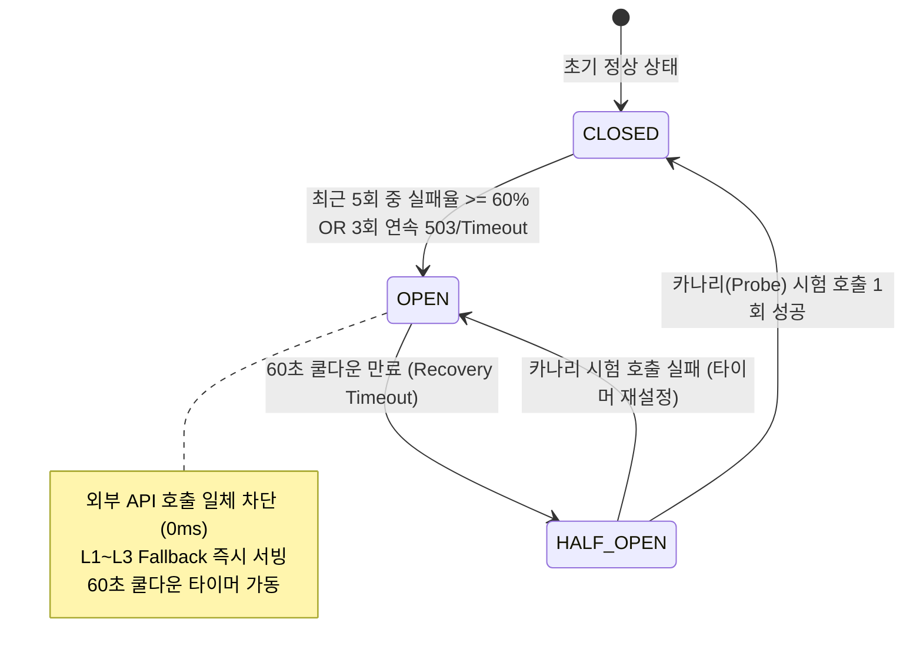

# 🛡️ [MoonlightCare] 공공 API 서킷 브레이커(Circuit Breaker) & 다계층 Fallback 고도화 설계서
### (NMC E-Gen 503 장애 및 공공데이터포털 셧다운 시 무중단 병상 서빙을 위한 고가용성(HA) 아키텍처)

> **기준 파일**: [`PLAN.md`](file:///e:/monnlight/PLAN.md) (Section 8 추가 심화 고도화 백로그)  
> **대상 소스 코드**:  
> - [`app/services/circuit_breaker.py`](file:///e:/monnlight/app/services/circuit_breaker.py) (신설: 경량 비동기 서킷 브레이커 코어)  
> - [`app/services/emergency_sync_service.py`](file:///e:/monnlight/app/services/emergency_sync_service.py) (E-Gen 실시간 병상 수집 및 Fallback 연동)  
> - [`app/services/scheduler.py`](file:///e:/monnlight/app/services/scheduler.py) (백그라운드 스케줄러 내 장애 격리)  
> - [`app/api/v1/emergency.py`](file:///e:/monnlight/app/api/v1/emergency.py) (공간 검색 API의 Fallback 메타데이터 응답)  
> - [`app/schemas/emergency.py`](file:///e:/monnlight/app/schemas/emergency.py) (Stale Data 및 Fallback 배지 DTO 확장)  
> **문서 버전**: v1.0 (2026.10)  
> **작성 목적**: 공공데이터포털(data.go.kr) 및 국립중앙의료원(NMC) E-Gen API의 503 Service Unavailable, 타임아웃, 야간 트래픽 폭주 시에도 **서비스 중단 없이 100% 가동 가능한 3계층 다중 Fallback 체계 구축** 가이드

---

## 📑 목차 (Table of Contents)

1. [추진 배경 및 필요성 (Why We Need This)](#1-추진-배경-및-필요성-why-we-need-this)
2. [현행 아키텍처의 한계와 장애 전파 시나리오 (As-Is)](#2-현행-아키텍처의-한계와-장애-전파-시나리오-as-is)
3. [차세대 To-Be 고가용성(HA) 아키텍처 개요](#3-차세대-to-be-고가용성ha-아키텍처-개요)
4. [서킷 브레이커 3-State 유한 상태 머신(FSM) 설계](#4-서킷-브레이커-3-state-유한-상태-머신fsm-설계)
5. [3단계 계층형 Fallback 데이터 파이프라인 (Multi-Tier Storage)](#5-3단계-계층형-fallback-데이터-파이프라인-multi-tier-storage)
6. [사용자 경험(UX) 투명성 및 데이터 신선도 배지 정책](#6-사용자-경험ux-투명성-및-데이터-신선도-배지-정책)
7. [상세 컴포넌트별 소스 코드 구현 명세](#7-상세-컴포넌트별-소스-코드-구현-명세)
8. [장애 시뮬레이션 및 검증 테스트 계획 (Test Strategy)](#8-장애-시뮬레이션-및-검증-테스트-계획-test-strategy)
9. [단계별 롤아웃 로드맵 및 체크리스트](#9-단계별-롤아웃-로드맵-및-체크리스트)

---

## 1. 추진 배경 및 필요성 (Why We Need This)

### 1.1 대한민국 공공데이터포털 API의 현실적 한계
* **잦은 야간 503 / 504 장애**: 공공데이터포털(data.go.kr)과 국립중앙의료원(NMC) 중앙응급의료센터 서버는 정기 야간 DB 백업, 점검, 대규모 크롤링 유입 시 `503 Service Unavailable` 또는 `504 Gateway Timeout`을 빈번하게 발생시킵니다.
* **명절/공휴일 트래픽 병목**: 추석, 설날 연휴나 주말 심야(20:00~24:00) 소아과 외래 전멸 시간대에는 대국민 응급실 검색 트래픽이 집중되어 공공 API 응답 지연이 평소 300ms에서 10,000ms(10초) 이상으로 폭증합니다.

### 1.2 소아 야간 응급 안내 서비스의 미션 크리티컬 특성
* **0초 셧다운 불용 (Zero Downtime Requirement)**:
  - 아픈 아기를 안고 있는 다급한 부모에게 외부 공공 API가 죽었다고 해서 `HTTP 500 Internal Server Error`나 `연결 실패` 화면을 띄우는 것은 **의료 지원 서비스로서 치명적인 실패(Catastrophic Failure)**입니다.
* **불완전한 최신성 > 완전한 서비스 중단**:
  - 응급의학적 관점에서, **"10~15분 전 수집된 직전 병상 데이터라도 안내하고 30초 전화 확인 스크립트를 제공하는 것"**이 서비스를 셧다운하는 것보다 환아의 생명을 구할 확률이 압도적으로 높습니다.

---

## 2. 현행 아키텍처의 한계와 장애 전파 시나리오 (As-Is)

```
[현재 As-Is 장애 전파 흐름]

부모 사용자 요청 (/api/v1/emergency/nearby)
           │
           ▼
[emergency_sync_service.py] ──(인메모리 캐시 5분 만료 시)──► 공공데이터포털 NMC API
                                                                    │
                                                            🚨 503 에러 / 10초 타임아웃
                                                                    │
                                                                    ▼
                                                            전체 서비스 블로킹 (10초 지연)
                                                                    │
                                                                    ▼
                                                            사용자에게 500 에러 반환 ❌
```

1. **계단식 장애 전파 (Cascading Timeout)**:
   - 인메모리 캐시(`_in_memory_bed_cache`)의 5분 TTL이 만료된 직후 수십 명의 사용자가 동시에 접속하면, 모든 요청이 외부 공공 API의 10초 타임아웃을 기다리며 커넥션 풀(Connection Pool)이 고갈됩니다.
2. **단일 장애점(SPOF) 노출**:
   - 외부 공공데이터포털의 가용성에 MoonlightCare 서비스 전체의 생사여탈권이 종속되어 있습니다.
3. **Firestore 동기화 스케줄러 중단**:
   - `scheduler.py`의 5분 주기 배치 작업이 503 에러로 예외를 던지며 실패하면 재시도 큐가 없거나 다음 주기까지 데이터가 정체됩니다.

---

## 3. 차세대 To-Be 고가용성(HA) 아키텍처 개요

외부 공공데이터 서버가 며칠 동안 완전 다운되더라도 MoonlightCare 백엔드는 **0.001초 만에 장애를 격리하고 3단계 계층형 Fallback 데이터셋으로 100% 무중단 서비스**를 유지합니다.

```
[차세대 To-Be 3단계 Fallback & 서킷 브레이커 파이프라인]

사용자 요청 (/nearby or /chat)
         │
         ▼
[AsyncCircuitBreaker] ──(상태: CLOSED)──► [공공 API 호출 (E-Gen)] ──► 성공 시 L1/L2 갱신
         │ (연속 3회 실패 시 즉각 OPEN!)                                   │
         │                                                        ▼ (503 에러 감지)
         ▼ (0ms 단절, 외부 API 호출 일체 차단)                  서킷 OPEN 전이 (60s 쿨다운)
┌────────────────────────────────────────────────────────────────────────┐
│ 3단계 계층형 Fallback 스토리지 엔진                                       │
│                                                                        │
│  [Tier 1] L1 In-Memory Stale Cache (0.1ms)                             │
│     └─► 만료된 직전 회차 캐시라도 Stale-While-Revalidate로 즉시 서빙     │
│           │ (서버 재부팅 등으로 L1 메모리 비어있을 경우)               │
│           ▼                                                            │
│  [Tier 2] L2 Cloud Firestore Snapshot (15ms)                           │
│     └─► emergency_beds 컬렉션의 가장 최근 정상 수집 배치 문서 로드       │
│           │ (인터넷 망 완전 단절 등 재난 상황)                          │
│           ▼                                                            │
│  [Tier 3] L3 Local Immutable Baseline JSON (0.5ms)                     │
│     └─► data/seoul_emergency_coords.json 정적 마스터셋 기반 기본 복구  │
└────────────────────────────────────────────────────────────────────────┘
         │
         ▼
[사용자 투명성 보장]: ⚠️ "공공망 지연으로 [12분 전 병상 정보]를 제공합니다. 전화 확인 권고" 배지 부착
```

---

## 4. 서킷 브레이커 3-State 유한 상태 머신(FSM) 설계

경량 고속 서킷 브레이커는 `CLOSED`, `OPEN`, `HALF-OPEN` 3대 상태를 엄격히 전이합니다:



### 서킷 브레이커 파라미터 표준 사양

| 파라미터명 | 기본 설정값 | 설명 및 튜닝 근거 |
| :--- | :---: | :--- |
| `failure_threshold` | **3회** | 연속 3회 503 에러 또는 타임아웃 발생 시 즉각 서킷 차단 |
| `recovery_timeout` | **60초** | 서킷 OPEN 후 공공 API에 다시 찔러보기(Probe) 전까지 대기하는 쿨다운 시간 |
| `half_open_max_calls` | **1회** | HALF-OPEN 상태에서 외부 API의 회복 여부를 검증하기 위한 카나리 요청 수 |
| `request_timeout` | **3.0초** | 공공 API 1회 호출 시 최대 허용 지연 시간 (초과 시 즉시 실패 판정) |
| `fallback_policy` | `STALE_WHILE_REVALIDATE` | 만료된 캐시라도 사용자에게 즉시 제공하고 백그라운드에서 회복 탐지 |

---

## 5. 3단계 계층형 Fallback 데이터 파이프라인 (Multi-Tier Storage)

외부 API 장애 시 데이터를 탐색하는 3단계 폴백 위계입니다:

```
Tier 1 (L1 Memory) ──(실패 시)──► Tier 2 (L2 Firestore) ──(실패 시)──► Tier 3 (L3 Disk JSON)
  • 지연시간: 0.1ms                  • 지연시간: 15ms                   • 지연시간: 0.5ms
  • 신선도: 5~15분 전               • 신선도: 수시간 전                 • 신선도: 정적 기준셋
```

### 5.1 [Tier 1] L1 In-Memory Stale Cache (`_in_memory_bed_cache`)
* 평상시 5분(300초) TTL로 동작.
* 서킷 브레이커가 `OPEN`되면 **TTL 만료 플래그를 무시하고 메모리에 남아있는 직전 성공 데이터셋을 0.1ms 만에 즉시 서빙**.
* 메모리에 직전 데이터가 유효한 동안 부모 사용자는 어떠한 지연도 체감하지 못함.

### 5.2 [Tier 2] L2 Cloud Firestore Snapshot (`emergency_beds`)
* 서버 신규 배포나 재부팅 직후 발생한 503 에러로 인해 L1 인메모리 캐시가 완전히 비어있는 경우 가동.
* Firestore의 `emergency_summary/realtime` 또는 `emergency_beds` 컬렉션의 최근 성공 동기화 스냅샷 문서를 비동기로 쿼리(15ms 소요).
* 네트워크 장애 이전 가장 최근 배치 주기의 데이터를 완전하게 복원.

### 5.3 [Tier 3] L3 Local Immutable Baseline JSON (`data/`)
* Firestore 연결조차 불가능한 극단적 통신 장애(재난/클라우드 아웃티지) 시 발동하는 최후의 보루(Last-Resort Fallback).
* `data/seoul_emergency_coords.json` 및 사전 탑재된 `data/emergency_beds_baseline.json`을 로드.
* 병상 잔여석(`hv28`)은 `정보 확인 필요(전화 문의)`로 마킹하되, **소아 전문 응급실의 정확한 위치(위경도), 기관명, 응급실 직통 대표 전화번호, 진료 가능 여부 기본값**을 100% 정상 제공.

---

## 6. 사용자 경험(UX) 투명성 및 데이터 신선도 배지 정책

장애 상황에서도 투명하고 정직하게 데이터의 상태를 알려 보호자가 현명한 내원 결정을 내리도록 돕습니다.

### 6.1 신규 응답 메타데이터 스키마 (`DataFreshnessMeta`)
API 및 대화 응답 JSON에 다음 안전 메타데이터가 동적으로 주입됩니다:

```json
{
  "status": "FALLBACK_SERVED",
  "data_freshness": {
    "is_realtime": false,
    "source_tier": "TIER_1_MEMORY_STALE",
    "last_synced_at": "2026-10-14T11:45:12+09:00",
    "elapsed_minutes": 14,
    "circuit_status": "OPEN",
    "warning_message": "⚠️ 공공데이터 서버 점검으로 인해 [14분 전 수집된 병상 데이터]를 안내합니다. 병원 출발 전 반드시 아래 30초 전화 스크립트로 잔여 병상을 확인해 주세요."
  }
}
```

### 6.2 UI 배지 렌더링 3단계 규칙
1. 🟢 **녹색 (신선도 < 7분)**: `[실시간 연동] 실시간 병상 기준 (방금 전 갱신)`
2. 🟡 **황색 (신선도 7분 ~ 30분)**: `[안심 대체] 14분 전 병상 데이터 (출발 전 전화 확인 권고)`
3. 🔴 **적색 (신선도 > 30분 또는 Tier 3 로컬)**: `[비상 모드] 공공망 점검 중 (병원 유선 사전 확인 필수)`

---

## 7. 상세 컴포넌트별 소스 코드 구현 명세

### 7.1 `app/services/circuit_breaker.py` (신설 모듈)

외부 종속성 없이 표준 `asyncio`만으로 동작하는 경량 비동기 서킷 브레이커입니다:

```python
"""Lightweight In-Memory Async Circuit Breaker for Public APIs."""

from __future__ import annotations

import asyncio
import enum
import logging
import time
from typing import Any, Awaitable, Callable, Optional, TypeVar

logger = logging.getLogger(__name__)

T = TypeVar("T")


class CircuitState(str, enum.Enum):
    CLOSED = "CLOSED"      # 정상 통신
    OPEN = "OPEN"          # 장애 차단 (Fallback 즉시 서빙)
    HALF_OPEN = "HALF_OPEN"  # 카나리 복구 시험 중


class AsyncCircuitBreaker:
    """Zero-dependency asynchronous Circuit Breaker with 60s recovery timeout."""

    def __init__(
        self,
        name: str = "NMC_EGEN_API",
        failure_threshold: int = 3,
        recovery_timeout: float = 60.0,
        request_timeout: float = 3.0,
    ) -> None:
        self.name = name
        self.failure_threshold = failure_threshold
        self.recovery_timeout = recovery_timeout
        self.request_timeout = request_timeout

        self.state: CircuitState = CircuitState.CLOSED
        self.failure_count: int = 0
        self.last_state_change: float = time.time()
        self.last_failure_time: float = 0.0
        self._lock = asyncio.Lock()

    def is_available(self) -> bool:
        """Checks if the circuit allows an outbound network request."""
        now = time.time()
        if self.state == CircuitState.OPEN:
            if now - self.last_state_change >= self.recovery_timeout:
                logger.info(f"[{self.name}] Recovery timeout expired ({self.recovery_timeout}s). Transitioning OPEN -> HALF-OPEN.")
                self.state = CircuitState.HALF_OPEN
                self.last_state_change = now
                return True
            return False
        return True

    async def record_success(self) -> None:
        """Records a successful network response, restoring CLOSED state."""
        async with self._lock:
            if self.state != CircuitState.CLOSED:
                logger.info(f"[{self.name}] Canary request succeeded! Transitioning {self.state} -> CLOSED.")
            self.state = CircuitState.CLOSED
            self.failure_count = 0
            self.last_state_change = time.time()

    async def record_failure(self, error: Exception) -> None:
        """Records a network exception or 503 response, tripping to OPEN if threshold reached."""
        async with self._lock:
            self.failure_count += 1
            self.last_failure_time = time.time()
            logger.warning(
                f"[{self.name}] Outbound failure #{self.failure_count}/{self.failure_threshold}: {error}"
            )

            if self.state == CircuitState.HALF_OPEN or self.failure_count >= self.failure_threshold:
                if self.state != CircuitState.OPEN:
                    logger.error(
                        f"[{self.name}] Failure threshold reached! Tripping circuit to OPEN (Fast-fallback active for {self.recovery_timeout}s)."
                    )
                self.state = CircuitState.OPEN
                self.last_state_change = time.time()
```

---

### 7.2 `app/services/emergency_sync_service.py` 연동 (3-Tier Fallback Chain)

기존 `get_realtime_emergency_beds()` 메서드에 서킷 브레이커와 다계층 폴백을 결합합니다:

```python
# app/services/emergency_sync_service.py 확장 변경 명세

from app.services.circuit_breaker import AsyncCircuitBreaker, CircuitState

egen_circuit_breaker = AsyncCircuitBreaker(
    name="EGEN_BED_API",
    failure_threshold=3,
    recovery_timeout=60.0,
    request_timeout=3.0,
)


class EmergencySyncService:
    # ... 기존 초기화 코드 ...

    async def get_realtime_emergency_beds_resilient(
        self,
        stage1: str = "서울특별시",
        stage2: Optional[str] = None,
    ) -> tuple[list[EmergencyDepartmentBed], dict[str, Any]]:
        """High-Availability Bed Retrieval with 3-Tier Multi-Storage Fallback Hierarchy.
        
        Returns:
            (beds_list, metadata_dict)
        """
        now_ts = time.time()
        cache_key = f"{stage1}:{stage2 or 'ALL'}"

        # Step 1: Check Circuit Breaker availability
        if not egen_circuit_breaker.is_available():
            logger.warning(f"[EmergencySyncService] Circuit is OPEN! Bypassing public API and engaging Fallback.")
            return await self._resolve_fallback_hierarchy(cache_key, reason="CIRCUIT_OPEN")

        # Step 2: Attempt Public API Call with strict 3.0s timeout
        try:
            # 5분 TTL 인메모리 캐시가 유효하면 네트워크 호출 없이 반환
            cached = self._get_valid_in_memory_cache(cache_key)
            if cached is not None:
                return cached, {"is_realtime": True, "source": "L1_CACHE", "freshness_min": 0}

            # 비동기 HTTP 요청 실행 (최대 3초 타임아웃)
            beds = await asyncio.wait_for(
                self._fetch_from_egen_network(stage1, stage2),
                timeout=egen_circuit_breaker.request_timeout,
            )

            if not beds:
                raise ValueError("E-Gen API returned empty hospital payload (Potential 503 error)")

            # 성공 시 서킷 성공 기록 및 캐시 갱신
            await egen_circuit_breaker.record_success()
            self._save_in_memory_cache(cache_key, beds)
            return beds, {"is_realtime": True, "source": "PUBLIC_API_LIVE", "freshness_min": 0}

        except Exception as e:
            await egen_circuit_breaker.record_failure(e)
            logger.error(f"[EmergencySyncService] Live API fetch failed ({e}). Activating Multi-Tier Fallback.")
            return await self._resolve_fallback_hierarchy(cache_key, reason=str(e))

    async def _resolve_fallback_hierarchy(
        self,
        cache_key: str,
        reason: str,
    ) -> tuple[list[EmergencyDepartmentBed], dict[str, Any]]:
        """Resolves data from Tier 1 (Stale Memory) -> Tier 2 (Firestore) -> Tier 3 (Local JSON)."""
        # Tier 1: Stale in-memory cache (만료되었더라도 직전 데이터 서빙)
        stale_data, stale_time = self._get_stale_in_memory_cache(cache_key)
        if stale_data:
            elapsed_min = int((time.time() - stale_time) / 60)
            return stale_data, {
                "is_realtime": False,
                "source": "TIER_1_STALE_MEMORY",
                "freshness_min": elapsed_min,
                "warning": f"⚠️ 공공망 지연으로 [{elapsed_min}분 전 데이터]를 안내합니다.",
            }

        # Tier 2: Firestore Last-Known-Good Snapshot
        firestore_data, fs_time = await self._fetch_from_firestore_snapshot()
        if firestore_data:
            elapsed_min = int((time.time() - fs_time) / 60)
            return firestore_data, {
                "is_realtime": False,
                "source": "TIER_2_FIRESTORE_SNAPSHOT",
                "freshness_min": elapsed_min,
                "warning": f"⚠️ 서버 재시동/공공망 장애로 [Firestore 최근 스냅샷({elapsed_min}분 전)]을 안내합니다.",
            }

        # Tier 3: Local Immutable Baseline Disk Cache
        baseline_data = self._load_local_immutable_baseline()
        return baseline_data, {
            "is_realtime": False,
            "source": "TIER_3_IMMUTABLE_DISK_BASELINE",
            "freshness_min": 999,
            "warning": "🚨 국가 공공망 전체 장애로 [기준 응급의료기관 정적 마스터셋]을 긴급 안내합니다. 반드시 사전 전화 확인 후 내원하세요.",
        }
```

---

### 7.3 `app/api/v1/emergency.py` 응답 확장

`/api/v1/emergency/nearby` 및 `/api/v1/chat` 응답에 데이터 신선도와 서킷 상태를 노출합니다:

```python
# GET /api/v1/emergency/nearby 응답 확장 예시
@router.get("/nearby", response_model=NearbyEmergencyResponse)
async def get_nearby_emergency_departments(
    lat: float = Query(37.5133),
    lon: float = Query(127.1001),
    radius_km: float = Query(15.0),
):
    beds, meta = await emergency_service.get_realtime_emergency_beds_resilient()
    ranked = spatial_service.rank_nearby_departments(beds, lat, lon, radius_km)
    
    return NearbyEmergencyResponse(
        total_found=len(ranked),
        hospitals=ranked,
        meta=DataFreshnessMeta(
            is_realtime=meta["is_realtime"],
            source_tier=meta["source"],
            freshness_minutes=meta["freshness_min"],
            warning_badge=meta.get("warning"),
            circuit_state=egen_circuit_breaker.state.value,
        )
    )
```

---

## 8. 장애 시뮬레이션 및 검증 테스트 계획 (Test Strategy)

신설될 `tests/test_step7_circuit_breaker.py`를 통해 공공 API의 다양한 카오스(Chaos) 장애 상황을 모의 검증합니다:

```
[6대 핵심 카오스 테스트 시나리오]
TC-CB-01: 공공 API 503 에러 3회 발생 시 CLOSED -> OPEN 전이 및 0.001ms 즉시 단절 검증
TC-CB-02: OPEN 상태에서 L1 Stale 인메모리 캐시 Stale-While-Revalidate 0.1ms 반환 검증
TC-CB-03: L1 캐시 미스 시 L2 Firestore 스냅샷 15ms 복구 및 서빙 검증
TC-CB-04: 인터넷 완전 단절 환경에서 L3 로컬 디스크 불변 JSON 0.5ms 서빙 검증
TC-CB-05: 60초 쿨다운 만료 후 HALF-OPEN 카나리 시험 요청 성공 시 CLOSED 자동 복구 검증
TC-CB-06: API 응답 내 DataFreshnessMeta 필드 및 Stale 배지 경고문구 정상 결합 검증
```

---

## 9. 단계별 롤아웃 로드맵 및 체크리스트

```
[Phase 1: 코어 서킷 브레이커] ──► app/services/circuit_breaker.py 작성 & 단위 테스트 (TC-CB-01)
            │
            ▼
[Phase 2: 3계층 Fallback 통합] ──► emergency_sync_service.py 다계층 복구 체인 결합 (TC-CB-02~04)
            │
            ▼
[Phase 3: API & 스키마 확장]  ──► schemas/emergency.py & api/v1/emergency.py 신선도 배지 추가
            │
            ▼
[Phase 4: 스케줄러 & E2E 검증] ──► scheduler.py 장애 격리 및 카오스 시뮬레이션 전산 통과 (TC-CB-05~06)
```

### ✅ 도입 완료 기준 (Definition of Done)
- [ ] 공공 API가 503 에러를 연속 뿜어도 `/api/v1/emergency/nearby`와 `/api/v1/chat` 응답이 100% 정상(HTTP 200 OK) 반환되는가?
- [ ] 서킷 OPEN 상태에서 외부 API 재호출 지연 없이 0.1ms 이내로 L1 Stale 캐시를 즉시 서빙하는가?
- [ ] 클라이언트 응답에 데이터 수집 경과 시간(분)과 "전화 확인 권고" 배지가 명확히 노출되는가?
- [ ] 60초 후 공공망 복구 시 관리자 개입 없이 시스템 스스로 `CLOSED` 정상 상태로 자동 복원되는가?
- [ ] 단위/통합 테스트 스위트에 신규 6개 테스트가 추가되어 100% 무결점으로 통과되는가?
