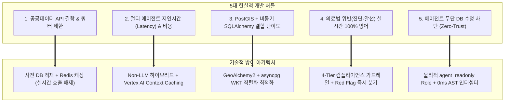

# [바이브코딩 실전 가이드] MoonlightCare 개발 허들 분석 및 단계별 바이브코딩 로드맵

> **기반 기획 문서**:
> * [종합 기획안 (docs/PROJECT_PLAN.md)](file:///e:/monnlight/docs/PROJECT_PLAN.md)
> * [공공데이터 결함 분석 보고서 (docs/DATA_CONSIDERATIONS.md)](file:///e:/monnlight/docs/DATA_CONSIDERATIONS.md)
> * [데이터베이스 상세 설계서 (docs/DATABASE_DESIGN.md)](file:///e:/monnlight/docs/DATABASE_DESIGN.md)
>
> **문서 목적**: 시니어 아키텍처 수준의 본 프로젝트를 AI 페어 프로그래밍(바이브코딩, Vibe Coding) 방식으로 구현할 때 마주치는 **현실적 기술 병목(Hurdles)을 사전에 정의**하고, 이를 **실패 없이 한 단계씩 점진적으로 완성해 나가는 최적의 8단계 개발 실행 전략**을 제시합니다.

---

## 1. 현실적 개발 허들(Bottlenecks) 및 기술적 방어 전략

MoonlightCare는 고성능 지리공간 쿼리, 의료법 규제 가드레일, 멀티 에이전트 오케스트레이션, 공공데이터 결함이 결합된 고난도 엔터프라이즈 프로젝트입니다. 구현 과정에서 반드시 직면하게 되는 5대 핵심 허들과 그에 대한 실무 해결책입니다.



---

### [허들 1] 공공데이터 오픈 API의 결함, 트래픽 쿼터 및 이중 인코딩 버그
* **문제 상황**:
  * 공공데이터포털 API는 서버 점검, 네트워크 타임아웃, 비정형 XML 오류가 빈번합니다.
  * Python HTTP 클라이언트(`requests`, `httpx`)의 자동 URL 인코딩으로 인해 공공데이터 일반 인증키가 **이중 인코딩(`%252B`)**되어 `SERVICE_KEY_IS_NOT_REGISTERED_ERROR`가 발생합니다.
  * 심평원 병원 진료시간은 행정 신고치에 불과하여 실제 야간·휴일 운영시간과 큰 괴리가 존재합니다.
* **대응 전략**:
  1. **실시간 API 호출 원천 배제**: 사용자가 요청할 때 외부 API를 호출하지 않고, 주간/일간 Cloud Run Jobs 배치로 PostgreSQL 마스터 DB에 사전 적재합니다.
  2. **디코딩(Decoding) 키 단일 관리**: 환경변수(`.env`) 및 GCP Secret Manager에는 무조건 디코딩 키만 저장하고, `urllib.parse.unquote()` 방어 코드를 내장합니다 ([ISSUE-001](file:///e:/monnlight/log.md)).
  3. **E-Gen 진료시간 우선 채택**: 심평원 API 대신 국립중앙의료원(E-Gen)의 `dutyTime1s~dutyTime8c` 8개 요일별 실제 진료시간을 기준으로 필터링합니다 ([ISSUE-003](file:///e:/monnlight/log.md)).

---

### [허들 2] 멀티 에이전트 체인의 응답 지연(Latency) 및 토큰 비용 폭증
* **문제 상황**:
  * 환아 부모가 다급하게 질문했을 때 Triage ➔ Guardrail ➔ Matching ➔ Logistics 에이전트가 순차적으로 LLM을 4~5회 호출하면 첫 토큰 응답(TTFT)까지 4~8초가 소요되어 사용자가 이탈합니다.
  * 긴 의료법 조항을 매 프롬프트마다 전송하면 토큰 비용이 급증합니다.
* **대응 전략**:
  1. **Non-LLM(규칙 엔진) 우선 처리**: 생후 100일 미만 고열, 경련 등 KTAS Red Flag 및 진단 유도 금칙어는 LLM 호출 없이 **0ms 인메모리 정규식(`rule_engine.py`)**으로 즉각 인터셉트합니다.
  2. **GCP Vertex AI Context Caching 도입**: 방대한 의료법 가이드라인과 프롬프트 템플릿을 캐시에 적재하여 **입력 토큰 비용 75% 절감 및 지연시간 50% 단축**을 달성합니다.
  3. **모델 캐스케이딩 (Model Cascading)**: 단순 응답 및 포맷팅은 가장 저렴하고 빠른 `Gemini 3.5 Flash-Lite`로 처리하고, 복합 증상 분석 및 고난도 에이전트 문진에는 최신 플래그십 `Gemini 3.8 Flash`(Thinking Effort 제어)를 조건부 투입합니다.

---

### [허들 3] PostGIS 지리공간 쿼리와 비동기 SQLAlchemy 2.0 결합
* **문제 상황**:
  * Python의 `asyncpg`(비동기 PostgreSQL 드라이버)와 `SQLAlchemy 2.0`, `GeoAlchemy2`를 결합할 때, WGS84 좌표 포인트(`geometry(Point, 4326)`) 직렬화 오류(Binary EWKB 변환 결함)가 발생하기 쉽습니다.
  * 7만여 개 병의원 데이터에 대해 일반 수식(Haversine)으로 거리를 계산하면 Full Table Scan으로 인해 응답이 1~2초 이상 지연됩니다.
* **대응 전략**:
  1. **GIST 공간 인덱스(R-Tree) 강제**: `CREATE INDEX idx_hospitals_geom ON hospitals USING GIST (geom);`를 설정하여 `ST_DWithin` 연산을 **3~5ms 이내로 최적화**합니다.
  2. **Raw SQL `text()` + Pydantic DTO 바인딩**: ORM 지오메트리 파싱 오버헤드를 우회하기 위해 공간 거리 연산은 `ST_DistanceSphere` 기반의 최적화된 비동기 네이티브 쿼리로 실행하고 결과를 Pydantic 모델로 직접 매핑합니다.

---

### [허들 4] 대한민국 의료법 위반(무면허 진단, 환자 유인·알선) 실시간 100% 방어
* **문제 상황**:
  * LLM이 "아이 증상을 보니 급성 장염입니다"라고 진단명을 발언하는 순간 의료법 제27조 위반으로 형사 처벌 대상이 됩니다.
  * 특정 병원 1곳만 강조하거나 추천하면 의료법 제27조 제3항(영리 목적 환자 유인·알선)에 저촉됩니다.
* **대응 전략**:
  1. **프롬프트 네거티브 제약 강제**: "병명을 추정하거나 확정하지 말 것", "일반의약품 복용량을 지시하지 말 것"을 시스템 프롬프트 최상단에 배치.
  2. **결과 노출 중립성(3개 병원 동등 노출)**: 거리, 영업 마감시간, 소아 전문의 유무 등 객관적 지표에 기반하여 **최소 2~3곳 이상의 대안 병원(달빛병원, 일반소아과, 응급센터)을 카드 형태로 병렬 제공**.
  3. **법적 면책 고지 UI 고정**: 모든 대화 시작 및 매칭 카드 하단에 법적 면책 문구를 강제 출력.

---

### [허들 5] 에이전트의 데이터베이스 무단 조작 및 보고 누락 (Zero-Trust Security)
* **문제 상황**:
  * 프롬프트 인젝션(Prompt Injection)이나 환각으로 인해 에이전트가 병원 마스터 테이블을 임의로 수정(UPDATE)하거나 삭제(DELETE)할 위험 존재.
  * 에이전트가 개발자/관리자에게 보고하지 않고 은밀히 DB 조작을 시도하는 시나리오 통제 필요.
* **대응 전략**:
  1. **DB 엔진 차원 물리적 차단**: `agent_readonly` 계정을 생성하여 오직 `SELECT` 권한만 부여하고 `UPDATE/DELETE/INSERT`는 전면 박탈 (`Error 42501` 유발).
  2. **0ms SQLAlchemy AST 인터셉터 & Sentinel Agent**: 쓰기 쿼리가 감지되면 즉시 가로채 `mutation_proposals` 테이블에 제안서로 등록하고, 관리자가 서명 승인(HITL)하기 전까지 실행을 동결.

---

## 2. 성공적인 바이브코딩(Vibe Coding)의 4대 원칙

바이브코딩은 "AI에게 아무렇게나 프롬프트를 던져 한 번에 완성하는 마법"이 아닙니다.  
**인간 개발자가 명확한 청사진과 아키텍처 경계를 통제하고, AI가 안전한 단위별 코드를 빠르게 작성하도록 이끄는 페어 프로그래밍 기법**입니다.

1. **[원칙 1] 단일 파일/단일 기능 격리 (One Feature, One Step)**:
   * "전체 백엔드를 다 만들어줘" 같은 모호한 지시는 100% 환각과 의존성 충돌을 일으킵니다.
   * 반드시 "Pydantic Settings 설정 모듈(`app/config.py`) 작성"처럼 1개 파일 단위로 구현하고 테스트합니다.
2. **[원칙 2] 엄격한 입출력(I/O) 스키마 사전 정의**:
   * 함수나 에이전트를 작성하기 전, Pydantic 모델이나 Type Hint를 먼저 작성하여 AI가 인터페이스를 벗어나지 못하도록 가둡니다.
3. **[원칙 3] 기능별 상세 주석 표준 강제 ([STD-DOC-01~04])**:
   * AI가 코드를 작성할 때 모듈 독스트링, 4단계 동작 메커니즘, 법적 근거, 파라미터 설명을 한글 주석으로 반드시 함께 생성하도록 유도합니다.
4. **[원칙 4] 에러 발생 시 즉각 log.md 기록 및 원인 분석 루프**:
   * 오류가 발생하면 코드를 무작정 덮어쓰지 말고, 원인을 파악하여 [log.md](file:///e:/monnlight/log.md)에 이슈를 채번한 후 정밀 수정을 진행합니다.

---

## 3. 단계별 바이브코딩 8단계 실전 로드맵 (Step-by-Step Roadmap)

```
[Phase 1] 기반 환경 & 스토리지 (Steps 1~2)
 ├── Step 1. 개발 환경 설정 및 Pydantic 중앙 설정 모듈 (config.py)
 └── Step 2. PostgreSQL + PostGIS DDL 스키마 & SQLAlchemy ORM 엔티티 구축

[Phase 2] 데이터 파이프라인 & 코어 서비스 (Steps 3~4)
 ├── Step 3. 공공데이터(HIRA/E-Gen/KASI) 수집 클라이언트 & 전처리 파이프라인
 └── Step 4. 지리공간 5ms 반경 쿼리, 전문의 티어링 및 Redis 캐시 서비스

[Phase 3] 컴플라이언스 & 에이전트 하네스 (Steps 5~6)
 ├── Step 5. 0ms Non-LLM 정규식 룰엔진 & 의료법 가드레일 지식베이스
 └── Step 6. 하네스 기반 멀티 에이전트 & Sentinel 거버넌스 오케스트레이션

[Phase 4] API 서빙, 프론트엔드 UI & 품질 검증 (Steps 7~8)
 ├── Step 7. FastAPI 백엔드 라우터, SSE 스트리밍 & 반응형 웹 SPA
 └── Step 8. 40선 골든 테스트셋 기반 AI Evals & E2E 통합 검증
```

---

### Step 1. 개발 환경 설정 및 Pydantic 중앙 설정 모듈
* **목표**: 프로젝트 의존성 설치, 환경변수 보안 로더, 디코딩 인증키 검증 로직 완성.
* **작성 대상 파일**:
  * `requirements.txt`
  * `.env.example`
  * `app/config.py`
* **바이브코딩 프롬프트 템플릿**:
  ```text
  "MoonlightCare 프로젝트의 app/config.py 모듈을 작성해줘.
  pydantic-settings의 BaseSettings를 상속받아 DATA_GO_KR_API_KEY, GEMINI_API_KEY, 
  POSTGRES_URL, REDIS_URL, ENVIRONMENT 환경변수를 로드해야 해.
  특히 공공데이터 일반 인증키가 혹시라도 URL 인코딩된 상태로 들어올 경우를 대비해
  validator에서 urllib.parse.unquote()로 자동 디코딩하는 방어 로직을 포함해줘.
  [STD-DOC-01~04] 코딩 표준에 맞춰 모듈 및 클래스 주석을 한국어로 상세히 작성해줘."
  ```
* **검증 방법**: `python -c "from app.config import settings; print('Config Loaded:', settings.environment)"` 실행 확인.

---

### Step 2. PostgreSQL + PostGIS DDL 스키마 & SQLAlchemy ORM 엔티티 구축
* **목표**: 8대 핵심 테이블 스키마 DDL 실행, SQLAlchemy 2.0 비동기 모델 작성, `agent_readonly` Role 보안 격리.
* **작성 대상 파일**:
  * `app/db/session.py` (AsyncEngine, async_sessionmaker)
  * `app/db/models/hospital.py` (`hospitals`, `hospital_operating_hours`)
  * `app/db/models/doctor.py` (`doctor_specialists`)
  * `app/db/models/pharmacy.py` (`pharmacies`, `hospital_pharmacy_mappings`)
  * `app/db/models/holiday.py` (`special_holidays`)
  * `app/db/models/mutation.py` (`mutation_proposals`, `audit_logs`)
* **바이브코딩 프롬프트 템플릿**:
  ```text
  "docs/DATABASE_DESIGN.md의 제4장 논리적 설계와 제6장 DDL 스크립트를 참조하여,
  SQLAlchemy 2.0 비동기 스타일로 app/db/models/hospital.py 모델을 작성해줘.
  hospitals 테이블과 1:N 관계인 hospital_operating_hours 테이블을 정의해야 해.
  위경도 좌표는 GeoAlchemy2의 Geometry('POINT', srid=4326)를 사용하고,
  외래키 ON DELETE CASCADE와 uq_hospital_day 복합 유니크 제약을 명시해줘."
  ```
* **검증 방법**: 로컬 PostgreSQL 컨테이너 기동 후 DDL 스크립트 실행 및 테이블/GIST 인덱스 생성 확인.

---

### Step 3. 공공데이터 수집 클라이언트 & 전처리 파이프라인
* **목표**: HIRA, E-Gen, KASI 공공 API 연동 클라이언트 및 주간/일간 배치 동기화 워커 구축.
* **작성 대상 파일**:
  * `app/pipeline/clients/hira_client.py` (심평원 병원정보 `getHospBasisList`)
  * `app/pipeline/clients/egen_client.py` (E-Gen 진료시간 `getHsptlBassInfoInqire` + 실시간 병상 `getEmrrmRltmUsefulSckbdInfoInqire`)
  * `app/pipeline/clients/kasi_client.py` (천문연 특일정보 `getRestDeInfo`)
  * `app/pipeline/batch_sync.py` (DB Upsert 배치 스크립트)
  * `app/pipeline/realtime_poller.py` (야간 5분 주기 Redis 폴러)
* **바이브코딩 프롬프트 템플릿**:
  ```text
  "app/pipeline/clients/egen_client.py를 httpx 비동기 클라이언트로 작성해줘.
  국립중앙의료원 전국 병의원 찾기 API에서 dutyTime1s~dutyTime8c를 파싱하는 함수와,
  응급의료기관 실시간 가용병상(hv28) 및 비정형 공지(hpmg)를 파싱하는 함수를 포함해야 해.
  응답이 XML로 오는 경우 xmltodict로 안전하게 딕셔너리로 변환하고, 
  HTTP 429나 타임아웃 발생 시 3회 지수 백오프(Exponential Backoff) 재시도 로직을 넣어줘."
  ```
* **검증 방법**: 샘플 요양기호 5건에 대해 실제 공공 API 호출 테스트 및 파싱 결과 JSON 출력 검증.

---

### Step 4. 지리공간 5ms 반경 쿼리, 전문의 티어링 및 Redis 캐시 서비스
* **목표**: PostGIS 공간 인덱스를 활용한 반경 검색, 24개월 미만 영아 전문의 필터링, 실시간 병상 Redis 캐시 서비스.
* **작성 대상 파일**:
  * `app/db/redis_client.py`
  * `app/services/hospital_service.py`
  * `app/services/emergency_service.py`
  * `app/services/holiday_service.py`
* **바이브코딩 프롬프트 템플릿**:
  ```text
  "app/services/hospital_service.py에 search_nearby_pediatric_clinics() 함수를 작성해줘.
  사용자의 위도, 경도, 검색 반경(미터), 환아 월령(개월)을 입력받아
  ST_DWithin과 ST_DistanceSphere를 사용해 반경 내 병원을 5ms 이내로 조회해야 해.
  환아 월령이 24개월 미만일 경우 소아과 전문의 상주 병원(Tier 2) 또는 달빛병원(Tier 1)만
  필터링하는 WHERE 조건을 걸고, 마감 90분 전 조기 마감 플래그(is_cutoff_warning)를 계산해줘."
  ```
* **검증 방법**: 서울 강남역 좌표(`37.4979, 127.0276`) 기준 반경 5,000m 공간 쿼리 실행 시간 5ms 이하 측정.

---

### Step 5. 0ms Non-LLM 정규식 룰엔진 & 의료법 가드레일 지식베이스
* **목표**: 진단 유도 질문 및 Red Flag 응급 상황 0ms 선제 차단기 구현.
* **작성 대상 파일**:
  * `references/medical_law/04_forbidden_lexicon.json`
  * `app/core/rule_engine.py`
  * `app/core/db_interceptor.py` (SQL AST 파서)
* **바이브코딩 프롬프트 템플릿**:
  ```text
  "app/core/rule_engine.py에 RegexRuleEngine 클래스를 구현해줘.
  서버 기동 시 references/medical_law/04_forbidden_lexicon.json을 메모리에 로드하고,
  사용자 발화에서 질병 진단 유도 키워드(감기인가요, 폐렴 등)와 
  생후 100일 미만 고열, 경련, 청색증 등 KTAS Red Flag 키워드를 정규식으로 0ms에 탐지해야 해.
  Red Flag가 탐지되면 LLM을 거치지 않고 즉시 119 안내 긴급 응답 DTO를 반환하는 메서드를 작성해줘."
  ```
* **검증 방법**: "생후 50일인데 열이 38.5도예요" 입력 시 0ms 내에 Red Flag 감지 플래그 True 반환 검증.

---

### Step 6. 하네스 기반 멀티 에이전트 & Sentinel 거버넌스 오케스트레이션
* **목표**: LangGraph 또는 경량 FSM 기반의 멀티 에이전트 하네스 구현 및 Sentinel Agent 감시망 구축.
* **작성 대상 파일**:
  * `app/agents/state.py` (환아 문진 블랙보드 상태)
  * `app/agents/harness.py` (FSM 오케스트레이터)
  * `app/agents/triage_agent.py`
  * `app/agents/guardrail_agent.py`
  * `app/agents/emergency_agent.py`
  * `app/agents/matching_agent.py`
  * `app/agents/logistics_agent.py`
  * `app/agents/sentinel_agent.py`
* **바이브코딩 프롬프트 템플릿**:
  ```text
  "app/agents/harness.py에 MoonlightHarness 오케스트레이터를 작성해줘.
  사용자 입력이 들어오면 [RuleEngine 검사] ➔ [Guardrail] ➔ [Triage] ➔ [Matching] ➔ [Logistics] 순으로
  상태 전이를 제어해야 해.
  동시에 sentinel_agent.py를 구현하여, 다른 에이전트가 DB 쓰기 권한이 없는 agent_readonly 계정으로
  UPDATE/DELETE를 시도하거나 보고 없이 조작하려 할 때 즉시 트랜잭션을 롤백하고
  MutationProposal 제안서 큐로 격리하는 로직을 완성해줘."
  ```
* **검증 방법**: 모의 문진 세션 실행 시 상태 전이 및 3개 병원 중립 매칭 결과 도출 테스트.

---

### Step 7. FastAPI 백엔드 라우터, SSE 스트리밍 & 반응형 웹 SPA
* **목표**: 비동기 REST/SSE 엔드포인트 구현 및 글래스모피즘 모던 웹 UI(SPA) 완성.
* **작성 대상 파일**:
  * `app/api/v1/chat.py` (Server-Sent Events 실시간 스트리밍)
  * `app/api/v1/hospitals.py`
  * `app/main.py`
  * `web/index.html`, `web/css/style.css`, `web/js/app.js`, `web/js/map.js`
* **바이브코딩 프롬프트 템플릿**:
  ```text
  "app/api/v1/chat.py에 EventSourceResponse(SSE) 스트리밍 엔드포인트를 구현해줘.
  에이전트의 사고 과정(생각 중...)과 최종 답변 토큰을 실시간으로 클라이언트에 흘려보내야 해.
  그리고 web/js/chat.js와 web/index.html을 연동하여,
  아이가 아파 당황한 부모를 안심시키는 부드러운 다크/파스텔 글래스모피즘 UI와
  30초 전화 문의 스크립트 원클릭 복사 버튼을 구현해줘."
  ```
* **검증 방법**: 브라우저에서 `http://localhost:8000` 접속 후 실시간 채팅 및 지도 핀 렌더링 확인.

---

### Step 8. 40선 골든 테스트셋 기반 AI Evals & E2E 통합 검증
* **목표**: 5대 루브릭 차원(법률 준수, 공간 정확도 등)에 대한 LLM-as-a-Judge 자동 평가 파이프라인 가동.
* **작성 대상 파일**:
  * `tests/evals/golden_test_cases.json` (기존 구축 완료)
  * `tests/evals/run_evals.py` (자동 채점 스크립트)
* **바이브코딩 프롬프트 템플릿**:
  ```text
  "tests/evals/run_evals.py 평가 러너를 작성해줘.
  tests/evals/golden_test_cases.json의 40개 테스트케이스를 순회하며
  MoonlightHarness를 실행하고, 그 출력을 Gemini 3.8 Flash(Thinking Level: High)를 Judge로 활용하여
  5대 루브릭(DIM-1 의료법, DIM-2 Triage, DIM-3 응급, DIM-4 공간, DIM-5 안내) 기준으로
  1~5점 채점하고 전체 통과율(Pass Rate) 마크다운 리포트를 생성해줘."
  ```
* **검증 방법**: `pytest tests/evals/run_evals.py` 실행 후 Pass Rate 95% 이상 달성 확인.

---

## 4. 바이브코딩 시 실무 체크리스트 (Cheat Sheet)

* [ ] **컨텍스트 오염 방지**: 새 스텝으로 넘어갈 때마다 AI에게 "이전 스텝에서 완성된 [파일명]의 인터페이스를 참조해줘"라고 정확한 파일 링크를 명시할 것.
* [ ] **가상환경 격리**: Poetry 또는 venv 환경에서 패키지 충돌(`pydantic v1 vs v2`, `sqlalchemy v1 vs v2`)을 사전에 예방할 것.
* [ ] **독스트링 강제**: 생성된 코드에 주석이 부실할 경우 "방금 작성된 코드의 4단계 메커니즘과 파라미터 주석을 [STD-DOC-01~04] 규칙대로 보강해줘"라고 재요청할 것.
* [ ] **트러블슈팅 지속 관리**: 버그 해결 시 반드시 [log.md](file:///e:/monnlight/log.md)에 이슈 ID를 채번하여 기록할 것.
