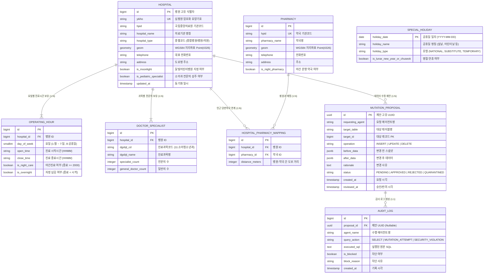

# [DB 설계 기획서] ISOOM 데이터베이스 아키텍처 및 상세 모델링 명세서

> **참조 가이드**: [코딩추월차선: 데이터베이스 설계 순서와 방법 (백엔드 개발자를 위한 필수 지식)](https://www.developerfastlane.com/blog/database-design-sequence-for-backend-developers)  
> **기반 기획안**: [ISOOM 종합 기획안 (docs/PROJECT_PLAN.md)](file:///e:/monnlight/docs/PROJECT_PLAN.md)  
> **작성 일자**: 2026-10-01 | **버전**: v1.0.0

---

## 1. 서론 및 DBMS 선정 근거 (DBMS Selection Rationale)

본 설계서는 백엔드 엔지니어링 표준 설계 순서인 **[요구사항 분석 ➔ 개념적 설계 ➔ 논리적 설계 ➔ 물리적 설계]** 4단계를 체계적으로 준수하여 작성되었습니다.

### 1.1 어떤 데이터베이스를 사용하는 것이 최적인가?

ISOOM는 **"야간·휴일 소아청소년과 5ms 초고속 공간 매칭"**과 **"의료법 컴플라이언스 및 에이전트 무단 조작 차단(Zero-Trust Security)"**을 동시에 만족해야 합니다. 이를 위해 단일 DB 대신 **PostgreSQL (PostGIS 확장) + Redis 하이브리드 아키텍처**를 최종 채택합니다.

```mermaid
flowchart LR
    subgraph ClientLayer [요청 계층]
        App[FastAPI 백엔드 / 멀티 에이전트]
    end

    subgraph RDBMS [영구 마스터 스토리지 계층]
        PG[(Cloud SQL PostgreSQL 16+)]
        PostGIS[PostGIS 3.4+ 공간 확장 모듈]
        PG --- PostGIS
    end

    subgraph InvertedCache [초고속 인메모리 캐시 계층]
        Redis[(Cloud Memorystore Redis 7+)]
    end

    App <-->|5ms 지리공간 쿼리 & 정규화 관계형 데이터| PG
    App <-->|1ms 실시간 병상(hv28) & 5분 TTL 공지(hpmg)| Redis
```

### 1.2 DBMS 기술 스택 비교 및 선정 근거

| 평가 항목                 |   MySQL 8.0    |    MongoDB    | **PostgreSQL + PostGIS (선택)** | 선정 당위성 및 근거                                                                                                               |
| :-------------------- | :------------: | :-----------: | :---------------------------: | :------------------------------------------------------------------------------------------------------------------------ |
| **지리공간(Spatial) 쿼리**  | 보통 (기본 R-Tree) | 보통 (2dsphere) |   **압도적 최상 (GIST 공간 인덱스)**    | • `ST_DWithin`, `ST_DistanceSphere`를 통해 곡면 타원체(WGS84) 기반 거리 계산을 3~5ms 내에 완료.<br>• 공간 연산자 풍부도 및 인덱싱 성능이 업계 표준임.            |
| **의료 데이터 무결성 (ACID)** |       우수       | 미흡 (단일문서 중심)  |  **최상 (완전한 ACID & 풍부한 제약)**   | • 병원-의사-진료시간-약국 간의 엄격한 외래키(FK) 및 도메인 제약 보장.<br>• 의료법 관련 감사 로그의 불변성 보장.                                                    |
| **에이전트 권한 분리 (보안)**   |   계정별 권한 분리    |   컬렉션 단위 분리   |  **엔진 레벨 세분화 Role 분리 (최상)**   | • `agent_readonly` 계정으로 `SELECT`만 부여하고 `UPDATE/DELETE`는 원천 박탈.<br>• LLM 탈옥 시에도 엔진 차원에서 Error 42501(Permission Denied) 방어. |
| **확장성 및 커스텀 타입**      |       보통       |      높음       | **높음 (JSONB, Custom Types)**  | • 구조화된 관계형 데이터와 비정형 공공데이터 JSONB를 자유롭게 혼합 적재 가능.                                                                           |

#### 💡 Redis 캐시 병용 사유:
* 국립중앙의료원(E-Gen) 실시간 응급실 병상(`hv28`) 및 비정형 긴급 공지(`hpmg`)는 **5~10분 주기로 수시 변동되는 휘발성 데이터**입니다.
* 이를 매번 디스크 RDBMS에 쓰기(Write)하면 I/O 병목이 발생하므로, 인메모리 **Redis Key-Value(TTL: 10분)**에 적재하여 1ms 이내로 초고속 서빙합니다.

---

## 2. [1단계] 요구사항 분석 (Requirements Analysis)

### 2.1 시스템 목표 및 데이터 처리 특성
1. **피크 타임 트래픽 집중**: 평일 18시~24시 및 주말/공휴일 낮 시간대에 사용자가 집중되므로, 복잡한 실시간 공공 API 호출을 배제하고 **사전 인덱싱된 내부 DB 단일 쿼리로 10ms 이내에 응답**해야 합니다.
2. **지리 공간 반경 검색**: 사용자의 위경도(WGS84, `Point(lng, lat)`) 기준 반경 5km/10km 이내 병의원을 거리순 정렬 추출합니다.
3. **영업 시간 판정의 결정론성**: 현재 요일(월~일, 공휴일) 및 시각(`HHMM`)이 병원의 진료시간 범위 내에 포함되는지 즉각 판정해야 합니다.

### 2.2 업무 규칙 (Business Rules)
* **[BR-01] 소아 전문성 티어링 (Pediatric Tiering)**:
  * 생후 24개월 미만 영아 환아는 소아청소년과 전문의가 상주하는 의원(Tier 2) 또는 달빛어린이병원(Tier 1)만 매칭 대상에 포함합니다.
* **[BR-02] 조기 접수 마감(Cut-off) 휴리스틱**:
  * 병원 진료 마감 시각 90분 전부터는 `is_cutoff_warning = TRUE`로 판정합니다.
* **[BR-03] Zero-Trust DB 접근 거버넌스**:
  * 모든 LLM 에이전트는 `SELECT`만 실행 가능하며, `UPDATE/DELETE/INSERT`는 `mutation_proposals` 테이블에 제안서로만 등록 가능합니다 (관리자 승인 필수).

---

## 3. [2단계] 개념적 설계 (Conceptual Design)

### 3.1 엔티티(Entity) 및 속성(Attribute) 도출

1. **병원 (Hospital)**: 전국 요양기관 기본 마스터 정보 및 PostGIS 위치 좌표.
2. **진료시간 (OperatingHour)**: 요일별(월~일, 공휴일) 실제 진료 시작·종료 시각.
3. **전문의 인력 (DoctorSpecialist)**: 병원별 진료과목코드 및 전문의 상주 인원수.
4. **약국 (Pharmacy)**: 인근 야간·휴일 당번 약국 정보 및 위치 좌표.
5. **특일/공휴일 (SpecialHoliday)**: 천문연 연동 법정공휴일/대체공휴일/명절 캘린더.
6. **데이터 변경 제안서 (MutationProposal)**: 에이전트의 쓰기/수정 제안 및 관리자 HITL 결재 큐.
7. **보안 감사 로그 (AuditLog)**: 에이전트 쿼리 감시 및 무단 시도 차단 기록.

### 3.2 개체 관계 다이어그램 (ERD)



---

## 4. [3단계] 논리적 설계 (Logical Design)

### 4.1 정규화(Normalization) 검증
* **제1정규형(1NF)**: 모든 속성은 원자값(Atomic value)을 가지며, 요일별 진료시간은 `OPERATING_HOUR` 테이블로 1:N 분리.
* **제2정규형(2NF)**: 모든 기본키는 단일 대리키(`id BIGINT IDENTITY`)로 설계되어 복합키의 부분 함수 종속성 제거.
* **제3정규형(3NF)**: 전문의 인력 수, 약국 정보는 기본키에만 완전 종속되며 이행적 함수 종속(A ➔ B ➔ C)을 제거함.
* **성능을 위한 제어된 역정규화(Controlled Denormalization)**:
  * 공간 쿼리 속도 극대화를 위해 `HOSPITAL` 테이블에 `is_pediatric_specialist` (소아 전문의 보유 여부), `is_moonlight` (달빛병원 여부) 불리언 컬럼을 반정규화하여 인덱싱함.

---

### 4.2 상세 테이블 명세서 (Data Dictionary)

#### 1) `hospitals` (전국 의료기관 마스터)

| 컬럼명                       | 데이터 타입                                | 제약 조건                | 설명                           |
| :------------------------ | :------------------------------------ | :------------------- | :--------------------------- |
| `id`                      | `BIGINT GENERATED ALWAYS AS IDENTITY` | **PRIMARY KEY**      | 고유 식별자                       |
| `ykiho`                   | `VARCHAR(64)`                         | **UNIQUE, NOT NULL** | 심평원 암호화 요양기호                 |
| `hpid`                    | `VARCHAR(32)`                         | `NULL`               | 국립중앙의료원 기관코드                 |
| `hospital_name`           | `VARCHAR(150)`                        | **NOT NULL**         | 병의원 명칭                       |
| `hospital_type`           | `VARCHAR(20)`                         | **NOT NULL**         | 종별코드 (종합병원, 병원, 의원)          |
| `geom`                    | `geometry(Point, 4326)`               | **NOT NULL**         | 표준 WGS84 위경도 좌표 포인트          |
| `telephone`               | `VARCHAR(30)`                         | `NULL`               | 대표 전화번호                      |
| `address`                 | `VARCHAR(255)`                        | **NOT NULL**         | 도로명 주소                       |
| `is_moonlight`            | `BOOLEAN`                             | `DEFAULT FALSE`      | 보건복지부 지정 달빛어린이병원 여부          |
| `is_pediatric_specialist` | `BOOLEAN`                             | `DEFAULT FALSE`      | 소아청소년과 전문의 상주 여부 (Tier 2 판정) |
| `is_active_now`           | `BOOLEAN`                             | `DEFAULT FALSE`      | 당일 현재 진료 중 플래그 (배치 계산)       |
| `today_close_time`        | `VARCHAR(4)`                          | `NULL`               | 당일 진료 종료 시각 (HHMM)           |
| `created_at`              | `TIMESTAMPTZ`                         | `DEFAULT NOW()`      | 최초 등록 일시                     |
| `updated_at`              | `TIMESTAMPTZ`                         | `DEFAULT NOW()`      | 최근 동기화 일시                    |

#### 2) `hospital_operating_hours` (요일별 실제 진료시간)

| 컬럼명 | 데이터 타입 | 제약 조건 | 설명 |
| :--- | :--- | :--- | :--- |
| `id` | `BIGINT GENERATED ALWAYS AS IDENTITY` | **PRIMARY KEY** | 고유 식별자 |
| `hospital_id` | `BIGINT` | **FOREIGN KEY (hospitals.id)** | 소속 병원 ID (ON DELETE CASCADE) |
| `day_of_week` | `SMALLINT` | **NOT NULL** | 1:월, 2:화, 3:수, 4:목, 5:금, 6:토, 7:일, 8:공휴일 |
| `open_time` | `VARCHAR(4)` | **NOT NULL** | 진료 시작 시각 (예: '0900') |
| `close_time` | `VARCHAR(4)` | **NOT NULL** | 진료 종료 시각 (예: '2300', '0200') |
| `is_night_care` | `BOOLEAN` | `DEFAULT FALSE` | 20시 이후 운영 여부 (`close_time >= '2000'`) |
| `is_overnight` | `BOOLEAN` | `DEFAULT FALSE` | 익일 새벽까지 운영 여부 (`close_time < open_time`) |

#### 3) `doctor_specialists` (과목별 전문의 인력 현황)

| 컬럼명 | 데이터 타입 | 제약 조건 | 설명 |
| :--- | :--- | :--- | :--- |
| `id` | `BIGINT GENERATED ALWAYS AS IDENTITY` | **PRIMARY KEY** | 고유 식별자 |
| `hospital_id` | `BIGINT` | **FOREIGN KEY (hospitals.id)** | 소속 병원 ID (ON DELETE CASCADE) |
| `dgsbjt_cd` | `VARCHAR(4)` | **NOT NULL** | 진료과목코드 (`11`: 소아청소년과) |
| `dgsbjt_name` | `VARCHAR(50)` | **NOT NULL** | 진료과목 명칭 |
| `specialist_count` | `INTEGER` | `DEFAULT 0, CHECK (>= 0)` | 전문의 인원수 |
| `general_doctor_count`| `INTEGER` | `DEFAULT 0, CHECK (>= 0)` | 일반의 인원수 |

#### 4) `special_holidays` (공휴일/명절 캘린더)

| 컬럼명 | 데이터 타입 | 제약 조건 | 설명 |
| :--- | :--- | :--- | :--- |
| `holiday_date` | `DATE` | **PRIMARY KEY** | 공휴일 일자 |
| `holiday_name` | `VARCHAR(50)` | **NOT NULL** | 공휴일 명칭 |
| `holiday_type` | `VARCHAR(20)` | **NOT NULL** | NATIONAL, SUBSTITUTE, TEMPORARY |
| `is_lunar_new_year_or_chuseok` | `BOOLEAN` | `DEFAULT FALSE` | 설날/추석 명절 당일 및 연휴 여부 |

#### 5) `mutation_proposals` (에이전트 DB 변경 제안 및 HITL 큐)

| 컬럼명 | 데이터 타입 | 제약 조건 | 설명 |
| :--- | :--- | :--- | :--- |
| `id` | `UUID` | **PRIMARY KEY** | 제안 고유 UUID (`gen_random_uuid()`) |
| `requesting_agent` | `VARCHAR(50)` | **NOT NULL** | 변경을 요청한 에이전트 명칭 |
| `target_table` | `VARCHAR(50)` | **NOT NULL** | 대상 테이블명 |
| `target_id` | `BIGINT` | **NOT NULL** | 대상 레코드 ID |
| `operation` | `VARCHAR(10)` | **CHECK IN ('INSERT', 'UPDATE', 'DELETE')** | 변이 연산 종류 |
| `before_data` | `JSONB` | `NULL` | 변경 전 데이터 스냅샷 |
| `after_data` | `JSONB` | **NOT NULL** | 변경 후 데이터 스냅샷 |
| `rationale` | `TEXT` | **NOT NULL** | 에이전트의 구체적 수정 사유 |
| `status` | `VARCHAR(20)` | **DEFAULT 'PENDING'** | PENDING, APPROVED, REJECTED, QUARANTINED |
| `created_at` | `TIMESTAMPTZ` | `DEFAULT NOW()` | 제안 생성 일시 |
| `reviewed_at` | `TIMESTAMPTZ` | `NULL` | 관리자 검토 일시 |

---

## 5. [4단계] 물리적 설계 (Physical Design)

### 5.1 인덱스(Index) 전략 및 지리공간 쿼리 최적화

반경 검색 5ms 미만 달성을 위한 필수 인덱스 설계입니다.

```sql
-- 1. [공간 인덱스] PostGIS GIST 인덱스 (가장 핵심)
-- Full Table Scan 없이 R-Tree 구조를 통해 반경 검색 속도 100배 향상
CREATE INDEX idx_hospitals_geom ON hospitals USING GIST (geom);

-- 2. [복합 인덱스] 야간/휴일/소아과 전문의 필터링용 B-Tree 인덱스
CREATE INDEX idx_hospitals_filtering 
ON hospitals (is_active_now, is_pediatric_specialist, is_moonlight);

-- 3. [진료시간 인덱스] 요일 및 종료시간 검색용
CREATE INDEX idx_operating_hours_lookup 
ON hospital_operating_hours (hospital_id, day_of_week, close_time);

-- 4. [전문의 인덱스] 소아과 전문의 존재 여부 매핑용
CREATE INDEX idx_doctor_specialists_dgsbjt 
ON doctor_specialists (hospital_id, dgsbjt_cd, specialist_count);
```

### 5.2 Redis 인메모리 캐시 구조 및 키 설계

| 용도 | Redis Key 패턴 | 자료구조 | TTL (만료시간) | 저장 내용 예시 |
| :--- | :--- | :---: | :---: | :--- |
| **실시간 응급병상** | `er:status:{hpid}` | **Hash** | **10분** | `{"hv28": 3, "hpmg": "소아 고열 가능", "updated": "22:10"}` |
| **당일 영업 소아과** | `active:clinics:{YYYYMMDD_HH}` | **Set** | **1시간** | `[1023, 1055, 2041, ...]` (진료중인 병원 PK 세트) |
| **근접 병원 캐시** | `geo:cache:{geohash_6}` | **String (JSON)** | **30분** | 해당 지오해시 영역 내 상위 3개 병원 브리핑 카드 |
| **시맨틱 질문 캐시** | `sem:cache:{prompt_hash}` | **String** | **2시간** | 동일 유사 질문에 대한 Triage 구조화 결과 |

---

### 5.3 데이터베이스 보안 및 Role 분리 DDL (물리적 쓰기 차단)

사용자가 요구한 **"읽기는 자유롭되, 수정/삭제는 절대 불가한 에이전트 전용 권한 체계"**의 물리적 DDL입니다.

```sql
-- ==============================================================================
-- 1. [에이전트 전용 Role 생성] 오직 SELECT 권한만 부여
-- ==============================================================================
CREATE ROLE agent_readonly WITH LOGIN PASSWORD 'strong_agent_password';

-- 모든 기존 테이블에 대해 SELECT 권한만 인가
GRANT CONNECT ON DATABASE moonlight TO agent_readonly;
GRANT USAGE ON SCHEMA public TO agent_readonly;
GRANT SELECT ON ALL TABLES IN SCHEMA public TO agent_readonly;
ALTER DEFAULT PRIVILEGES IN SCHEMA public GRANT SELECT ON TABLES TO agent_readonly;

-- 쓰기/삭제/구조변경 권한 전면 박탈
REVOKE INSERT, UPDATE, DELETE, TRUNCATE, REFERENCES, TRIGGER ON ALL TABLES IN SCHEMA public FROM agent_readonly;

-- ==============================================================================
-- 2. [제안서 제출 전용 Role 생성] mutation_proposals 테이블에만 INSERT 허용
-- ==============================================================================
GRANT INSERT ON TABLE mutation_proposals TO agent_readonly;
GRANT SELECT ON TABLE mutation_proposals TO agent_readonly;
GRANT USAGE, SELECT ON SEQUENCE mutation_proposals_id_seq TO agent_readonly;

-- ==============================================================================
-- 3. [관리자 전용 Role 생성] 승인 완료 시 실제 수정을 반영하는 권한
-- ==============================================================================
CREATE ROLE admin_executor WITH LOGIN PASSWORD 'super_admin_secret';
GRANT ALL PRIVILEGES ON ALL TABLES IN SCHEMA public TO admin_executor;
```

---

## 6. PostgreSQL + PostGIS 완제 DDL 스크립트

개발 및 배포 시 즉시 실행할 수 있는 표준 DDL 스크립트입니다.

```sql
-- 1. 공간 데이터베이스 확장 모듈 활성화
CREATE EXTENSION IF NOT EXISTS postgis;
CREATE EXTENSION IF NOT EXISTS "uuid-ossp";

-- 2. 병원 마스터 테이블
CREATE TABLE IF NOT EXISTS hospitals (
    id BIGINT GENERATED ALWAYS AS IDENTITY PRIMARY KEY,
    ykiho VARCHAR(64) UNIQUE NOT NULL,
    hpid VARCHAR(32),
    hospital_name VARCHAR(150) NOT NULL,
    hospital_type VARCHAR(20) NOT NULL,
    geom geometry(Point, 4326) NOT NULL,
    telephone VARCHAR(30),
    address VARCHAR(255) NOT NULL,
    is_moonlight BOOLEAN DEFAULT FALSE,
    is_pediatric_specialist BOOLEAN DEFAULT FALSE,
    is_active_now BOOLEAN DEFAULT FALSE,
    today_close_time VARCHAR(4),
    created_at TIMESTAMPTZ DEFAULT NOW(),
    updated_at TIMESTAMPTZ DEFAULT NOW()
);

-- 3. 요일별 진료시간 테이블
CREATE TABLE IF NOT EXISTS hospital_operating_hours (
    id BIGINT GENERATED ALWAYS AS IDENTITY PRIMARY KEY,
    hospital_id BIGINT NOT NULL REFERENCES hospitals(id) ON DELETE CASCADE,
    day_of_week SMALLINT NOT NULL CHECK (day_of_week BETWEEN 1 AND 8),
    open_time VARCHAR(4) NOT NULL,
    close_time VARCHAR(4) NOT NULL,
    is_night_care BOOLEAN DEFAULT FALSE,
    is_overnight BOOLEAN DEFAULT FALSE,
    CONSTRAINT uq_hospital_day UNIQUE (hospital_id, day_of_week)
);

-- 4. 진료과목별 전문의 인력 테이블
CREATE TABLE IF NOT EXISTS doctor_specialists (
    id BIGINT GENERATED ALWAYS AS IDENTITY PRIMARY KEY,
    hospital_id BIGINT NOT NULL REFERENCES hospitals(id) ON DELETE CASCADE,
    dgsbjt_cd VARCHAR(4) NOT NULL,
    dgsbjt_name VARCHAR(50) NOT NULL,
    specialist_count INTEGER DEFAULT 0 CHECK (specialist_count >= 0),
    general_doctor_count INTEGER DEFAULT 0 CHECK (general_doctor_count >= 0),
    CONSTRAINT uq_hospital_dgsbjt UNIQUE (hospital_id, dgsbjt_cd)
);

-- 5. 야간/당번 약국 테이블
CREATE TABLE IF NOT EXISTS pharmacies (
    id BIGINT GENERATED ALWAYS AS IDENTITY PRIMARY KEY,
    hpid VARCHAR(32) UNIQUE,
    pharmacy_name VARCHAR(150) NOT NULL,
    geom geometry(Point, 4326) NOT NULL,
    telephone VARCHAR(30),
    address VARCHAR(255) NOT NULL,
    is_night_pharmacy BOOLEAN DEFAULT FALSE,
    created_at TIMESTAMPTZ DEFAULT NOW()
);

-- 6. 병원-약국 근접 연계 매핑 테이블
CREATE TABLE IF NOT EXISTS hospital_pharmacy_mappings (
    id BIGINT GENERATED ALWAYS AS IDENTITY PRIMARY KEY,
    hospital_id BIGINT NOT NULL REFERENCES hospitals(id) ON DELETE CASCADE,
    pharmacy_id BIGINT NOT NULL REFERENCES pharmacies(id) ON DELETE CASCADE,
    distance_meters INTEGER NOT NULL,
    CONSTRAINT uq_hosp_pharm UNIQUE (hospital_id, pharmacy_id)
);

-- 7. 특일/공휴일 테이블
CREATE TABLE IF NOT EXISTS special_holidays (
    holiday_date DATE PRIMARY KEY,
    holiday_name VARCHAR(50) NOT NULL,
    holiday_type VARCHAR(20) NOT NULL,
    is_lunar_new_year_or_chuseok BOOLEAN DEFAULT FALSE
);

-- 8. 데이터 변경 제안서 (HITL 승인 대기 큐)
CREATE TABLE IF NOT EXISTS mutation_proposals (
    id UUID PRIMARY KEY DEFAULT gen_random_uuid(),
    requesting_agent VARCHAR(50) NOT NULL,
    target_table VARCHAR(50) NOT NULL,
    target_id BIGINT NOT NULL,
    operation VARCHAR(10) NOT NULL CHECK (operation IN ('INSERT', 'UPDATE', 'DELETE')),
    before_data JSONB,
    after_data JSONB NOT NULL,
    rationale TEXT NOT NULL,
    status VARCHAR(20) NOT NULL DEFAULT 'PENDING' CHECK (status IN ('PENDING', 'APPROVED', 'REJECTED', 'QUARANTINED')),
    created_at TIMESTAMPTZ DEFAULT NOW(),
    reviewed_at TIMESTAMPTZ
);

-- 9. 보안 감사 로그 테이블
CREATE TABLE IF NOT EXISTS audit_logs (
    id BIGINT GENERATED ALWAYS AS IDENTITY PRIMARY KEY,
    proposal_id UUID REFERENCES mutation_proposals(id),
    agent_name VARCHAR(50) NOT NULL,
    query_action VARCHAR(30) NOT NULL,
    executed_sql TEXT NOT NULL,
    is_blocked BOOLEAN NOT NULL DEFAULT FALSE,
    block_reason VARCHAR(255),
    created_at TIMESTAMPTZ DEFAULT NOW()
);

-- 10. 인덱스 생성
CREATE INDEX IF NOT EXISTS idx_hospitals_geom ON hospitals USING GIST (geom);
CREATE INDEX IF NOT EXISTS idx_hospitals_filtering ON hospitals (is_active_now, is_pediatric_specialist, is_moonlight);
CREATE INDEX IF NOT EXISTS idx_pharmacies_geom ON pharmacies USING GIST (geom);
CREATE INDEX IF NOT EXISTS idx_operating_hours_lookup ON hospital_operating_hours (hospital_id, day_of_week, close_time);
CREATE INDEX IF NOT EXISTS idx_mutation_proposals_status ON mutation_proposals (status, created_at);
```

---

## 7. 백업 및 재해 복구(DR) 전략

1. **지속적 WAL 아카이빙 (Point-in-Time Recovery, PITR)**:
   * Google Cloud SQL 자동 백업 기능을 활용하여 최근 7일간의 임의 시점(1초 단위) 복구 기능 활성화.
2. **일간 자동 전체 스냅샷**:
   * 매일 새벽 04:00 트래픽 최저치 시간대에 스냅샷 자동 생성 및 30일간 보관.
3. **무중단 페일오버(High Availability)**:
   * Cloud SQL 고가용성(HA) 구성을 통해 기본 인스턴스 장애 발생 시 대기 인스턴스로 30초 내 자동 장애 조치(Failover).
