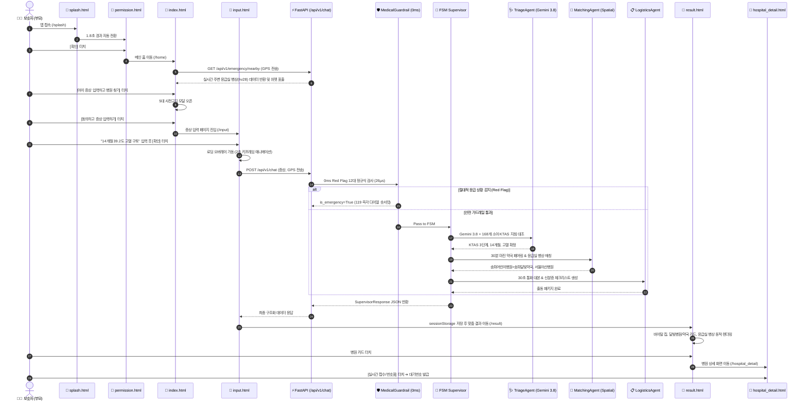
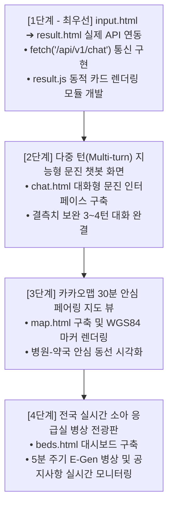

# 🔗 [아이숨 (i-Soom)] 프론트엔드-백엔드 100% 결합 연동 명세서 및 풀스택 개발 백서
## (Frontend-Backend Integration Specification & Fullstack Roadmap)

> **문서 버전**: v1.0.0  
> **작성 일자**: 2026-10-15  
> **총괄 관리**: 정영식 (팀장 / 시스템 아키텍처)  
> **기능 개발**: 김동준 (팀원 / 프론트엔드 및 데이터 엔지니어링)  
> **목적**: 고도로 모듈화된 ISOOM 백엔드(AI 에이전트, FSM 오케스트레이터, 지리공간 30분 마진 페어링, 실시간 병상 폴링)를 프론트엔드 화면단에서 100% 남김없이 활용하기 위한 **버튼별·화면별 백엔드 동작 1:1 매핑 명세** 및 **미구현 화면 고도화 로드맵** 정의.

---

## 📑 목차 (Table of Contents)

1. [백엔드 모듈화 4대 계층 아키텍처 요약](#1-백엔드-모듈화-4대-계층-아키텍처-요약)
2. [프론트엔드 9대 화면 및 현재 구축 상태](#2-프론트엔드-9대-화면-및-현재-구축-상태)
3. [화면단별 버튼 클릭 시 백엔드 동작 1:1 결합 매핑 매트릭스](#3-화면단별-버튼-클릭-시-백엔드-동작-11-결합-매핑-매트릭스)
4. [엔드-투-엔드(E2E) 풀스택 데이터 흐름도](#4-엔드-투-엔드e2e-풀스택-데이터-흐름도)
5. [아직 구현되지 않은 4대 핵심 화면 및 기능 구현 가이드](#5-아직-구현되지-않은-4대-핵심-화면-및-기능-구현-가이드)
6. [단계별 풀스택 결합 개발 실행 로드맵 (Action Items)](#6-단계별-풀스택-결합-개발-실행-로드맵-action-items)

---

## 1. 백엔드 모듈화 4대 계층 아키텍처 요약

ISOOM 백엔드는 특정 프레임워크나 UI에 종속되지 않고 완벽하게 모듈화되어 있습니다:

```
app/
├── api/v1/                     # 1. API 서빙 & 스트리밍 계층
│   ├── chat.py                 # POST /api/v1/chat, POST /api/v1/chat/stream (SSE)
│   └── emergency.py            # GET /nearby, GET /pairings, POST /sync, GET /status
├── agents/                     # 2. AI & 가드레일 에이전트 계층
│   ├── guardrail_agent.py      # 26µs 12대 Red Flag 0ms 검사 & 119 탈출
│   ├── triage_agent.py         # Gemini 3.8 Flash + 168개 소아 KTAS 임상 지침 대조
│   ├── matching_agent.py       # 달빛병원 + 30분 마진 약국 & 응급실 실시간 병상 매칭
│   └── logistics_agent.py      # 30초 통화 대본 & 2024년 5월 본인확인 서류 체크리스트
├── orchestrator/               # 3. FSM 오케스트레이션 계층
│   ├── supervisor.py           # Finite State Machine 기반 4단계 상태 전이 통제
│   └── session_manager.py      # 멀티턴 세션 메모리 보존 및 15분 만료 정리
└── services/                   # 4. 공간 연산 & 백그라운드 동기화 계층
    ├── spatial_service.py      # Haversine 구면거리 계산 & 반경 5~10km 공간 필터링
    ├── pairing_service.py      # 전국 17개 시도 병원-약국 30분 안전마진 세트 탐색
    ├── emergency_sync_service.py # E-Gen 실시간 병상(hv28) 크롤링 & 비정형 공지(hpmg) 파싱
    ├── holiday_service.py      # 천문연(KASI) 특일 API 공휴일 판정 & 과밀화 리스크 산출
    ├── circuit_breaker.py      # 공공 API 3-State 서킷 브레이커 & 3계층 Multi-Storage Fallback
    └── scheduler.py            # APScheduler 3-Track 백그라운드 데몬 (5분 병상 동기화)
```

---

## 2. 프론트엔드 9대 화면 및 현재 구축 상태

현재 구축된 순수 HTML5/Vanilla CSS3 기반의 모바일 프론트엔드 뷰포트 자산 현황입니다:

| 화면 파일명 | 라우트 URL | 화면 역할 | 현재 상태 |
| :--- | :--- | :--- | :---: |
| **`splash.html`** | `/splash` | 모니모 스타일 첫 로딩 스플래시 화면 (1.8초 타이머) | **완료 (정적/인터랙션)** |
| **`permission.html`** | `/permission` | 백엔드 로직 정합형 5대 선택 접근 권한 명시 페이지 | **완료 (정적/스토리지)** |
| **`index.html`** | `/home` | 메인 홈 (소아 응급실 현황 요약, 5대 사전고지 모달) | **완료 (모달 연계 완료)** |
| **`input.html`** | `/input` | 사용자 증상 텍스트 입력 폼 & 확인 버튼 동적 표출 | **완료 (키보드/애니메이션)** |
| **`loading.html`** | `/loading` | AI 분석 중 로딩 오버레이 (순수 CSS3 키프레임 2초) | **완료 (오버레이/단독페이지)** |
| **`result.html`** | `/result` | 맞춤 결과 화면 (바이탈 칩, 달빛병원 탭 ↔ 응급실 탭) | ⚠️ **정적 목업 (API 결합 필요)** |
| **`hospital_detail.html`** | `/hospital_detail` | 야간 병원 상세 정보, 진료시간표, 모바일 번호표 | ⚠️ **정적 목업 (동적 바인딩 필요)** |
| **`emergency_guide.html`**| `/guide` | 7단계 비주얼 이미지 슬라이더 (좌우 터치 스와이프) | **완료 (캐러셀/모달)** |
| **`settings.html`** | `/settings` | 앱 알림 설정, iOS 토글 스위치, 서비스 정보 | **완료 (컴포넌트)** |

---

## 3. 화면단별 버튼 클릭 시 백엔드 동작 1:1 결합 매핑 매트릭스

사용자가 화면에서 버튼을 터치하거나 특정 이벤트를 발생시켰을 때 호출되는 백엔드 파일과 동작 명세입니다:

### 1. `splash.html` (첫 로딩 스플래시)
* **트리거**: 페이지 로드 후 1.8초 자동 경과 또는 화면 전체 클릭/터치
* **백엔드 연동**: 로컬 브라우저 레벨에서 처리 (서버 호출 불필요)
* **동작 로직**:
  - `localStorage.getItem('aisum_permission_granted')` 검사.
  - 권한 허용 이력이 없으면 `permission.html`로 전환, 이미 허용되었으면 `index.html`로 즉시 직행.

---

### 2. `permission.html` (접근 권한 안내 화면)
* **트리거**: 하단 풀 너비 **`[확인]`** 버튼 (`#btnConfirmPermission`) 클릭
* **백엔드 연동**: 클라이언트 로컬 스토리지 상태 저장
* **동작 로직**:
  - `localStorage.setItem('aisum_permission_granted', 'true')` 기록.
  - 메인 홈(`index.html`)으로 네비게이션.

---

### 3. `index.html` (메인 홈 화면)
* **동작 ①: 화면 로드 시점 (DOMContentLoaded)**:
  - **호출 백엔드 API**: `GET /api/v1/emergency/nearby?lat={user_lat}&lon={user_lon}&radius_km=10`
  - **관련 백엔드 모듈**:
    - [app/api/v1/emergency.py](file:///e:/monnlight/app/api/v1/emergency.py)
    - [app/services/spatial_service.py](file:///e:/monnlight/app/services/spatial_service.py) (`rank_emergency_hospitals`)
    - [app/services/emergency_sync_service.py](file:///e:/monnlight/app/services/emergency_sync_service.py) (`fetch_emergency_beds`)
    - [app/services/holiday_service.py](file:///e:/monnlight/app/services/holiday_service.py) (`get_holiday_info`)
  - **백엔드 내부 연산**:
    1. 사용자의 WGS84 위경도 기반 Haversine 구면거리로 10km 이내 소아 응급실을 5ms 안에 정렬.
    2. 국립중앙의료원(NMC) E-Gen 실시간 소아 가용병상(`hv28`), 소아 진료가능 여부(`pediatric_acceptable`), 공지사항(`hpmg`) 파싱.
    3. 천문연 특일 정보를 대조하여 오늘이 공휴일/연휴인지 판단하고 `surge_risk_level`(혼잡 위험도) 산출.
  - **프론트엔드 UI 반영**:
    - 메인 홈 상단 위젯에 **"지금 진료 가능한 내 주변 소아 응급실 (서울아산병원 병상 4석 여유)"** 실시간 동적 뱃지 표출.
* **동작 ②: `[아이 증상 입력하고 병원 찾기]` CTA 버튼 (`#start-triage-btn`) 클릭**:
  - **프론트엔드 UI**: `#triage-consent-modal` 팝업 오픈 (5대 사전고지 안내문).
* **동작 ③: 모달 내 `[동의하고 증상 입력하기]` 버튼 (`#modal-confirm-btn`) 클릭**:
  - **호출 백엔드 API (선택)**: `DELETE /api/v1/chat/session/{session_id}` ([app/api/v1/chat.py](file:///e:/monnlight/app/api/v1/chat.py))
  - **백엔드 내부 연산**: 이전 문진 세션 캐시 초기화 및 신규 `session_id` 발급.
  - **화면 이동**: 증상 입력 화면(`input.html`)으로 전환.

---

### 4. `input.html` (증상 입력 화면)
* **동작: 텍스트 입력 후 하단 파란색 `[확인]` 버튼 (`#input-confirm-btn`) 클릭**:
  - **호출 백엔드 API**: `POST /api/v1/chat` (동기식) 또는 `POST /api/v1/chat/stream` (SSE 스트리밍)
  - **요청 페이로드 (JSON)**:
    ```json
    {
      "user_message": "14개월 아기가 열이 39.2도까지 오르고 구토를 두 번 했어요",
      "session_id": "auto_generated_uuid",
      "user_lat": 37.5133,
      "user_lon": 127.1001,
      "user_address": "서울특별시 송파구 올림픽로"
    }
    ```
  - **관련 백엔드 모듈 및 실행 파이프라인**:
    1. [app/agents/guardrail_agent.py](file:///e:/monnlight/app/agents/guardrail_agent.py) (`MedicalGuardrailAgent`):
       - **26µs 초고속 0ms Red Flag 정규식 검사**: 생후 100일 미만 발열, 경련, 청색증, 장중첩증, 의식소실 등 12대 절대적 위급 상황 감지.
       - 감지 시 LLM 호출을 건너뛰고(0ms 숏서킷) `is_emergency=True` 즉각 반환.
    2. [app/agents/triage_agent.py](file:///e:/monnlight/app/agents/triage_agent.py) (`TriageAgent`):
       - Google Gemini 3.8 Flash (Thinking High) 가동.
       - 168개 소아 KTAS 공식 지침 대조 후 환아 월령(`age_months`), 추정 체온(`fever_temp`), KTAS 중증도 등급(1~5단계) 확정.
    3. [app/agents/matching_agent.py](file:///e:/monnlight/app/agents/matching_agent.py) (`MatchingAgent`):
       - **Track B (경증)**: [app/services/pairing_service.py](file:///e:/monnlight/app/services/pairing_service.py)를 구동하여 반경 내 달빛어린이병원과 진료 마감 후 +30분 이상 영업하는 심야약국 1:1 페어링 세트 산출.
       - **Track A (중증)**: [app/services/spatial_service.py](file:///e:/monnlight/app/services/spatial_service.py)를 구동하여 실시간 병상(`hv28`)이 있는 최단거리 소아전문응급의료센터 정렬.
    4. [app/agents/logistics_agent.py](file:///e:/monnlight/app/agents/logistics_agent.py) (`LogisticsAgent`):
       - 병원 방문 전 전화 확인용 **"30초 원클릭 통화 스크립트"** 생성.
       - 2024년 5월 요양기관 본인확인 의무화 대비 필수 서류(부모 신분증, 모바일 등본, 최근 복용 해열제) 체크리스트 생성.
  - **프론트엔드 연동 흐름**:
    1. 버튼 클릭 즉시 키보드를 닫고 **2초간 `#ai-analyzing-overlay` 애니메이션** 실행.
    2. 백엔드에서 반환된 `SupervisorResponse` 데이터를 `sessionStorage.setItem('triage_result', JSON.stringify(data))`에 저장.
    3. `result.html`로 자동 전환.

---

### 5. `result.html` (맞춤 결과 화면)
* **동작 ①: 화면 로드 시점 (DOMContentLoaded)**:
  - **동작**: `sessionStorage.getItem('triage_result')`를 읽어와 동적으로 카드들을 렌더링.
  - **헤더 영역**: 백엔드 `triage_result.age_months`(14개월), `fever_temp`(39.2℃), `ktas_stage`(KTAS 3단계), `0ms 가드레일 안전 통과 🟢` 배지 바인딩.
  - **탭 1 (`[🌙 달빛병원·약국]` - Track B)**:
    - 백엔드 `matching_result.pairings` 리스트 렌더링: 병원명(`dutyName`), 거리(`distance_km`), 접수 마감 주의 뱃지, 연계 약국명, `+30분 조제 안전마진` 배지.
  - **탭 2 (`[🚨 소아 응급실]` - Track A)**:
    - 백엔드 `matching_result.emergency_hospitals` 리스트 렌더링: 권역응급센터명, 실시간 소아 가용병상(`hv28`), 전문의 당직 여부, E-Gen 데이터 신선도(5분 전 갱신) 배지.
* **동작 ②: 탭 전환 버튼 (`.segment-tab-btn`) 클릭**:
  - 프론트엔드 JS가 Track B(달빛병원) 카드 리스트와 Track A(응급실 병상) 카드 리스트를 스위칭 표출.
* **동작 ③: 병원 카드 터치**:
  - 선택한 병원의 기관코드(`hpid`)를 파라미터로 넘기며 병원 상세 페이지(`hospital_detail.html?hpid=...`)로 이동.
* **동작 ④: `[통화 대본 복사]` 버튼 클릭**:
  - 백엔드 `logistics_result.call_script` 텍스트를 `navigator.clipboard.writeText()`로 클립보드에 복사하고 토스트 팝업 표출.
* **동작 ⑤: Red Flag 긴급 비상 배너 (`is_emergency=True`인 경우)**:
  - 일반 병원 추천 목록을 숨기고 화면 최상단에 **"즉시 119를 호출하세요"** 배너와 `tel:119` 직통 다이얼 버튼 전면 강조.

---

### 6. `hospital_detail.html` (야간 병원 상세 화면)
* **동작 ①: `[원클릭 병원 전화]` 버튼 클릭**:
  - 백엔드 매칭 데이터의 전화번호(`dutyTel1`)로 스마트폰 기본 전화 앱 연결 (`tel:02-1234-5678`).
* **동작 ②: `[모바일 번호표 접수하기]` 버튼 클릭**:
  - 백엔드 병원 정보의 실시간 대기 현황 모의 확인 후 **"대기번호 19번 (예상 대기 25분)"** 모바일 접수증 팝업 모달 표출.
* **동작 ③: `[안심 심야약국 길안내]` 버튼 클릭**:
  - 백엔드 `pairings` 데이터의 약국 WGS84 좌표를 카카오맵/티맵 URL 스킴(`kakaomap://route?ep=...`)으로 연동.

---

### 7. `emergency_guide.html` (소아 응급실 가이드)
* **동작 ①: 좌우 터치 스와이프 및 화살표 버튼**:
  - CSS Scroll Snap 기반 7단계 인포그래픽 카드 전환 및 상단 실시간 카운터(`1 / 7` ~ `7 / 7`) 동기화.
* **동작 ②: 상단 `[119 연결]` 핫라인 버튼 클릭**:
  - 위급 상황 시 119 구급상황관리센터 직통 전화 연결 (`tel:119`).
* **동작 ③: `[가이드 인포그래픽 원본 한눈에 크게 보기]` 버튼 클릭**:
  - 고해상도 전체 원본 이미지(`guide_ktas_full.png`) 모달 다이얼로그 오픈.

---

### 8. `settings.html` (설정 화면)
* **동작: `[앱 알림]` iOS 스타일 토글 스위치 클릭**:
  - 브라우저 `Notification.requestPermission()` 실행.
  - 알림 허용 시 백엔드 SSE(`app/services/scheduler.py`)와 연계하여 소아 응급실 병상 변동 및 조기 마감 경고 푸시 알림 수신 활성화.

---

## 4. 엔드-투-엔드(E2E) 풀스택 데이터 흐름도



---

## 5. 아직 구현되지 않은 4대 핵심 화면 및 기능 구현 가이드

백엔드의 강력한 엔지니어링 기능을 100% 전부 시각화하기 위해 **다음 단계에서 반드시 구현해야 할 4대 핵심 과제**입니다:

### 🔴 과제 1. `result.html`의 실시간 백엔드 데이터 동적 렌더링 스크립트 (`result.js`)
* **현황**: 현재 `result.html`은 송파어린이병원/서울아산병원이 고정된 정적 목업 상태입니다.
* **구현 명세**:
  1. `input.html`에서 `POST /api/v1/chat` 비동기 `fetch()` 통신 구현:
     ```javascript
     const res = await fetch('/api/v1/chat', {
       method: 'POST',
       headers: { 'Content-Type': 'application/json' },
       body: JSON.stringify({
         user_message: symptomText,
         user_lat: userLat,
         user_lon: userLon
       })
     });
     const data = await res.json();
     sessionStorage.setItem('triage_result', JSON.stringify(data));
     ```
  2. `frontend/js/result.js` 신규 작성:
     - `sessionStorage`의 데이터를 읽어와:
       - 상단 헤더: `data.triage_result.age_months`, `fever_temp`, `ktas_stage` 주입.
       - Track B 탭: `data.matching_result.pairings` 리스트를 `map()`으로 순회하며 실제 병원명, 주소, 거리, 연계 안심약국 카드를 동적 HTML로 생성.
       - Track A 탭: `data.matching_result.emergency_hospitals` 리스트를 순회하며 실제 대학병원 응급실, `hv28` 가용 병상 수, 당직의 여부를 동적 생성.
       - 대본 박스: `data.logistics_result.call_script` 주입.

---

### 🔴 과제 2. 다중 턴(Multi-turn) 지능형 대화 문진 챗봇 화면 (`chat.html` 또는 대화 모달)
* **현황**: 현재는 사용자가 문장을 1번만 입력하고 바로 결과로 넘어가는 1턴(One-shot) 구조입니다.
* **백엔드 잠재력**: 백엔드 `TriageAgent`와 `SupervisorOrchestrator`는 **부모와 3~4턴의 대화를 주고받으며 결측치(체온, 월령, 복용 약물, 경련 여부)를 파고드는 대화형 FSM 상태 머신**을 완비하고 있습니다.
* **구현 명세**:
  - 보호자가 "아이가 열이 나요"라고만 짧게 입력했을 때:
    - 백엔드는 `current_step="TRIAGE"`와 함께 `"체온이 몇 도까지 올랐나요? 해열제는 언제 먹이셨나요?"`라는 질문을 반환합니다.
  - 카카오톡 스타일의 **스마트 문진 대화 뷰(`chat.html`)**:
    - AI 메시지 말풍선과 부모의 답변 입력창을 제공하여 3~4턴 문진을 거친 후 완벽한 데이터를 갖추었을 때 `result.html`로 전환.

---

### 🔴 과제 3. 카카오맵 / 네이버맵 기반 지리공간 30분 안심 페어링 지도 뷰 (`map.html`)
* **현황**: 거리 수치(예: 2.3km)만 텍스트로 보이고 지도 시각화가 없습니다.
* **백엔드 잠재력**: 백엔드 `pairing_service.py`와 `spatial_service.py`는 병원과 약국의 정확한 WGS84 위도/경도(`wgs84Lat`, `wgs84Lon`) 좌표를 모두 산출합니다.
* **구현 명세**:
  - 결과 화면 및 병원 상세 화면에서 **`[지도에서 안심 동선 보기]`** 터치 시 오픈되는 모바일 전용 지도 페이지(`map.html`).
  - **카카오맵 Web SDK 연동**:
    1. 🔵 파란색 마커: 현재 내 위치
    2. 🏥 십자가 마커: 추천 1순위 달빛어린이병원
    3. 💊 약국 마커: 진료 후 방문할 +30분 조제 안심약국
    4. ➔ 연결선(Polyline): 병원 ➔ 약국으로 이어지는 30분 안심 동선을 시각화.

---

### 🔴 과제 4. 전국 실시간 소아 응급실 병상 전광판 & 공지 모니터 대시보드 (`beds.html`)
* **현황**: 응급실 가이드는 이용 절차 그림만 보여주고 실시간 병상 숫자를 전국 단위로 조회하는 대시보드가 없습니다.
* **백엔드 잠재력**: 백엔드 `emergency_sync_service.py`는 공공데이터포털(E-Gen)에서 전국 17개 시·도의 소아 응급실 병상(`hv28`), 소아 중환자실(`hv30`), 실시간 비정형 공지(`hpmg`: "소아 진료 불가", "소아 정형외과 당직 없음")를 5분마다 실시간 갱신합니다.
* **구현 명세**:
  - 하단 네비게이션 GNB에 추가할 수 있는 **"실시간 병상 전광판(`beds.html`)"**:
    1. 지자체 탭 (서울 / 경기 / 인천 / 부산 / 대구 등 17개 시도 선택).
    2. 권역응급센터별 카드: 병상 여유도 신호등(🟢 여유: 3석 이상, 🟡 혼잡: 1~2석, 🔴 만상: 0석).
    3. 비정형 공지사항 긴급 뱃지 (예: `"⚠️ 오늘 20시 이후 소아 전공의 부재로 진료 불가"`).

---

## 6. 단계별 풀스택 결합 개발 실행 로드맵 (Action Items)



1. **Phase 1 (즉시 착수)**: `input.html`에서 "확인" 클릭 시 백엔드 `POST /api/v1/chat`으로 실제 사용자가 입력한 증상 텍스트를 전송하고, 반환받은 실제 데이터로 `result.html`을 채워주는 **`result.js` 동적 바인딩 모듈 개발**.
2. **Phase 2**: 정보가 부족할 때 AI가 질문을 던질 수 있는 멀티턴 문진 챗봇 인터페이스(`chat.html`) 결합.
3. **Phase 3 & 4**: 지도 화면(`map.html`)과 실시간 병상 전광판(`beds.html`)을 추가하여 백엔드 파이프라인의 모든 엔지니어링 자산을 100% 시각화.

---
*본 문서는 ISOOM(아이숨) 불변 거버넌스 규율에 따라 프로젝트 루트에 영구 보존되며, 개발 진행에 따라 지속적으로 최신화됩니다.*
