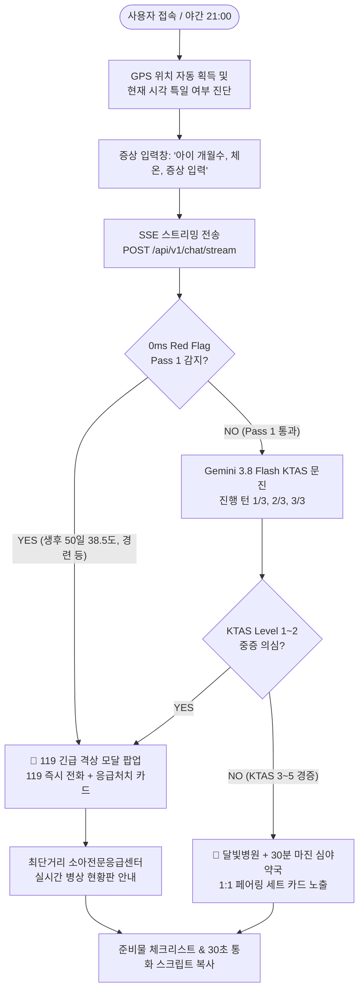

# 🌙 ISOOM 프론트엔드 UI/UX 설계 및 화면 구성 명세서 (FRONTEND_UI_UX_SPECIFICATION.md)

> **문서 버전**: v1.0.0 (백엔드 Step 1~7 및 Red Flag V2 연동 프론트엔드 완결 기획)  
> **작성 일자**: 2026-10-14  
> **작성자**: 정영식 (팀장), 김동준 (팀원)  
> **적용 대상**: ISOOM 웹/모바일 반응형 웹 애플리케이션  
> **핵심 가치**: *"늦은 밤, 아픈 아이를 안고 한 손으로 조작하는 부모를 위한 0초 직관성과 절대적 심리적 안정감"*

---

## 📑 목차 (Table of Contents)

1. [프론트엔드 개발 착수 적합성 평가](#1-프론트엔드-개발-착수-적합성-평가)
2. [UI/UX 디자인 시스템 & 비주얼 컨셉 (Design Aesthetics)](#2-uiux-디자인-시스템--비주얼-컨셉-design-aesthetics)
3. [핵심 사용자 흐름도 (End-to-End User Flow)](#3-핵심-사용자-흐름도-end-to-end-user-flow)
4. [전체 화면 구성도 (Screen Hierarchy & Layout)](#4-전체-화면-구성도-screen-hierarchy--layout)
5. [화면별 상세 기능 및 컴포넌트 명세](#5-화면별-상세-기능-및-컴포넌트-명세)
   - [5.1 메인 랜딩 & GPS 주변 현황 헤더](#51-메인-랜딩--gps-주변-현황-헤더)
   - [5.2 실시간 증상 문진 챗봇 영역 (SSE 스트리밍)](#52-실시간-증상-문진-챗봇-영역-sse-스트리밍)
   - [5.3 [Emergency] 119 비상 격상 긴급 오버레이 모달](#53-emergency-119-비상-격상-긴급-오버레이-모달)
   - [5.4 [Track B] 달빛병원 + 30분 마진 심야약국 1:1 페어링 카드](#54-track-b-달빛병원--30분-마진-심야약국-11-페어링-카드)
   - [5.5 [Track A] 소아전문응급의료센터 실시간 병상 현황판](#55-track-a-소아전문응급의료센터-실시간-병상-현황판)
   - [5.6 2024년 5월 본인확인 준비물 체크리스트 & 30초 통화 스크립트](#56-2024년-5월-본인확인-준비물-체크리스트--30초-통화-스크립트)
   - [5.7 시스템 가용성(HA) 투명성 배지 & 법적 안심 고지](#57-시스템-가용성ha-투명성-배지--법적-안심-고지)
6. [백엔드 API 연동 매핑 테이블](#6-백엔드-api-연동-매핑-테이블)
7. [구현 기술 스택 및 권장 파일 구조](#7-구현-기술-스택-및-권장-파일-구조)
8. [단계별 프론트엔드 구현 로드맵](#8-단계별-프론트엔드-구현-로드맵)

---

## 1. 프론트엔드 개발 착수 적합성 평가

### ✅ 결론: 지금 바로 프론트엔드 개발을 착수하기에 완벽한 타이밍입니다.

* **백엔드 무결점 보장**: Step 1(도구)부터 Step 7(서킷 브레이커 & 계층형 Fallback), 그리고 Red Flag V2(소아 KTAS 168개 주증상)까지 **총 74개 테스트(100% 통과)** 및 **40대 임상 골든 케이스 Evals(100% 합격, 평균 99.5점)**로 데이터 계약(API Contract)이 완전히 동결 및 안정화되었습니다.
* **실시간 통신 준비 완료**: SSE(Server-Sent Events) 스트리밍(`/api/v1/chat/stream`)과 119 긴급 이벤트(`event: emergency`), 구조화 데이터 출력(`event: result`)이 모두 구현되어 있어 클라이언트 UI와 1:1로 즉각 바인딩 가능합니다.

---

## 2. UI/UX 디자인 시스템 & 비주얼 컨셉 (Design Aesthetics)

야간에 갑자기 아이가 아파 당황한 부모는 극심한 불안 상태에 있습니다.  
따라서 **어두운 방 안에서 눈부심이 없는 다크/미드나잇 테마**, **신뢰감을 주는 포근한 글래스모피즘**, **위급 상황 시 즉각 인지되는 엠버/크림슨 액센트**를 적용합니다.

### 2.1 컬러 팔레트 (Color Tokens)
* **Midnight Navy (배경)**: `#0B0F19` (심야의 안정감, 눈부심 방지)
* **Surface Slate (카드/컨테이너)**: `rgba(22, 30, 49, 0.75)` (반투명 글래스모피즘, `backdrop-filter: blur(12px)`)
* **Moonlight Gold (포인트/브랜드)**: `#FBBF24` (달빛의 따스함과 안내의 상징)
* **Emergency Crimson (초응급/119)**: `#EF4444` (신속한 인지, 맥박 애니메이션 연동)
* **Safe Mint (안전마진/영업중)**: `#10B981` (+30분 마진 약국, 여유 병상)
* **Warning Amber (주의/마감임박)**: `#F59E0B` (접수 조기마감 주의, 혼잡 병상)
* **Text High / Medium / Low**: `#F9FAFB` / `#9CA3AF` / `#6B7280`

### 2.2 타이포그래피 (Modern Typography)
* **Font Family**: `'Pretendard', -apple-system, BlinkMacSystemFont, 'Segoe UI', Roboto, sans-serif`
* **Hierarchy**:
  - H1 / Display: 24px~28px (Bold 700)
  - H2 / Title: 18px~20px (SemiBold 600)
  - Body: 14px~15px (Regular 400, Line-height 1.6)
  - Caption / Badge: 11px~12px (Medium 500)

### 2.3 마이크로 인터랙션 & 모션 원칙
* **모바일 한 손 최적화 (Thumb-Zone Optimization)**: 주요 액션 버튼(119 전화, 병원 전화, 길찾기)은 화면 하단 40% 영역 내에 큼직한 터치 타깃(최소 48px 이상)으로 배치.
* **스무스 상태 전이**: FSM 상태 변화(문진 진행 ➔ 시설 매칭 ➔ 완료) 시 부드러운 스켈레톤 로더와 슬라이드 인 애니메이션 적용.
* **긴급 펄스 (Emergency Pulse)**: Red Flag 감지 시 화면 외곽 테두리에 은은한 붉은색 펄스 글로우 효과(`@keyframes pulse-emergency`).

---

## 3. 핵심 사용자 흐름도 (End-to-End User Flow)



---

## 4. 전체 화면 구성도 (Screen Hierarchy & Layout)

앱은 **단일 페이지 애플리케이션(SPA)** 형태로 구현되며, 상황에 따라 화면 상단/중앙의 컴포넌트가 동적으로 전환되는 반응형 레이아웃을 갖습니다.

```
┌──────────────────────────────────────────────────────────┐
│ [TOP GNB] 🌙 ISOOM    [서울 강남구 역삼동] 📍 [22:15]│
│           • 특일 상태: 평일 야간 • 서킷 브레이커: CLOSED (정상)  │
├──────────────────────────────────────────────────────────┤
│                                                          │
│  [HERO & STATUS BANNER]                                  │
│  "지금 야간 진료 가능한 달빛어린이병원 3곳, 응급실 2곳"    │
│                                                          │
├──────────────────────────────────────────────────────────┤
│                                                          │
│  [TRIAGE CHAT & STREAMING AREA]                          │
│  ┌────────────────────────────────────────────────────┐  │
│  │ 🤖 달빛 닥터 (소아 전담 케어 AI)                    │  │
│  │ "아이가 열이 많이 나나요? 몇 개월인지 알려주시면     │  │
│  │  지금 갈 수 있는 가장 안전한 병원을 찾아드릴게요."  │  │
│  │ -------------------------------------------------- │  │
│  │ 👤 "14개월 아기인데 39.2도 열나고 토해요"            │  │
│  │ -------------------------------------------------- │  │
│  │ 🤖 [상태 분석 중...] ➔ 스트리밍 답변                 │  │
│  │   • 추출: 14개월 | 39.2도 | 구토 (2시간째)           │  │
│  │   • 진행: 문진 완료 (3/3) ➔ 최적 매칭 도출           │  │
│  └────────────────────────────────────────────────────┘  │
│  [ 입력창: 아이 증상을 편하게 말씀해주세요... ] [전송]    │
│                                                          │
├──────────────────────────────────────────────────────────┤
│                                                          │
│  [DYNAMIC RESULT TABS: 매칭 결과 뷰어]                    │
│  [🌙 달빛병원 + 안심약국 (3)]  |  [🚨 소아 가용 응급실 (2)] │
│                                                          │
│  ┌─ [Track B: 1:1 페어링 추천 카드 #1] ────────────────┐ │
│  │ 🏥 송파어린이병원 (달빛어린이병원)   [진료중 ~23:00]  │ │
│  │    거리: 1.8km | 접수마감: 22:20 (40분 전 주의!)     │ │
│  │    ----------------------------------------------  │ │
│  │ 💊 송파달빛약국 (지정약국)         [영업중 ~23:30]  │ │
│  │    거리: 도보 2분 | 🟢 +30분 조제 안전마진 확보     │ │
│  │    [ 📞 병원 전화 ]  [ 📍 길찾기 (카카오/티맵) ]   │ │
│  └────────────────────────────────────────────────────┘ │
│                                                          │
│  ┌─ [ACTION HELPER: 내원 전 필수 준비 & 통화 스크립트] ─┐ │
│  │ 📋 2024년 5월 본인확인 필수 체크리스트                 │ │
│  │    [x] 부모 신분증  [x] 주민등록등본/가족관계증명서    │ │
│  │ 📞 출발 전 30초 당직의 통화 스크립트                   │ │
│  │    "14개월 아기 체온 39.2도 구토 증상으로 지금... "   │ │
│  │    [ 📋 스크립트 복사 ] [ 📞 바로 통화 연결 ]        │ │
│  └────────────────────────────────────────────────────┘ │
│                                                          │
├──────────────────────────────────────────────────────────┤
│ [FOOTER] 🛡️ 대한민국 의료법 제27조 준수 안심 서비스       │
│          비의료 AI로 진단/처방을 대신하지 않으며 대면 필수│
│          데이터 출처: 국립중앙의료원(NMC), 심평원, 천문연 │
└──────────────────────────────────────────────────────────┘
```

---

## 5. 화면별 상세 기능 및 컴포넌트 명세

### 5.1 메인 랜딩 & GPS 주변 현황 헤더
* **컴포넌트명**: `AppHeader`, `GeoStatusBanner`
* **표시 정보**:
  - 사용자 현재 위치(동/구 단위 지오코딩 결과) 및 재탐색 버튼.
  - 현재 시각(KST) 및 한국천문연구원 특일 여부(공휴일/대체휴일 배지).
  - 반경 10km 이내 현재 운영 중인 소아과/달빛병원 및 응급실 총 개수 퀵 카운터.
* **인터랙션**:
  - 위치 권한 거부 시 "위치 직접 선택(예: 강남구, 분당구)" 팝업 제공.

### 5.2 실시간 증상 문진 챗봇 영역 (SSE 스트리밍)
* **컴포넌트명**: `TriageChatContainer`, `ChatBubble`, `TriageMetaPill`
* **백엔드 연동**: `POST /api/v1/chat/stream` (SSE)
* **주요 기능**:
  - **3턴 진행률 프로그레스 바 (`TurnProgressIndicator`)**: 현재 턴 수가 1/3 ➔ 2/3 ➔ 3/3으로 진행되며 3턴 도달 시 자동 종결됨을 시각화.
  - **실시간 토큰 스트리밍**: `event: delta` 수신 시 타자 치듯 자연스러운 텍스트 렌더링.
  - **추출된 환아 바이탈 메타 캡슐**:
    - 월령/나이: `14개월` 캡슐
    - 체온: `39.2℃` (38도 이상 시 주황, 39도 이상 시 빨강 배지)
    - 증상 태그: `#발열`, `#구토`
  - **입력 편의 단축 칩 (Quick Reply Chips)**:
    - `"38.5도 열이 나요"`, `"토하고 설사해요"`, `"약 먹고 잠들었어요"`, `"숨소리가 쌕쌕거려요"` 등 당황한 부모가 터치 한 번으로 입력 가능한 추천 칩 제공.

### 5.3 [Emergency] 119 비상 격상 긴급 오버레이 모달
* **컴포넌트명**: `EmergencyModalOverlay`, `FirstAidCard`
* **트리거 조건**: SSE 스트림에서 `event: emergency` 수신 시 또는 백엔드 `is_emergency: true` 반환 시.
* **화면 연출**:
  - 배경이 짙은 암적색 오버레이로 전환되고 경고 사이렌 애니메이션 구동.
  - 화면 최상단에 **[🚨 119 즉시 전화 걸기 (0초 연결)]** 거대 버튼 노출.
* **표시 콘텐츠**:
  1. **초응급 감지 사유**: 예) *"생후 100일 미만 영아의 38도 이상 고열은 신생아 패혈증 위험이 있어 동네 병원이 아닌 권역응급의료센터로 즉시 이송해야 합니다."*
  2. **119 구급대 도착 전 응급처치 요령 (`first_aid`)**:
     - 열성경련: 고개를 옆으로 돌려 기도 확보, 입 안에 물건 넣지 않기.
     - 수지절단: 절단 부위 거즈로 감싸 비닐에 밀봉 후 얼음물에 담아 이송.
  3. **가장 가까운 소아전문응급의료센터 1순위 카드 자동 포커스**.

### 5.4 [Track B] 달빛병원 + 30분 마진 심야약국 1:1 페어링 카드
* **컴포넌트명**: `HospitalPharmacyPairingCard`
* **백엔드 연동**: `GET /api/v1/emergency/pairings` 및 Supervisor `matched_pairings`
* **화면 구성**:
  - **상단 (병원 영역)**:
    - 병원명, 진료과목, 현재 위치로부터의 거리(km), 오늘 야간 마감 시각(예: `23:00 마감`).
    - **접수 마감 주의 뱃지**: 현재 시각이 마감 40분 전 이내일 경우 `[⚠️ 조기 현장 접수 마감 주의 - 출발 전 전화 필수]` 주황색 경고 뱃지 점멸.
  - **하단 (연계 약국 영역)**:
    - 약국명, 약국 마감 시각(예: `23:30 마감`).
    - **[🟢 +30분 조제 안전마진 확보]** 녹색 배지 (병원 진료 후 여유 있게 약 조제 가능함을 보증).
  - **하단 액션 버튼**:
    - `[ 📞 병원 전화 ]`: 터치 시 다이얼러 즉각 실행.
    - `[ 📍 지도 길찾기 ]`: 카카오맵/네이버지도/티맵 딥링크 연동.

### 5.5 [Track A] 소아전문응급의료센터 실시간 병상 현황판
* **컴포넌트명**: `EmergencyDepartmentBoard`, `BedStatusGauge`
* **백엔드 연동**: `GET /api/v1/emergency/nearby`
* **화면 구성**:
  - 응급의료기관명 (권역응급센터, 소아전문응급의료센터 배지).
  - **실시간 소아 가용 병상 게이지**: `hv28` 수치 (예: `4석 여유`, `1석 남음(혼잡)`, `만실`).
  - **소아 진료 가능 여부 상태 태그**:
    - `pediatric_acceptable == True` ➔ `[🟢 소아진료 즉시 가능]`
    - 공지사항(`hpmg`) 파싱 결과 소아 당직의 부재 시 ➔ `[🔴 소아 진료 제한 - 타 병원 권고]`
  - **데이터 신선도 투명성 배지**:
    - 실시간 데이터: `[⚡ 3분 전 E-Gen 공식 수집]`
    - 서킷 브레이커 폴백 동작 시: `[🛡️ 안전 백업 데이터 - 출발 전 30초 전화 확인 필수]`

### 5.6 2024년 5월 본인확인 준비물 체크리스트 & 30초 통화 스크립트
* **컴포넌트명**: `PreparationDrawer`, `CallScriptBox`
* **백엔드 연동**: LogisticsAgent 출력 (`document_checklist`, `call_script`)
* **화면 구성**:
  1. **인터랙티브 준비물 체크리스트**:
     - `[x] 부모(보호자) 실물 신분증 (주민등록증, 운전면허증, 모바일신분증)`
     - `[x] 주민등록등본 또는 가족관계증명서 (아이와의 가족관계 확인용)`
     - `[x] 아기수첩 / 예방접종 기록`
     - 체크 시 시각적 체크 표시 및 완료 피드백.
  2. **원클릭 복사 가능한 30초 통화 스크립트**:
     - *"안녕하세요, 송파어린이병원 접수처 맞으신가요? 지금 14개월 아기가 39.2도 열이 나고 구토 증상이 있어 출발하려고 합니다. 현재 접수 마감 전 진료 가능한가요?"*
     - `[ 📋 스크립트 복사 ]` 버튼 터치 시 클립보드 복사 및 토스트 팝업.
     - `[ 📞 전화 걸고 스크립트 보기 ]` 분할 화면 모드 지원.

### 5.7 시스템 가용성(HA) 투명성 배지 & 법적 안심 고지
* **컴포넌트명**: `SystemTrustFooter`, `ComplianceNotice`
* **표시 내용**:
  - **의료법 제27조 준수 고지**: *"본 서비스는 인공지능 기반의 사전 안내 및 응급 의료기관 탐색 보조 도구이며, 의사의 공식 진단 및 처방을 대신할 수 없습니다. 응급 상황 시 반드시 의료진의 대면 진료를 받으십시오."*
  - **무중단 서킷 브레이커 상태 인디케이터**: 공공망 장애 시에도 L1/L2/L3 Fallback으로 안전하게 운영 중임을 은은한 안심 인디케이터로 안내.

---

## 6. 백엔드 API 연동 매핑 테이블

프론트엔드 각 컴포넌트는 기 구현된 FastAPI 엔드포인트와 다음과 같이 1:1로 결합됩니다:

| 화면 컴포넌트 | 연동 백엔드 엔드포인트 | Method | 통신 방식 | 주요 수신/송신 페이로드 |
| :--- | :--- | :---: | :---: | :--- |
| **증상 문진 챗봇** | `/api/v1/chat/stream` | POST | **SSE Stream** | • Req: `session_id`, `user_message`, `lat`, `lon`<br/>• Res: `event: status`, `delta`, `emergency`, `result` |
| **비상 119 모달** | `/api/v1/chat/stream` (이벤트) | POST | **SSE Event** | • `event: emergency` 수신 시 0초 팝업 트리거 |
| **달빛병원-약국 페어링** | `/api/v1/emergency/pairings` | GET | REST JSON | • Req: `lat`, `lon`, `radius_km=15`<br/>• Res: `PairingHospitalItem[]`, `안전마진_분` |
| **소아응급실 실시간 병상**| `/api/v1/emergency/nearby` | GET | REST JSON | • Req: `lat`, `lon`, `only_acceptable=true`<br/>• Res: `RankedEmergencyHospital[]`, `freshness` |
| **시스템 상태/서킷브레이커**| `/health`, `/api/v1/emergency/status` | GET | REST JSON | • Res: `circuit_status`, `storage_tier`, `scheduler` |

---

## 7. 구현 기술 스택 및 권장 파일 구조

### 7.1 권장 기술 스택
* **Core**: Modern JavaScript (ES2022+) & HTML5
* **Styling**: **Vanilla CSS (Design Tokens, Flex/Grid, Glassmorphism CSS Variables)**
  - 외부 프레임워크 오버헤드 없이 번들 크기 0KB의 초경량·초고속 로딩 달성 (심야 모바일 네트워크 환경 최적화).
* **Font**: Pretendard (Google Web Font CDN)
* **Icons**: Feather Icons / Lucide SVG Icons
* **Map Engine (선택)**: Kakao Maps SDK 또는 Leaflet.js (초경량 오픈소스 지도)

### 7.2 프론트엔드 디렉토리 구조 제안
```
e:\monnlight\app\static\
├── index.html                   # 메인 단일 페이지 (SPA 구조)
├── css/
│   ├── variables.css            # 미드나잇 테마 색상/간격 CSS 변수
│   ├── base.css                 # 리셋 및 타이포그래피
│   ├── components.css           # 챗버블, 페어링카드, 체크리스트 컴포넌트
│   └── emergency.css            # 119 긴급 오버레이 및 펄스 애니메이션
├── js/
│   ├── api.js                   # Fetch 래퍼 및 SSE EventSource 스트림 리스너
│   ├── chat.js                  # 챗봇 턴 관리 및 텍스트 렌더러
│   ├── emergency_modal.js       # 0초 긴급 모달 제어기
│   ├── pairing_card.js          # 병원-약국 페어링 렌더러
│   └── checklist.js             # 클립보드 복사 및 체크리스트 관리
└── assets/
    ├── icons/                   # 달빛, 앰뷸런스, 약국 SVG 아이콘
    └── sound/                   # 긴급 알림 비프음 (선택)
```

---

## 8. 단계별 프론트엔드 구현 로드맵

* **[Phase 1] 코어 레이아웃 & 테마 시스템 구축**:
  - CSS 토큰(`variables.css`), 미드나잇 다크 글래스모피즘 베이스 및 모바일 반응형 프레임 완성.
* **[Phase 2] SSE 스트리밍 챗봇 & 0ms 긴급 모달 연동**:
  - `/api/v1/chat/stream` SSE 클라이언트 구현, 실시간 타이핑 렌더링, 119 긴급 모달 인터셉트.
* **[Phase 3] 2-트랙 결과 카드 렌더링**:
  - Track B 달빛어린이병원 + 30분 마진 심야약국 1:1 카드 컴포넌트 구현.
  - Track A 실시간 응급실 잔여 병상 게이지 및 데이터 신선도 배지 구현.
* **[Phase 4] 내원 지원 툴킷 (체크리스트 & 30초 통화 스크립트)**:
  - 원클릭 복사, 본인확인 서류 체크리스트 인터랙션 및 전화 걸기 딥링크 완결.
* **[Phase 5] E2E 통합 테스트 & 시각적 완성도 검증**:
  - 실제 모바일 뷰포트에서 119 Red Flag 케이스와 일반 경증 케이스를 직접 브라우저로 검증.
